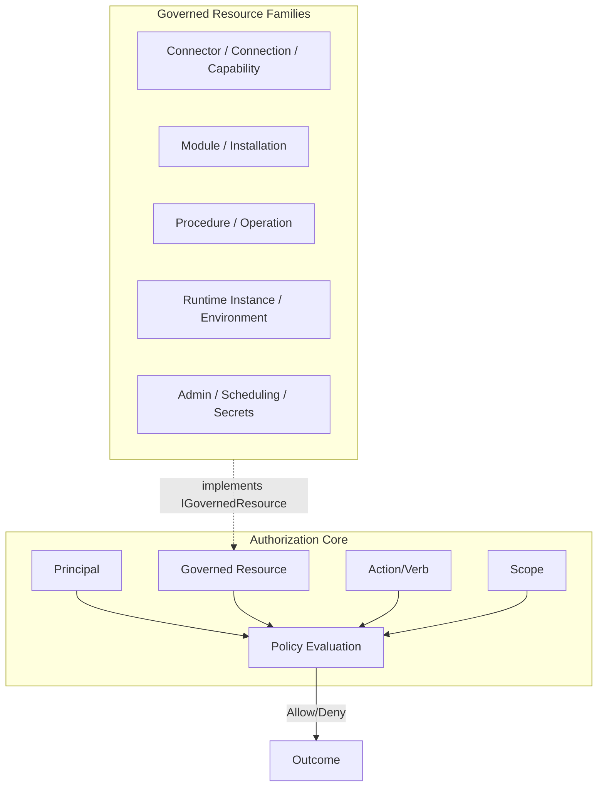
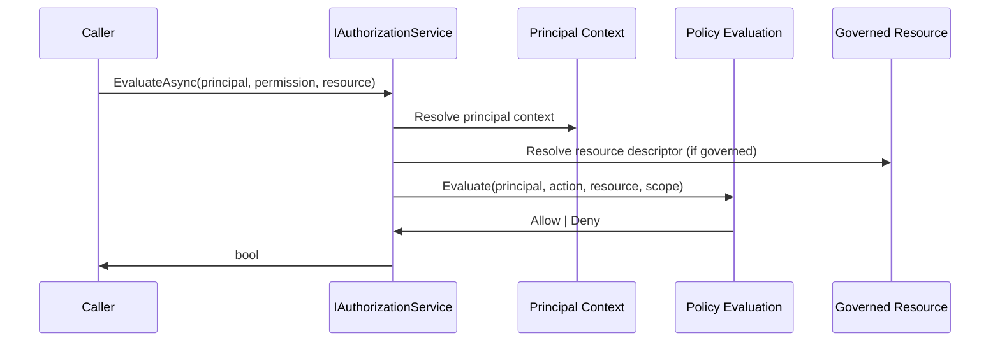
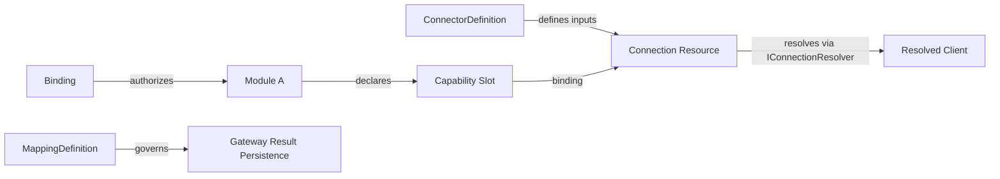

# Phase 1: Authorization and Resource-Governance Foundation

## Strategic Position

Authorization is a **central platform concern**. The connector/connection/capability/slot/binding model is one governed resource family that must integrate cleanly into this foundation—but it is not the center of authorization. Auth must remain generic and support future governance of modules, procedures, scheduling, runtime instances, administrative resources, and more.

---

## 1. Architecture Writeup

### 1.1 Core Model




**Key principles:**

- **Auth knows:** principals, resource types, actions, scopes, evaluation. It does NOT know connector-specific secret schemas, resolution mechanics, or capability slot wiring.
- **Governed resource families** participate through shared contracts: `IGovernedResource`, `IResourceDescriptor`, resource identity, ownership/scope.
- **Connector family** plugs in via `ConnectorDefinition` (governed), `Connection` (governed), `CapabilitySlot` (declared), `Binding` (delegation). Auth sees these as resource types and actions, not as auth primitives.
- **Administrative vs operational authorization** remain distinct: who may manage/configure vs what modules may use vs which users may execute operations.

### 1.2 Evaluation Flow




---

## 2. Canonical Vocabulary


| Term                             | Definition                                                                                                                                                             |
| -------------------------------- | ---------------------------------------------------------------------------------------------------------------------------------------------------------------------- |
| **Principal**                    | An identity that can perform actions. Categories: human (Entra/local user), machine (service account, runtime identity), system, remote instance (relationship-bound). |
| **Role**                         | Named set of permissions assigned to principals. Supports system and custom roles.                                                                                     |
| **Permission**                   | (Action, ResourceDescriptor?) — the right to perform an action, optionally scoped to a resource type/instance.                                                         |
| **Governed resource**            | A platform-managed entity that participates in authorization. Has identity, type, ownership, scope.                                                                    |
| **Resource type**                | Category of governed resource (e.g. Connection, Module, Operation, Schedule).                                                                                          |
| **Action**                       | Verb indicating what can be done (read, write, execute, manage, bind, etc.).                                                                                           |
| **Scope**                        | Boundary of visibility/control (instance, module, resource, operation, global).                                                                                        |
| **Delegation**                   | Explicit grant of capability from provider to consumer. Binding is a delegation mechanism.                                                                             |
| **Connector definition**         | Declares a connector kind (inputs, resolution contract). Governed resource type.                                                                                       |
| **Connection resource**          | Stored governed resource: config + secret references for resolving a live connector. Not the live client.                                                              |
| **Resolved client**              | Ephemeral runtime object obtained by resolving a connection. Not persisted; not a governed resource.                                                                   |
| **Capability**                   | A provided unit of functionality (connector, client, gateway). May be public (cross-module) or private.                                                                |
| **Slot**                         | Declared consumer need; a module declares slots it requires (e.g. `IDbConnection` slot).                                                                               |
| **Binding**                      | Explicit delegation: a slot is bound to a specific connection/capability. Authorizes that consumer to use that resource for that purpose.                              |
| **Procedure/operation resource** | Executable workflow/procedure. Requires permissions for execution; may resolve bound dependencies at runtime.                                                          |
| **Mapping definition**           | Registered mapping for gateway result persistence to platform-managed SQL. Governed; prevents arbitrary table writes.                                                  |


---

## 3. Foundational Resource Taxonomy

### 3.1 General / Core Platform Resource Families


| Family                   | Resource Types                                         | Notes                             |
| ------------------------ | ------------------------------------------------------ | --------------------------------- |
| **Environment/Instance** | Environment, RuntimeInstance                           | Instance boundary, ownership root |
| **Module**               | Module, ModuleInstallation, ModuleInstance             | Catalog, enabled, configured      |
| **Identity**             | User, Role, ServiceAccount                             | Principals and role assignments   |
| **Administrative**       | Schedule, SecretDescriptor, AuditPolicy                | Config, secrets metadata, audit   |
| **Trust/Relationship**   | TrustRelationship, ExternalInstance, GrantedCapability | Federation (existing model)       |


### 3.2 Connector/Capability Resource Family


| Resource Type          | Purpose                                                                            |
| ---------------------- | ---------------------------------------------------------------------------------- |
| ConnectorDefinition    | Declares connector kind, inputs, resolution contract. Platform or module-provided. |
| Connection             | Governed stored resource: config + secret refs. Resolves to live client.           |
| CapabilityRegistration | Module-provided capability (connector or client). Public or private.               |
| CapabilitySlot         | Declared consumer slot on a module.                                                |
| Binding                | Delegation: slot → connection/capability.                                          |
| MappingDefinition      | Gateway result persistence mapping.                                                |


### 3.3 Operational / Execution Resource Families


| Resource Type       | Purpose                                   |
| ------------------- | ----------------------------------------- |
| OperationDefinition | Procedure/workflow. Requires permissions. |
| OperationRun        | Execution record.                         |
| WorkflowInstance    | Runtime execution state.                  |


---

## 4. Initial Action/Permission Model

### 4.1 Naming Convention

`{resourceFamily}.{action}` or `{resourceFamily}.{resourceType}.{action}`. Use lowercase, dot-separated.

### 4.2 Administrative / Configuration-Oriented


| Action              | Scope                 | Notes                        |
| ------------------- | --------------------- | ---------------------------- |
| `connection.create` | Instance              | Create connection resources  |
| `connection.read`   | Instance / Connection | View connection metadata     |
| `connection.update` | Instance / Connection | Modify connection            |
| `connection.delete` | Instance / Connection | Remove connection            |
| `connector.manage`  | Instance              | Manage connector definitions |
| `binding.create`    | Module / Slot         | Create binding               |
| `binding.read`      | Module / Slot         | View bindings                |
| `binding.delete`    | Module / Slot         | Remove binding               |
| `module.install`    | Instance              | Install modules              |
| `module.configure`  | Module                | Configure module             |
| `schedule.manage`   | Instance              | Manage schedules             |
| `secret.manage`     | Instance              | Manage secret descriptors    |
| `mapping.manage`    | Instance              | Manage mapping definitions   |


### 4.3 Delegation / Binding-Oriented


| Action                | Scope             | Notes                              |
| --------------------- | ----------------- | ---------------------------------- |
| `binding.assign`      | Slot → Connection | Assign connection to slot          |
| `binding.revoke`      | Slot → Connection | Revoke assignment                  |
| `capability.register` | Module            | Register public/private capability |
| `capability.consume`  | Slot              | Use bound capability (runtime)     |


### 4.4 Runtime / Execution-Oriented


| Action              | Scope           | Notes                      |
| ------------------- | --------------- | -------------------------- |
| `operation.execute` | Operation       | Execute procedure/workflow |
| `operation.read`    | Operation / Run | View operation/run         |
| `workflow.start`    | Workflow        | Start workflow             |


### 4.5 Governance / Policy-Oriented


| Action                | Scope       | Notes                      |
| --------------------- | ----------- | -------------------------- |
| `role.manage`         | Instance    | Manage roles               |
| `permission.assign`   | Role / User | Assign permissions         |
| `audit.read`          | Instance    | View audit                 |
| `relationship.manage` | Instance    | Manage trust relationships |


---

## 5. Core Interfaces / Abstractions

### 5.1 Authorization (Core.Application)

Extend existing [IAuthorizationService](src/Apperture.Core/Apperture.Core.Application/Services/IAuthorizationService.cs); keep kernel-agnostic.

```csharp
// Existing: EvaluateAsync(IActor, PermissionDescriptor, ResourceDescriptor?)
// Add: Optional IPrincipalContext for richer principal resolution
```

### 5.2 Principal Context (Shared.Kernel + Core.Application)

- **IActor** (existing): Id, Kind, DisplayName. Keep.
- **IPrincipalContext** (new, Application): Resolves current principal; may include roles, permissions, relationship context. Used by authorization and audit.

### 5.3 Governed Resource Participation (Shared.Kernel)

```csharp
// Resource identity for authorization
public interface IGovernedResourceIdentity
{
    string ResourceType { get; }
    string ResourceId { get; }
    string? ScopeKey { get; }  // Instance, module, etc.
    string? OwnerId { get; }
}

// Resource families implement; auth consumes identity only
public interface IGovernedResource
{
    IGovernedResourceIdentity GetIdentity();
}
```

### 5.4 Resource Descriptor Registry

- **IResourceDescriptorRegistry** (existing): Register resource and permission descriptors. Extend with optional `ResourceFamily` grouping for taxonomy.

### 5.5 Connector / Capability Family (ModuleSdk.Abstractions + Core.Domain)


| Interface                    | Project                               | Purpose                                                        |
| ---------------------------- | ------------------------------------- | -------------------------------------------------------------- |
| `IConnectorDefinition`       | Core.Domain or ModuleSdk.Abstractions | Declares connector kind, required inputs, resolution contract  |
| `IConnectionResource`        | Core.Domain                           | Governed connection; GetIdentity(); no secret material         |
| `IConnectionResolver`        | Core.Application                      | Resolves connection → live client; internal to resolution path |
| `ICapabilitySlot`            | ModuleSdk.Abstractions                | Declared slot identity (module, slot name, contract type)      |
| `IBindingService`            | Core.Application                      | Create/delete bindings; resolve slot → connection/capability   |
| `IMappingDefinitionRegistry` | Core.Application                      | Register mapping definitions for gateway result persistence    |


**Placement:** ConnectorDefinition, Connection, Binding, MappingDefinition as domain/value types in Core.Domain. Resolution and binding services in Core.Application. Module SDK declares slot contract; Core.Application owns binding storage and resolution.

### 5.6 What Auth Must NOT Depend On

- Connector-specific secret schemas
- Connection resolution mechanics
- Capability slot wiring implementation
- ISecretResolver, ISecretStore (auth uses resource identity; secrets are behind connection abstraction)

---

## 6. Resource Relationship Model

### 6.1 Connector Family Flow




- **ConnectorDefinition → Connection:** Connection is created with config + secret refs per connector definition schema.
- **Connection → Resolved client:** At runtime, `IConnectionResolver` uses `ISecretResolver` and connector-specific logic. Resolved client is ephemeral.
- **Slot → Binding → Connection:** Binding records slot + connection; runtime resolves only bound connections for that slot.
- **Operation → Authorization → Bound dependencies:** User authorized for `operation.execute`; module has binding; runtime resolves slot → connection → client. No second connection-use permission by default (extensible later for sensitive policies).

### 6.2 Module-Provided Capability

- Module registers capability (public or private).
- Public: other modules may bind to it via slot.
- Private: only the defining module uses it.
- Visibility is capability governance, not the whole auth model.

### 6.3 Runtime-Created Resources

- Runtime may create connections (e.g. for dynamic workflows).
- Must follow: ownership/scope, validation, authorization, audit.
- Same governed resource model; creation requires `connection.create` (or equivalent) with proper principal.

---

## 7. Dependency Rules and Guardrails

### 7.1 Allowed

- Auth evaluates principal + permission + resource descriptor; resource may implement `IGovernedResource` for identity.
- Resource families register descriptors with `IResourceDescriptorRegistry`.
- Connector family uses platform-managed connection abstraction; secrets stay behind `ISecretResolver`.
- Modules declare slots; resolution is slot → binding → connection only.
- Explicit binding; no global connection browse by modules.
- SQL remains platform-shaped; gateway persistence via registered mapping definitions.

### 7.2 Forbidden

- Auth depending on connector-specific types (secret schemas, resolution mechanics).
- Modules browsing arbitrary connections without declared slots and bindings.
- Service-locator style resolution; use explicit slot + binding.
- Connections as live clients; connection is stored config, client is resolved ephemeral.
- Modules writing arbitrarily to SQL; use mapping definitions.
- Tight coupling of auth to any single resource family.

### 7.3 Anti-Patterns

- Do not shape authorization around connector semantics.
- Do not let capability/slot concepts become auth primitives.
- Do not conflate binding with user-level operation authorization.
- Do not bypass platform governance for runtime-created resources.

### 7.4 Generic vs Family-Specific


| Generic (auth/platform)                | Family-Specific (connector)           |
| -------------------------------------- | ------------------------------------- |
| Principal, Role, Permission            | ConnectorDefinition, Connection       |
| Resource type, Action, Scope           | Slot, Binding, CapabilityRegistration |
| IGovernedResource, IResourceDescriptor | IConnectionResolver, IBindingService  |
| Policy evaluation                      | Connection resolution, slot wiring    |


---

## 8. Layer Placement Recommendations


| Concern                                                            | Project                                         | Rationale                          |
| ------------------------------------------------------------------ | ----------------------------------------------- | ---------------------------------- |
| ResourceDescriptor, PermissionDescriptor, IActor                   | Shared.Kernel                                   | Primitive, no domain dependency    |
| IGovernedResource, IGovernedResourceIdentity                       | Shared.Kernel                                   | Generic resource participation     |
| Resource, Role, Permission, GrantedCapability                      | Core.Domain                                     | Domain model                       |
| Connection, Binding, ConnectorDefinition, MappingDefinition        | Core.Domain                                     | Domain entities/value objects      |
| IAuthorizationService, IResourceDescriptorRegistry, IRoleProvider  | Core.Application                                | Service contracts                  |
| IPrincipalContext, IBindingService, IConnectionResolver (contract) | Core.Application                                | Application services               |
| IConnectorDefinition, ICapabilitySlot                              | ModuleSdk.Abstractions                          | Module-facing contracts            |
| Connection resolution implementation                               | Persistence or dedicated Connector project      | Uses ISecretResolver, platform SQL |
| Auth evaluation implementation                                     | ControlPlane.Security or dedicated Auth project | Wires to Entra, role provider      |


**New project consideration:** `Apperture.Core.Governance` or `Apperture.Core.Authorization` could hold governance-specific contracts if Core.Application grows too broad. For Phase 1, keep in Core.Application.

---

## 9. Forward Compatibility

The design supports later:

- **Richer policy/ABAC:** Resource descriptors and scope expressions can carry attributes; evaluation can be extended.
- **Connection-use policies:** Operation execute can optionally require separate connection-use permission for sensitive resources.
- **Additional resource families:** Register new resource types and actions; implement `IGovernedResource`.
- **External queue bindings:** Same slot/binding pattern for queue resources.
- **Advanced secret backends:** Connection resolution stays behind `IConnectionResolver`; secret backend is internal.
- **Parent/child instance trust:** `RemoteInstancePrincipal` and `GrantedCapability` already model this; governance plugs into same evaluation.
- **Runtime-generated resources:** Same ownership/scope/audit rules.

---

## 10. Phase 2 / Phase 3 Roadmap

### Phase 2: Auth Model Scaffolding

- Implement `IPrincipalContext`; wire to Entra/local identity.
- Implement authorization evaluation (role + permission resolution).
- Seed permission catalog in `IResourceDescriptorRegistry`.
- Persist roles/permissions/assignments.
- Extend `IAuthorizationService` usage at API boundary.

### Phase 3: Connector Family Implementation

- Connector domain types (`ConnectorDefinition`, `Connection`, `Binding`, `MappingDefinition`) already exist in Core.Domain.Connector; Phase 3 focuses on persistence, services, and wiring.
- Implement `IBindingService`, `IConnectionResolver` (contract in Application; impl in infra).
- Persist connections, bindings, mapping definitions.
- Extend Module SDK: slot declaration, capability registration.
- Implement first connector (platform SQL) in common model.
- Wire binding resolution into runtime step context.

### Phase 4: Enforcement and Workflows

- Enforce connection/binding at resolution time.
- Enforce operation permissions at workflow start.
- Audit binding changes, connection use, operation execution.
- Gateway mapping definition enforcement.

---

## 11. Light Scaffolding Recommendations

### 11.1 Project/File Organization

```
src/Apperture.Core/
├── Apperture.Core.Domain/
│   ├── Governance/
│   │   ├── GovernedResourceIdentity.cs      (value object)
│   │   └── ResourceType.cs                  (enum or registry)
│   ├── Connector/
│   │   ├── ConnectorDefinition.cs           (entity)
│   │   ├── Connection.cs                    (entity, implements IGovernedResource)
│   │   ├── Binding.cs                       (entity)
│   │   └── MappingDefinition.cs             (entity)
│   └── ... (existing)
```

### 11.2 Enum / Value Object Ideas

- **ResourceFamily:** `Core`, `Connector`, `Operation`, `Administrative`, `Trust`
- **ActionCategory:** `Create`, `Read`, `Update`, `Delete`, `Execute`, `Manage`, `Bind`
- **BindingState:** `Active`, `Revoked`

### 11.3 Interface Skeletons

```csharp
// Shared.Kernel
public interface IGovernedResourceIdentity
{
    string ResourceType { get; }
    string ResourceId { get; }
    string? ScopeKey { get; }
    string? OwnerId { get; }
}

public interface IGovernedResource
{
    IGovernedResourceIdentity GetIdentity();
}
```

### 11.4 Seed Permission Naming Pattern

`{resourceFamily}.{resourceType}.{action}` — e.g. `connector.connection.read`, `connector.binding.assign`.

### 11.5 Resource Naming Conventions

- Resource types: PascalCase, e.g. `Connection`, `Binding`, `ConnectorDefinition`
- Action names: lowercase, dot-separated, e.g. `connection.create`, `operation.execute`
- Scope keys: `instance`, `module:{moduleId}`, `connection:{connectionId}`, `operation:{operationId}`

---

## 12. Decisions to Freeze Before Implementation

1. **Resource type registry:** Static enum vs dynamic registry. Recommend: static enum for initial types; registry for extensibility.
2. **Binding granularity:** One slot → one connection, or one slot → many (with selection policy)? Recommend: one-to-one for Phase 1.
3. **Connection vs ConnectionResource naming:** Use `Connection` in domain; `ConnectionResource` only if needed to avoid confusion with `IDbConnection`. Recommend: `Connection` as entity name.
4. **Where ConnectorDefinition lives:** Core.Domain vs ModuleSdk.Abstractions. Recommend: Core.Domain for platform types; ModuleSdk declares how modules contribute definitions.
5. **MappingDefinition scope:** Per gateway module, per operation, or per workflow? Defer detailed design to Phase 3 but reserve the resource type now.

---

## Related Documents

- [foundational-layers.md](docs/01-architecture/foundational-layers.md) — Layer boundaries
- [federated-instance-relationships.md](docs/01-architecture/federated-instance-relationships.md) — GrantedCapability, RemoteInstancePrincipal
- [secrets-and-key-management.md](docs/01-architecture/secrets-and-key-management.md) — SecretRef, ISecretResolver
- [project-map.md](.ai/playbooks/project-map.md) — Dependency rules
- ADR-0007, ADR-0011 — Auth and capability model separation

