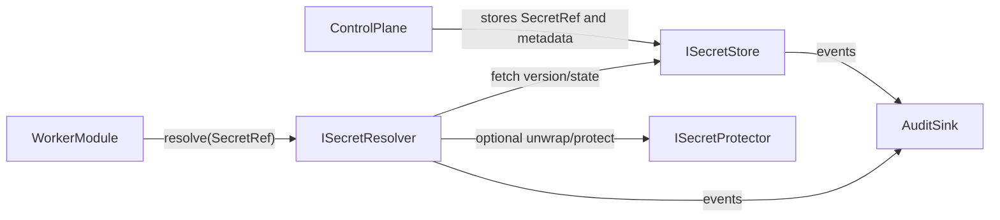

# Secrets & Key Management Plan

## Assumptions Applied

- Use exact documentation paths requested by user:
  - `docs/architecture/secrets-and-key-management.md`
  - `docs/roadmap.md`
- Keep existing docs under `docs/00-overview` and `docs/01-architecture` untouched except optional cross-links for discoverability.
- Create a dedicated new project under `src/`:
  - `src/Apperture.Core/Apperture.Core.Security.Secrets/Apperture.Core.Security.Secrets.csproj`
- Update `Apperture.slnx` to include the new project.

## Architecture Direction (Locked In)

- Split concerns into three core abstractions:
  - `ISecretStore`: metadata/version lifecycle/audit access.
  - `ISecretResolver`: runtime secret resolution by `SecretRef`.
  - `ISecretProtector`: envelope protection helpers for at-rest payloads.
- Enforce boundary:
  - Control Plane stores `SecretRef` + metadata.
  - Worker/Data Plane resolves material directly or unwraps with worker-only KEK access.
- Ensure no plaintext secret flow from Control Plane to Worker/Data Plane.

## Documentation Changes

### Create `docs/architecture/secrets-and-key-management.md`

Include:

- Problem statement and explicit non-goals.
- Threat model and data-flow boundaries (Control Plane vs Data Plane).
- Core abstraction rationale (`Store` / `Resolver` / `Protector`).
- Version lifecycle and rotation flow: `Pending -> Active -> Disabled/Revoked`.
- Audit event expectations and logging redaction rules.
- Provider matrix:
  - On-prem DB + protector.
  - Azure Key Vault modes.
  - Vault KV v2 + Transit + future dynamic/leased secrets.
- Migration path from DB-encrypted records to external vault-backed refs.
- "How to use" pseudocode for connectors/modules resolving `SecretRef` via `ISecretResolver` without plaintext logging.

### Create or update `docs/roadmap.md`

Add phases with acceptance criteria:

- Phase 1: interfaces + DB store/protector/resolver skeleton.
- Phase 2: Azure Key Vault provider.
- Phase 3: Vault KV v2 provider.
- Phase 4: Vault Transit + dynamic/leased secrets support.

## Code Scaffold (No Real Providers)

### New project

- `src/Apperture.Core/Apperture.Core.Security.Secrets/Apperture.Core.Security.Secrets.csproj`
  - Target `net10.0`
  - `nullable` enabled
  - Minimal required references only

### Models and enums

- `SecretId`
- `SecretRef`
- `SecretDescriptor`
- `SecretState`
- `SecretMaterialType`
- `SecretMaterial`
- `ResolvedSecret` (`ExpiresAt`, `LeaseId` optional)
- `SecretCreateRequest`
- `SecretAuditQuery`
- `SecretAuditPage`

### Interfaces (with XML docs)

- `ISecretStore`: `Create`, `Get`, `List`, `AddVersion`, `ActivateVersion`, `Disable`, `RevokeVersion`, `GetAudit`
- `ISecretResolver`: `Resolve`
- `ISecretProtector`: `Protect`, `Unprotect`
- Keep optional extension hook minimal and only when needed for compile-safe design.

### Provider placeholders (all throw `NotImplementedException`)

- `DbSecretStore`
- `DefaultSecretResolver`
- `DpapiSecretProtector` (Windows-guarded placeholder) or `CertSecretProtector`
- `AzureKeyVaultSecretStore`
- `VaultSecretStore`

All placeholders must include XML docs with TODO behavior constraints and security-boundary notes.

## Minimal Integration Touchpoints (Reference-Only)

Document where `SecretRef` belongs now/future:

- `src/Apperture.Runtime/Apperture.Runtime.Abstractions/StartWorkflowRequest.cs`
- `src/Apperture.Runtime/Apperture.Runtime.Abstractions/IWorkflowExecutor.cs`
- `src/Apperture.ModuleSdk/Apperture.ModuleSdk.Abstractions/ModuleManifest.cs`
- `docs/05-modules/module-manifest-spec.md`

Code changes at these touchpoints remain minimal: prefer storing `SecretRef` in config DTOs/contracts instead of plaintext fields.

## Solution Wiring + Validation

- Add project to `Apperture.slnx`.
- Run restore/build to verify all scaffolding compiles.
- Run lints for touched files and fix only scaffold-introduced issues.

## Expected Output

- New secrets spec + roadmap entries establish architecture contract before implementation.
- New project provides compile-safe API surface for Phase 1 without exposing plaintext secret flow.

