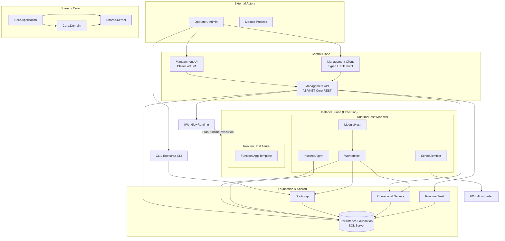
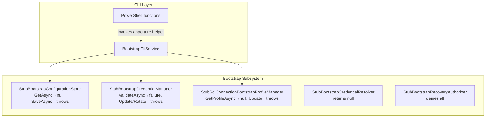
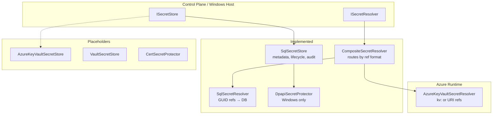
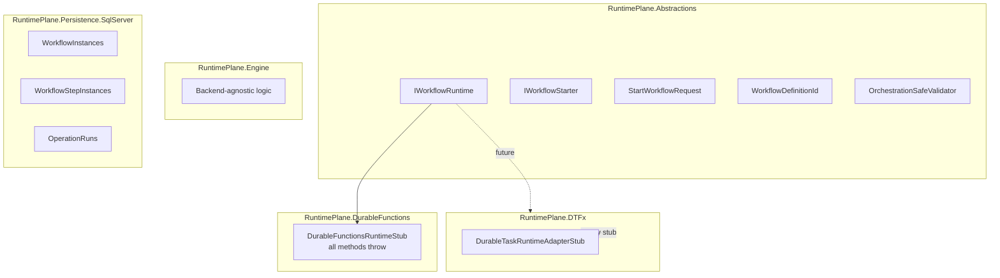
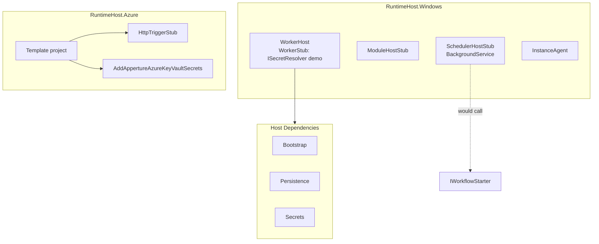
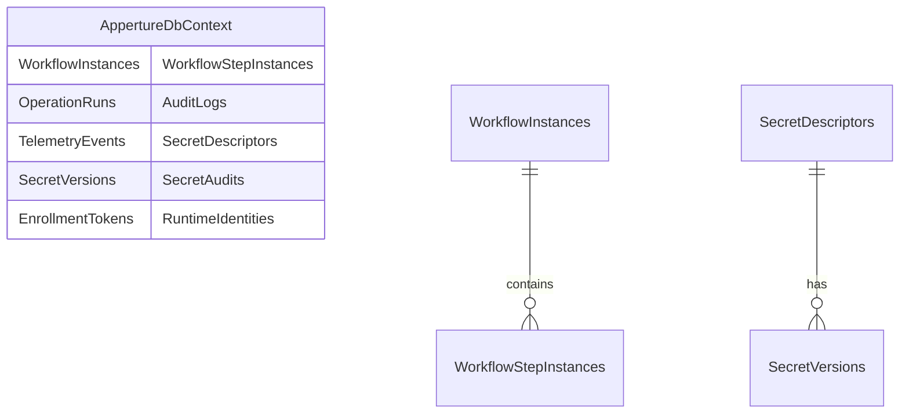
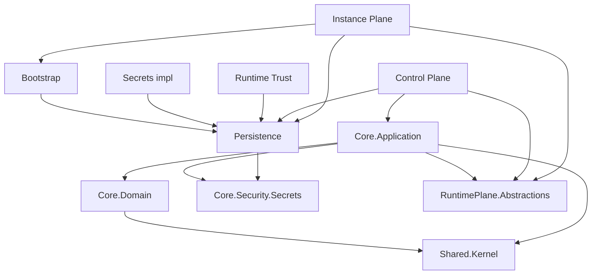

# Current Architecture — Tracking Document

> **Document purpose:** This is a **tracking document for current progress**, not a roadmap or specification of the ideal state. It reflects the architecture as it exists today—what is implemented, what is stubbed, and how subsystems connect. Update this document as the codebase evolves.

---

## High-Level Architecture



---

## Subsystem Overview

| Subsystem | Status | Notes |
|-----------|--------|-------|
| **Shared Kernel** | Implemented | IDs, Result, ActorId, environment context, audit sink |
| **Core.Domain** | Implemented | Environment, Module, User, Role, Operation, Schedule, Trust |
| **Core.Application** | Implemented | Service contracts; orchestration boundaries |
| **Bootstrap** | Stubbed | Config store, credential manager, profile manager all stubs |
| **Persistence Foundation** | Implemented | Shared DbContext, migrations, retry, schema |
| **Operational Secrets** | Partially | SqlSecretStore/Resolver done; Azure KV resolver done; KV store placeholder |
| **Runtime Trust** | Partially | EnrollController, SqlRuntimeIdentityService (stub validation) |
| **Runtime Plane** | Abstractions + Stubs | Engine exists; DTFx/DurableFunctions adapters stubbed |
| **Control Plane** | Partially | API, Menus, Modules, Runs, Workflows (start persists handoff; execution deferred), Enroll; UI shell |
| **Instance Plane** | Stubbed | WorkerHost/ModuleHost/SchedulerHost stubs; Azure template has HTTP stub |
| **CLI** | Partially | Bootstrap CLI scaffolding; PowerShell; invokes stubs |
| **Module SDK** | Implemented | Abstractions, SDK, test harness (stub) |

---

## Control Plane (Detail)

```mermaid
flowchart LR
    subgraph ControlPlane["Control Plane"]
        direction TB
        MenusController["MenusController<br/>GET /api/menus"]
        ModulesController["ModulesController<br/>GET /api/modules"]
        RunsController["RunsController<br/>GET /api/runs"]
        WorkflowsController["WorkflowsController<br/>POST /workflows/{id}/start"]
        EnrollController["EnrollController<br/>POST /enroll"]
        
        MenusController --> |200 OK| DomainMenus
        ModulesController --> |200 OK| Empty/stub
        RunsController --> |200/404/403| SQL-backed runs
        WorkflowsController --> |202/404/403| Persisted start handoff
        EnrollController --> IRuntimeEnrollmentService
    end

    WorkflowsController --> OrchestrationSafeValidator
    WorkflowsController -.->|Not wired| IWorkflowRuntime
```

**Implemented:**
- Menus API for Control Panel navigation
- Modules, Runs return empty/stub data
- WorkflowsController: parameter validation (rejects secret-bearing params), returns 501
- EnrollController: enrollment endpoint

**Not implemented:**
- Workflow start not wired to runtime
- Signal endpoint
- Schedule management API
- Audit/telemetry browse API

---

## Bootstrap (Detail)



**Implemented:**
- bootstrap show / validate succeed with "no configuration"
- All bootstrap interfaces defined; stubs provide non-throwing read paths where applicable

**Stubbed:**
- Config persistence, credential resolution, profile persistence, recovery authorization

---

## Operational Secrets (Detail)



---

## Runtime Plane (Detail)



**Implemented:**
- Portable model (StartWorkflowRequest, WorkflowDefinitionId, etc.)
- OrchestrationSafeValidator (parameter/signal validation)
- DbContext entities for workflow/step/operation state

**Stubbed:**
- DTFx adapter
- Durable Functions adapter (all IWorkflowRuntime methods throw)

---

## Instance Plane / Runtime Hosts (Detail)



---

## Persistence Foundation (Detail)



**Implemented:**
- Shared DbContext with all tables
- Migrations, retry/resilience, connection string factory
- Bootstrap provides connection string; persistence does not read config

---

## Dependency Flow



---

## Project Map (Current)

```
src/
├── Apperture.Shared/           Kernel, Security, Observability, Serialization
├── Apperture.Core/             Domain, Application, Security.Secrets, Security.Trust
├── Apperture.Bootstrap/        Stubs only; scaffolding for config/credential/profile
├── Apperture.Persistence/      SqlServer (shared DbContext)
├── Apperture.RuntimePlane/     Abstractions, Engine, Persistence.SqlServer, DTFx, DurableFunctions
├── Apperture.RuntimeHost/      Windows (WorkerHost, ModuleHost, InstanceAgent, SchedulerHost), Azure (Template, Secrets)
├── Apperture.ModuleSdk/        Abstractions, SDK, Testing
├── Apperture.ControlPlane/     Management.Api, Host, Client, UI (Blazor), Security
├── Apperture.Cli/              PowerShell, Cli.Core, Cli.Bootstrap, Cli.Host
└── Apperture.Modules/          Sample.HelloWorld (module, UI, contracts)
```

---

## Related

- [foundational-layers.md](foundational-layers.md) — Layer boundaries and dependency rules
- [bootstrap-and-secrets-boundary.md](bootstrap-and-secrets-boundary.md) — Bootstrap vs operational secrets
- [control-plane.md](control-plane.md) — Management API responsibilities
- [instance-plane.md](instance-plane.md) — Runtime host layout
- [persistence-foundation.md](persistence-foundation.md) — Schema and registration
- [secrets-and-key-management.md](secrets-and-key-management.md) — Secret subsystem
- [bootstrap-cli-invocation.md](bootstrap-cli-invocation.md) — Deferred implementation table
