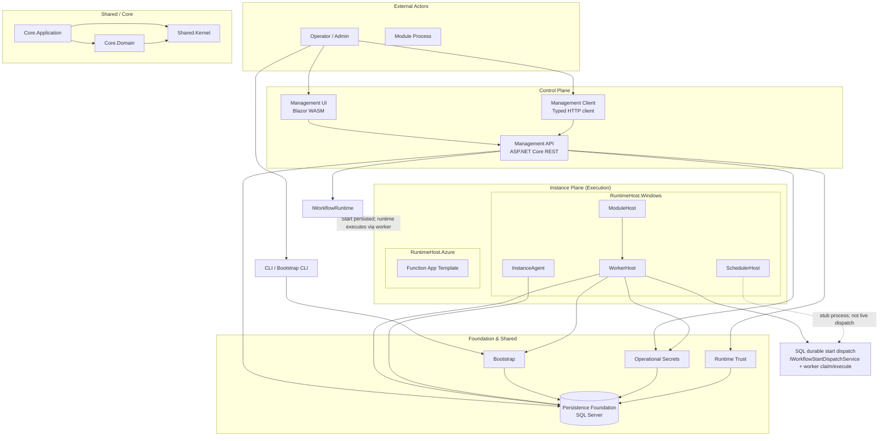
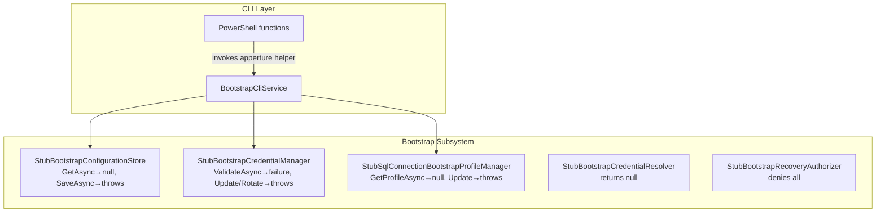
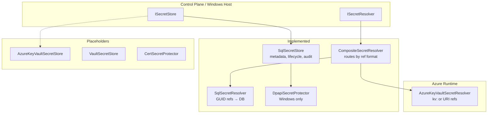
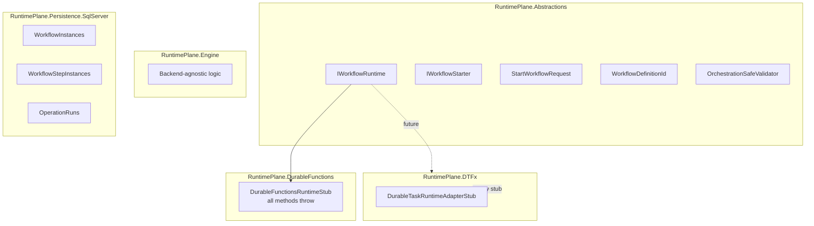
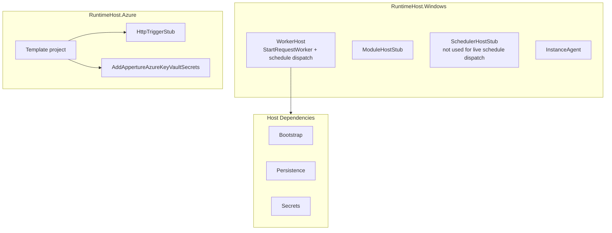
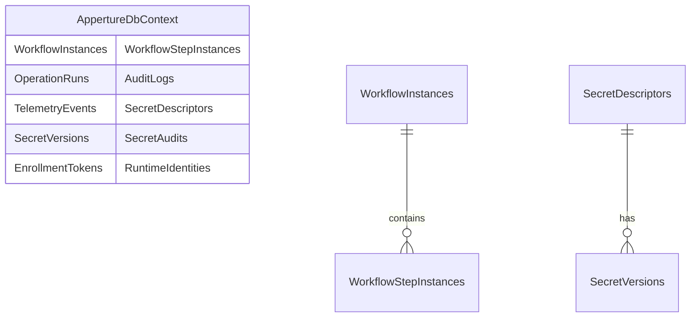
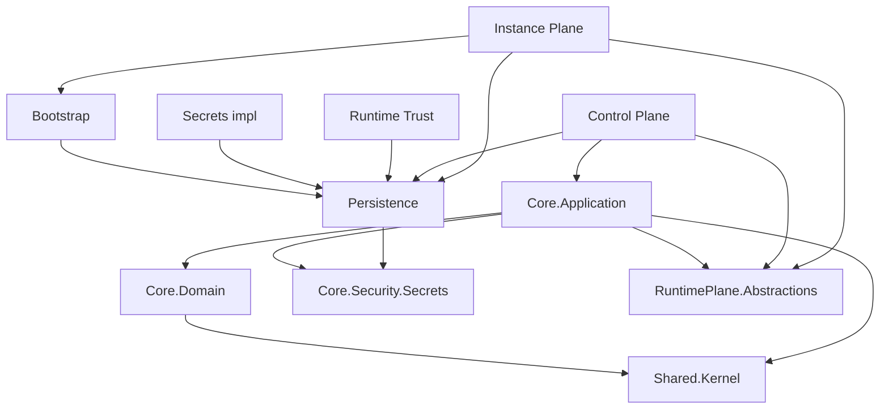

# Current Architecture — Tracking Document

> **Document purpose:** This is a **tracking document for current progress**, not a roadmap or specification of the ideal state. It reflects the architecture as it exists today—what is implemented, what is stubbed, and how subsystems connect. Update this document as the codebase evolves.

---

## High-Level Architecture



---

## Subsystem Overview

| Subsystem | Status | Notes |
|-----------|--------|-------|
| **Shared Kernel** | Implemented | IDs, Result, ActorId, environment context, audit sink |
| **Core.Domain** | Implemented | Environment, Module, User, Role, Operation, Schedule, Trust |
| **Core.Application** | Implemented | Service contracts; orchestration boundaries |
| **Bootstrap** | Stubbed | Config store, credential manager, profile manager all stubs |
| **Persistence Foundation** | Implemented | Shared DbContext, migrations, retry, schema |
| **Operational Secrets** | Partially | SqlSecretStore/Resolver done; Azure KV resolver done; KV store placeholder |
| **Runtime Trust** | Partially | EnrollController, SqlRuntimeIdentityService (stub validation) |
| **Runtime Plane** | Abstractions + Stubs | Engine exists; DTFx/DurableFunctions adapters stubbed |
| **Control Plane** | Partially | API, Menus, Modules, Runs, Workflows (start persists transactional handoff; execution deferred), Enroll; run detail now includes lifecycle and step history; UI shell |
| **Instance Plane** | Partially | WorkerHost consumes persisted workflow start requests and executes minimal lifecycle; other hosts remain stubbed |
| **CLI** | Partially | Bootstrap CLI scaffolding; PowerShell; invokes stubs |
| **Module SDK** | Implemented | Abstractions, SDK, test harness (stub) |

### WorkflowStartRequests lease and ownership (current baseline)

- **Lease model:** `WorkflowStartRequests` uses `ClaimedAt`/`ClaimedBy` as a lease. A request may be reclaimed when `Status == running` and `ClaimedAt` is older than the configured lease timeout.
- **Renewal / heartbeat:** the active worker renews the lease by refreshing `ClaimedAt` at **step boundaries** (before and after each step) while executing.
- **Ownership enforcement:** processing is valid only for the current owner (`ClaimedBy`). If ownership is lost (another worker successfully reclaims), the old worker **stops safely** and does not write terminal `completed/failed` status.
- **Configuration:** lease timeout is configured via a single options seam (`WorkflowStartRequestLeaseOptions.LeaseTimeout`) consumed by both worker discovery and processor claim/reclaim/renewal.

### WorkerHost module-driven execution (Prompt B baseline)

- **Module set:** WorkerHost uses an explicit, host-controlled `IEnumerable<IModule>` list to define which modules are executable in that process. Intended deployment remains one primary module per process (ADR-0001), but multiple modules are allowed for dev/testing and constrained composition.
- **Definition resolution:** Worker-side definition resolution is module-driven via `IWorkflowDefinitionResolver` (enumerates DI-registered `IModule` and `GetDefinitionsAsync()`), not hard-coded to a sample workflow id.
- **Step handlers:** modules register handlers via `IModuleStepHandlerRegistrar` into `IStepHandlerRegistry` (no demo-only handler wiring in the host).
- **Guardrails:** WorkerHost validates at startup that workflow definition ids are unique across loaded modules and that each `WorkflowDefinition.ModuleId` matches the owning module manifest id; handler registrations are module-scoped and collisions fail fast.

### Workflow cancellation (cancel control surface baseline)

- **API surface:** `POST /api/runs/{runId}/cancel` persists durable cancel intent and returns `202 Accepted` (idempotent) when the run exists and the caller is authorized.
- **Persistence:** cancel intent is stored in `WorkflowCancelRequests` keyed by `RunId` (one row per run).
- **Worker behavior:** `WorkflowStartRequestProcessor` checks for cancel intent at safe boundaries (before execution begins, before each step, and just before writing terminal success). When observed for a non-terminal run/instance, it writes `cancelled` terminal status for:
  - `WorkflowStartRequestEntity.Status`
  - `OperationRunEntity.Status` (+ `CompletedAt`)
  - `WorkflowInstanceEntity.Status` (+ clears `CurrentStepName`)

### Workflow retry (retry-as-new-run baseline)

- **API surface:** `POST /api/runs/{runId}/retry` creates a brand-new run and instance for the same workflow definition.
- **Semantics:** retry is “start again as a new run,” not resume/restart-in-place. The original run remains terminal and unchanged.
- **Eligibility:** retry is currently allowed only for terminal `failed` and `cancelled` runs.
- **Idempotency:** retry is non-idempotent by design; repeated retry calls against the same original run create additional fresh runs.
- **Persistence:** the new `OperationRunEntity` stores `RetryOfRunId` so the lineage from retried run to original run is durable and queryable.
- **Execution path:** retry reuses the existing start dispatch pipeline, which creates the new `WorkflowInstanceEntity`, `OperationRunEntity`, and `WorkflowStartRequestEntity` triple that the worker then consumes normally.

### Workflow lifecycle refinement (current baseline)

- **Lifecycle vocabulary:** the shared workflow lifecycle names are centralized in `WorkflowLifecycleStatusNames` and `WorkflowLifecycleEventNames`.
- **Run/control history:** durable lifecycle events are now recorded for start dispatch, start, park request, park, resume request, resume, cancel request, cancel, retry request, completion, and failure in `WorkflowLifecycleEvents`.
- **Step history:** worker step execution now populates `WorkflowStepInstances` so run detail can show per-step execution history instead of only the final run status.
- **Query surface:** `RunQueryService.GetRunAsync` now returns both lifecycle events and step history for a run.

### Workflow external-control recipient model (park/resume baseline)

- **Recipient state:** workflow runs can now enter a durable `parked` state at a safe boundary and later resume from the saved next step.
- **External-control inbox:** `WorkflowExternalControlRequests` persists queued park/resume requests and tracks whether the worker applied or rejected them.
- **Worker behavior:** the worker only resumes parked runs when a resume request is queued, and it parks only at safe step boundaries.
- **Query surface:** `RunQueryService.GetRunAsync` now returns the current step pointer and external-control request history alongside lifecycle and step history.
- **Hardening (recipient slice):** concurrent duplicate park/resume inserts against the filtered unique index are handled idempotently in `WorkflowExternalControlService` (no spurious 500). The worker re-validates the start-request lease immediately before applying park and before applying resume so a stale processor cannot flip state after another worker claims. **`CurrentStepName`** semantics: while **running**, it tracks current step progression; while **parked**, it is the saved **next** step to run after resume (documented on the instance entity and run-detail DTO).

---

## Control Plane (Detail)

```mermaid
flowchart LR
    subgraph ControlPlane["Control Plane"]
        direction TB
        MenusController["MenusController<br/>GET /api/menus"]
        ModulesController["ModulesController<br/>GET /api/modules"]
        RunsController["RunsController<br/>GET /api/runs"]
        RunsCancel["RunsController<br/>POST /api/runs/{id}/cancel"]
        RunsRetry["RunsController<br/>POST /api/runs/{id}/retry"]
        RunsPark["RunsController<br/>POST /api/runs/{id}/park"]
        RunsResume["RunsController<br/>POST /api/runs/{id}/resume"]
        WorkflowsController["WorkflowsController<br/>POST /workflows/{id}/start"]
        EnrollController["EnrollController<br/>POST /enroll"]
        
        MenusController --> |200 OK| DomainMenus
        ModulesController --> |200 OK| Empty/stub
        RunsController --> |200/404/403| SQL-backed runs
        RunsCancel --> |202/404/403| Persisted cancel intent
        RunsRetry --> |202/404/403/409| Reuses start dispatch
        RunsPark --> |202/404/403/409| Persists park intent
        RunsResume --> |202/404/403/409| Resumes a parked run
        WorkflowsController --> |202/404/403| Persisted start handoff
        EnrollController --> IRuntimeEnrollmentService
    end

    WorkflowsController --> OrchestrationSafeValidator
    WorkflowsController -.->|Not wired| IWorkflowRuntime
```

**Implemented:**
- Menus API for Control Panel navigation
- Runs API: list/detail from SQL with executable-permission-based read authorization
- Runs API: cancel persists durable intent (`POST /api/runs/{id}/cancel`)
- Runs API: retry starts a brand-new run from a terminal run (`POST /api/runs/{id}/retry`)
- Runs API: park/resume persist durable external-control intent and toggle a run between `running` and `parked`
- Runs API: detail now returns lifecycle events, step history, current step pointer, and external-control history for the selected run
- WorkflowsController: start persists a durable handoff and returns `202 Accepted`
- EnrollController: enrollment endpoint

**Not implemented:**
- Signal endpoint
- Schedule management API
- Audit/telemetry browse API

---

## Bootstrap (Detail)



**Implemented:**
- bootstrap show / validate succeed with "no configuration"
- All bootstrap interfaces defined; stubs provide non-throwing read paths where applicable

**Stubbed:**
- Config persistence, credential resolution, profile persistence, recovery authorization

---

## Operational Secrets (Detail)



---

## Runtime Plane (Detail)



**Implemented:**
- Portable model (StartWorkflowRequest, WorkflowDefinitionId, etc.)
- OrchestrationSafeValidator (parameter/signal validation)
- DbContext entities for workflow/step/operation state (platform `AppertureDbContext`; module-owned contexts for module tables — see [Epic 73 ADR](../02-decisions/Epic73-execution-hot-path-and-host-roles.md))
- SQL-backed durable enqueue: `IWorkflowStartDispatchService`, `IOperationStartDispatchService` (`Apperture.Core.Application`); implementations in `Apperture.RuntimePlane.Dispatch.SqlServer`

**Stubbed:**
- DTFx adapter
- Durable Functions adapter (all IWorkflowRuntime methods throw)
- `IWorkflowStarter` (contract exists; not the current enqueue surface — use dispatch services)

---

## Instance Plane / Runtime Hosts (Detail)



---

## Persistence Foundation (Detail)



**Implemented:**
- Shared DbContext with all tables
- Migrations, retry/resilience, connection string factory
- Bootstrap provides connection string; persistence does not read config

---

## Dependency Flow



---

## Project Map (Current)

```
src/
├── Apperture.Shared/           Kernel, Security, Observability, Serialization
├── Apperture.Core/             Domain, Application, Security.Secrets, Security.Trust
├── Apperture.Bootstrap/        Stubs only; scaffolding for config/credential/profile
├── Apperture.Persistence/      SqlServer (shared DbContext)
├── Apperture.RuntimePlane/     Abstractions, Engine, Persistence.SqlServer, DTFx, DurableFunctions
├── Apperture.RuntimeHost/      Windows (WorkerHost, ModuleHost, InstanceAgent, SchedulerHost), Azure (Template, Secrets)
├── Apperture.ModuleSdk/        Abstractions, SDK, Testing
├── Apperture.ControlPlane/     Management.Api, Host, Client, UI (Blazor), Security
├── Apperture.Cli/              PowerShell, Cli.Core, Cli.Bootstrap, Cli.Host
└── Apperture.Modules/          Sample.HelloWorld (module, UI, contracts)
```

---

## Related

- [foundational-layers.md](foundational-layers.md) — Layer boundaries and dependency rules
- [bootstrap-and-secrets-boundary.md](bootstrap-and-secrets-boundary.md) — Bootstrap vs operational secrets
- [control-plane.md](control-plane.md) — Management API responsibilities
- [instance-plane.md](instance-plane.md) — Runtime host layout
- [persistence-foundation.md](persistence-foundation.md) — Schema and registration
- [secrets-and-key-management.md](secrets-and-key-management.md) — Secret subsystem
- [bootstrap-cli-invocation.md](bootstrap-cli-invocation.md) — Deferred implementation table
