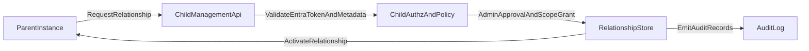

# Federated External Instance Relationships

## 1. Executive summary

Apperture should add cross-instance collaboration as a **federated control model** where each instance remains an independent security, data, and operational boundary. Parent-child is the first business scenario, but it must be implemented through a generalized external relationship domain so the platform can later support observer, peer, provider/customer, and auditor topologies without redesigning core contracts.

The recommended approach is:

- Use Microsoft Entra app registration as the authentication anchor for platform-to-platform identity.
- Keep human auth, service auth, and relationship authorization separate.
- Require explicit child-side approval and delegated capabilities for every relationship.
- Expose a constrained, versioned, auditable management API boundary for all cross-instance actions.
- Implement reliable upward notifications with signing, retry, idempotency, replay protection, and reconciliation.

This aligns with existing Apperture decisions on instance boundaries, control-plane vs instance-plane responsibilities, and auditable operations.

## 2. Architectural position

### Why federation instead of flattening into shared tenancy

Flattening separate organizations into a single tenancy model would violate current single-tenant instance boundaries and create unnecessary blast radius. Federation preserves:

- independent policy and operational autonomy per instance
- clean legal/compliance boundaries
- explicit trust and revocation points
- independent failure domains

### Why parent-child is a good first abstraction

Parent-child maps directly to near-term business need: a parent observes and performs bounded operations against a child, while children send critical operational/security signals upward. It is simple enough for a first release while delivering meaningful value.

### Why parent-child must sit on a generalized relationship model

Hardcoding tree semantics in core types would create future migration debt. The platform should model relationships generically (`RelationshipType`, capability grants, scopes, lifecycle state), then define parent-child as the first supported type and policy profile.

## 3. Domain model proposal

### `ExternalInstance`

- **Purpose:** Catalogs a remote Apperture instance known to the local control plane.
- **Key fields:** `ExternalInstanceId`, `DisplayName`, `OrganizationName`, `InstancePublicId`, `Environment`, `Status`, `CreatedAtUtc`, `LastSeenAtUtc`.
- **Lifecycle:** Created during onboarding, updated by discovery/heartbeat, soft-deactivated when relationships are revoked.
- **Auth tie-in:** Binds authenticated remote credentials to a stable domain identity.

### `InstanceRelationship`

- **Purpose:** Explicit trust contract between local and external instance.
- **Key fields:** `RelationshipId`, `LocalInstanceId`, `ExternalInstanceId`, `RelationshipType`, `State`, `Direction`, `RequestedBy`, `ApprovedBy`, `ActivatedAtUtc`, `ExpiresAtUtc`, `SuspendedAtUtc`, `RevokedAtUtc`.
- **Lifecycle:** `Pending -> Active -> Suspended|Revoked|Expired` with auditable transitions.
- **Auth tie-in:** Relationship state gates all remote authorization decisions.

### `RelationshipType` (value object / enum)

- **Purpose:** Declares business topology semantics.
- **Initial values:** `ParentChild`, `Observer`, `Peer`, `ServiceProvider`, `Auditor`.
- **Lifecycle:** Extensible with compatibility checks and policy defaults per type.
- **Auth tie-in:** Sets baseline capability templates; never grants full control by itself.

### `RelationshipState` (value object / enum)

- **Purpose:** Runtime trust enforcement state.
- **Values:** `Pending`, `Active`, `Suspended`, `Revoked`, `Expired`.
- **Lifecycle:** Managed by handshake, suspension, revocation, and expiry jobs.
- **Auth tie-in:** Only `Active` relationships can authorize remote operations.

### `GrantedCapability`

- **Purpose:** Normalized delegated permission grant.
- **Key fields:** `CapabilityName`, `ScopeExpression`, `Constraints`, `GrantedBy`, `GrantedAtUtc`, `ExpiresAtUtc`.
- **Lifecycle:** Added/changed by child admin policy workflows.
- **Auth tie-in:** Core input for child-side `IRelationshipAuthorizationService`.

### `RelationshipScope`

- **Purpose:** Bounded scope selector over module/resource/action surfaces.
- **Key fields:** `ScopeType` (`Global`, `Module`, `Resource`, `Operation`), `Selector`, `Conditions`.
- **Lifecycle:** Versioned with relationship policy revisions.
- **Auth tie-in:** Enables least-privilege and deny-by-default evaluation.

### `ManagementEndpoint` (or `RemoteEndpoint`)

- **Purpose:** Declares remote API endpoint metadata for trusted interaction.
- **Key fields:** `BaseUrl`, `Audience`, `ProtocolVersion`, `TlsPolicy`, `CertificateThumbprint`, `IsPrimary`.
- **Lifecycle:** Updated on rotation/failover/version upgrades.
- **Auth tie-in:** Used by gateway client for token audience validation and pinning policy.

### `EventSubscription`

- **Purpose:** Defines child-to-parent notification interests and delivery contract.
- **Key fields:** `SubscriptionId`, `RelationshipId`, `EventTypePattern`, `MinimumSeverity`, `DeliveryMode`, `Endpoint`, `SigningKeyRef`, `IsEnabled`.
- **Lifecycle:** Created/updated/revoked by child admin; suspended when relationship suspended.
- **Auth tie-in:** Notification emission checks subscription + relationship state.

### `RemoteInstanceCredentialReference`

- **Purpose:** Reference to machine credential material used for remote auth.
- **Key fields:** `CredentialRefId`, `CredentialType` (`ClientAssertionCert`, `FederatedCredential`, `SharedSecretLegacy`), `KeyId`, `ValidFromUtc`, `ValidToUtc`, `RotationPolicy`.
- **Lifecycle:** Rotated via credential lifecycle service; revocation must invalidate immediately.
- **Auth tie-in:** Binds remote caller authentication to relationship and principal.

### `RelationshipAuditRecord` and `TrustLifecycleMetadata`

- **Purpose:** Complete audit and compliance trail for relationship actions.
- **Key fields:** `EventId`, `RelationshipId`, `ActorType`, `ActorId`, `Action`, `Outcome`, `Reason`, `CorrelationId`, `TimestampUtc`.
- **Lifecycle:** Append-only; retained per compliance policy.
- **Auth tie-in:** Every allow/deny, scope change, suspend, revoke, and notification delivery attempt is auditable.

### `CompatibilityProfile`

- **Purpose:** Tracks protocol and capability compatibility.
- **Key fields:** `ProtocolVersion`, `ApiVersion`, `FeatureFlags`, `MinSupportedVersion`, `NegotiatedAtUtc`.
- **Lifecycle:** Negotiated during handshake and revalidated periodically.
- **Auth tie-in:** Prevents operations when compatibility policy is not met.

## 4. Relationship lifecycle and trust handshake

### Trust establishment (Entra-backed)

1. Parent creates relationship request with target child endpoint and desired capabilities.
2. Parent authenticates to child using Entra-issued token for a registered app identity.
3. Child validates token, issuer, audience, and presented instance metadata.
4. Child admin reviews request and explicitly approves/reduces scopes and capabilities.
5. Child persists relationship with `Pending` state until trust material and endpoint metadata are finalized.
6. Child and parent exchange protocol compatibility metadata and finalize endpoint contract.
7. Relationship transitions to `Active`.

### Lifecycle behavior

- **Pending:** Request received; not authorized for management operations.
- **Active:** Capabilities enforceable; notifications can flow.
- **Suspended:** Temporary block on inbound actions and outbound notifications except lifecycle/security events.
- **Revoked:** Permanent disable; credentials and subscriptions invalidated.
- **Expired:** Time-based deactivation pending renewal.

### Credential rotation and revocation

- Support dual-key overlap window for safe rotation.
- Enforce `NotBefore`/`NotAfter` and automated expiry alarms.
- Revocation must be effective immediately in authorization path and token acceptance policy.
- Prefer certificate-based client assertions or federated credentials over long-lived shared secrets.

### Compatibility/version negotiation

- Exchange supported protocol/API versions during handshake.
- Store negotiated profile and block unsupported operations.
- Add explicit compatibility check endpoint before activating relationship.

### Renewal/expiration

- Relationships have explicit expiry policy, renewable by bilateral approval.
- Renewal can keep existing scopes or require re-approval for privileged capabilities.

## 5. Integration with existing auth design

Apperture should preserve three separate but coordinated systems:

1. **User authn/authz:** Entra users and local users mapped into the unified role/permission model.
2. **Service authn:** Machine credentials for API-to-API instance communication.
3. **Relationship authorization:** Child-side policy deciding what authenticated remote instance principals may do.

### Child representation of parent identity

Represent a trusted parent as a `RemoteInstancePrincipal` bound to:

- authenticated machine identity (`RemoteInstanceCredentialReference`)
- active `InstanceRelationship`
- granted capabilities/scopes
- audit metadata and policy constraints

This principal is evaluated by child authorization policy on every remote call. Relationship trust does not grant local human roles and does not bypass module/resource authorization.

### Module resources and operations alignment

Module-defined resources/operations remain in the same authorization philosophy:

- modules declare resources and required permissions
- relationship capabilities map into these permissions via policy translation
- child enforcement remains authoritative at module/resource/operation boundaries

## 6. Authorization model for cross-instance actions

### Policy shape

- Deny by default.
- Explicit grants only.
- Least privilege presets for new relationships.
- Optional time-bound grants and just-in-time elevation for high-risk actions.

### Scope layers

- **Global relationship scopes:** instance metadata, health summary, inventory.
- **Module/resource delegated scopes:** constrained to approved modules/resources.
- **Operation-specific permissions:** specific actions with constraints.

### Example delegated grants

- Observe health only: `relationship.observe.health`
- Trigger approved operations in one module: `relationship.operate.module.run` scoped to `module:billing`
- Retry failed jobs for workload class: `relationship.operate.workflow.retry` scoped by workflow tag/class
- Rotate relationship credentials: `relationship.admin.credentials.rotate`
- Subscribe to failure notifications only: `relationship.observe.events.failure`

## 7. Management API boundary

All parent-to-child interaction goes through child control-plane management APIs only.

### Discovery and metadata

- **Belongs:** protocol versions, relationship capabilities, instance metadata.
- **Not exposed:** internal topology details, secret backend internals.
- **Security:** signed responses not required, but strict auth + audit mandatory.
- **Versioning:** explicit API version and protocol version fields.

### Health and status

- **Belongs:** summarized health, degraded components, readiness indicators.
- **Not exposed:** raw infrastructure secrets, host-level shell access.
- **Security:** read-only scopes and data minimization.
- **Versioning:** additive health dimensions.

### Jobs/workflows

- **Belongs:** run status queries, bounded retry/acknowledge actions.
- **Not exposed:** direct step execution internals or backend-native orchestration handles.
- **Security:** operation-level capability checks and idempotency keys.
- **Versioning:** action contracts must preserve backward compatibility.

### Module inventory

- **Belongs:** installed module IDs/versions/capabilities.
- **Not exposed:** module secret material or private connector credentials.
- **Security:** observe scopes only.
- **Versioning:** stable identifiers and semantic version fields.

### Delegated actions

- **Belongs:** approved remote operations, pause/resume, selected admin actions.
- **Not exposed:** unrestricted admin operations by default.
- **Security:** scoped authorization + reason codes + actor attribution.
- **Versioning:** explicit action schema versions.

### Notification subscription management

- **Belongs:** create/update/delete subscriptions and delivery diagnostics.
- **Not exposed:** unrelated tenant or internal routing internals.
- **Security:** capability `relationship.admin.subscriptions`.
- **Versioning:** event type taxonomy versioning.

### Diagnostics bundle requests

- **Belongs:** bounded diagnostics requests with redaction policy.
- **Not exposed:** plaintext secrets or raw key material.
- **Security:** high-privilege gated capability with approval workflow.
- **Versioning:** bundle schema version and retention metadata.

### Audit views

- **Belongs:** relationship-specific action trails and outcomes.
- **Not exposed:** full internal audit corpus unless explicitly delegated.
- **Security:** strict data scope filters per relationship ID.
- **Versioning:** stable envelope with extensible fields.

### Relationship admin endpoints

- **Belongs:** request, approve, suspend, revoke, rotate credentials, renew.
- **Not exposed:** direct manipulation of unrelated identity systems.
- **Security:** bilateral approval for high-impact changes.
- **Versioning:** conservative evolution and explicit state machine semantics.

## 8. Event and notification model

Important notifications must be formalized into explicit event contracts, not ad-hoc webhook payloads.

### Event classes

- `HealthStatusChanged`
- `WorkflowRunFailed`
- `WorkflowRunStuck`
- `DeploymentFailed`
- `ConfigurationDriftDetected`
- `SecurityIncidentDetected`
- `ComplianceAlertRaised`
- `RelationshipStateChanged`

### Severity model

- `Informational`, `Warning`, `Error`, `Critical`

### Subscription model

- Filter by event type, severity threshold, module/workflow scope, and optional tags.
- Support enable/disable without deleting subscription history.

### Delivery pattern

- Primary: signed outbound HTTPS webhook or outbound API post.
- Reliability: at-least-once delivery, retries with backoff, dead-letter capture, idempotency key.
- Safety: replay window, nonce/timestamp validation, signature verification.
- Correlation: include `CorrelationId`, `CausationId`, `RelationshipId`, `EventId`.
- Resilience: outbox-based durable event publication on child side.

### Reconciliation/event history

- Parent can query event history by watermark/time window.
- Parent can request replay for missed event ranges.
- Child maintains relationship-scoped delivery ledger for audit/recovery.

## 9. Security model and threat considerations

### Major risks and mitigations

- **Over-broad parent authority**
  - Mitigate with deny-by-default grants, scoped capabilities, and child-side enforcement.
- **Trust bootstrap abuse**
  - Require bilateral approval and strong issuer/audience validation.
- **Token theft / credential leakage**
  - Prefer certificates/federated credentials, short-lived tokens, strict secret handling.
- **Replay attacks**
  - Use signed payloads, nonce/timestamp checks, replay cache, expiry window.
- **Stale/unrevoked trust**
  - Enforce expiration, revocation propagation, periodic trust health checks.
- **Confused deputy**
  - Require explicit target resource scope and policy context on every action.
- **Bypassing child authorization**
  - Enforce policy centrally in child management API for all remote calls.
- **Direct access attempts outside boundary**
  - No direct DB/queue/secret access pathways; network and identity policies deny.

### Concrete recommendations

- Prefer cert-based client assertions over long-lived shared secrets.
- Use explicit bilateral approval for privileged relationship activation.
- Implement immediate revocation paths and short token lifetimes.
- Sign remote requests/events where feasible and validate strongly.
- Audit every trust lifecycle transition and remote action.
- Keep child as ultimate enforcement point.

## 10. Roadmap and phased implementation plan

### Phase 1

- Domain model and relationship records.
- Parent-child trust handshake.
- Entra-backed machine authentication bootstrap.
- Observe-only management APIs.
- Basic failure/health notifications.
- Relationship-focused audit trail.

### Phase 2

- Delegated action scopes.
- Subscription management.
- Retry/idempotency/replay controls.
- Credential rotation lifecycle.
- Richer health and workflow operations.

### Phase 3

- Additional relationship types beyond parent-child.
- Module/resource-granular delegation.
- Event reconciliation and replay history.
- Compatibility/version negotiation hardening.
- Policy-based controls and templates.

### Phase 4

- Advanced federation topologies.
- Multi-parent observer patterns (if needed).
- External auditor/compliance roles.
- Richer cross-instance orchestration patterns through bounded APIs.

## 11. Concrete recommendations for current architecture docs

Add or update the following:

- Auth and identity architecture: introduce the three-model separation and `RemoteInstancePrincipal`.
- Control plane design: include federated relationship services and boundary enforcement.
- Management API design: add relationship, discovery, delegated action, and notification endpoints.
- Notifications/eventing design: define formal event taxonomy and reliability model.
- Security architecture: add federation threat model and trust lifecycle controls.
- Domain model documentation: relationship entities, states, capabilities, compatibility profile.
- Roadmap and ADR set: phase-by-phase implementation and decisions.

## 12. ADR recommendations

Create the following ADRs:

1. **Federated external instance relationships**
   - Adopt explicit federated relationship model and lifecycle.
2. **Entra-backed platform trust for instance authentication**
   - Use Entra as authentication root for instance-to-instance identity.
3. **Separate human auth, service auth, and relationship authorization**
   - Enforce model separation to avoid privilege bleed.
4. **Parent-child as first supported relationship type on generalized model**
   - Deliver parent-child first without hardcoding topology.
5. **Constrained management API boundary for cross-instance control**
   - Require all cross-instance operations through auditable API contracts.
6. **Signed reliable child-to-parent notifications**
   - Standardize event signatures, retries, and idempotency guarantees.
7. **Delegated capability model for remote instance administration**
   - Define granular capabilities/scopes with least-privilege defaults.

## 13. Open questions and decisions to settle later

- Which exact token profile should be default for service auth (client assertion cert vs federated workload identity) by hosting mode?
- What should be the default expiry and renewal cadence for relationships by type?
- Should high-risk delegated actions require optional just-in-time dual approval?
- How should compatibility policy handle partial feature mismatches between parent and child versions?
- What minimum event retention window and replay depth are required by compliance tier?
- Should relationship policy support attribute-based conditions (time window, module tags, environment labels) in Phase 2 or Phase 3?
- How should diagnostics bundle redaction and approval workflow be standardized across modules?

## Recommended first implementation

Deliver an opinionated parent-child MVP that is observe-first:

1. Add generalized relationship entities and lifecycle state machine.
2. Implement Entra-backed machine authentication plus child-side explicit approval.
3. Expose read-only discovery/health/inventory endpoints under relationship capability checks.
4. Implement signed failure/health notifications with outbox + retry + idempotency keys.
5. Record full relationship audit trail on both sides with shared correlation IDs.

This provides immediate operational value while preserving future extensibility.

## Proposed domain model types and interfaces

### Types

- `ExternalInstance`
- `InstanceRelationship`
- `RelationshipType`
- `RelationshipState`
- `GrantedCapability`
- `RelationshipScope`
- `ManagementEndpoint`
- `EventSubscription`
- `RemoteInstanceCredentialReference`
- `RelationshipAuditRecord`
- `TrustLifecycleMetadata`
- `CompatibilityProfile`
- `RemoteInstancePrincipal`

### Interfaces (proposed)

- `IExternalInstanceRegistry`
- `IInstanceRelationshipService`
- `IRelationshipAuthorizationService`
- `IRelationshipHandshakeService`
- `IRelationshipCredentialService`
- `IRemoteManagementGateway`
- `IRelationshipEventPublisher`
- `IRelationshipEventOutbox`
- `ICompatibilityNegotiationService`

## Proposed API contract areas

- `Relationship Discovery API`
- `Relationship Administration API`
- `Federated Health and Status API`
- `Federated Workflow and Job Operations API`
- `Federated Module Inventory API`
- `Delegated Action API`
- `Notification Subscription API`
- `Relationship Audit API`
- `Event Reconciliation API`

## Proposed permission/capability names

- `relationship.observe.metadata`
- `relationship.observe.health`
- `relationship.observe.inventory`
- `relationship.observe.audit.summary`
- `relationship.observe.events.failure`
- `relationship.operate.workflow.retry`
- `relationship.operate.workflow.acknowledge`
- `relationship.operate.schedule.pause`
- `relationship.operate.schedule.resume`
- `relationship.admin.subscriptions`
- `relationship.admin.capabilities.manage`
- `relationship.admin.credentials.rotate`
- `relationship.admin.relationship.suspend`
- `relationship.admin.relationship.revoke`
- `relationship.bootstrap.fullcontrol` (restricted use only)

## Proposed event types

- `apperture.relationship.state.changed`
- `apperture.instance.health.changed`
- `apperture.workflow.run.failed`
- `apperture.workflow.run.degraded`
- `apperture.workflow.run.retried`
- `apperture.deployment.failed`
- `apperture.configuration.drift.detected`
- `apperture.security.alert.raised`
- `apperture.audit.threshold.exceeded`
- `apperture.notification.delivery.failed`
