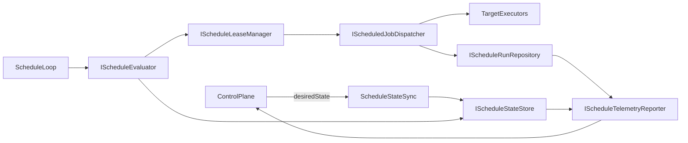

# Instance-owned Scheduling

See [ADR-0004](../02-decisions/ADR-0004-instance-owned-scheduling.md) for the canonical decision.

## Core model

Apperture scheduling follows one product model across Azure and Windows/on-prem:

- A schedule is assigned to an instance.
- The instance evaluates when the schedule is due.
- The instance executes scheduled work locally.
- The control plane governs definitions and observes execution, but does not normally execute tenant jobs.

## Responsibility split

## Control Plane (governance and visibility)

- Create/update/delete schedule definitions.
- Assign schedules to target instances.
- Enable/disable schedules and apply execution policies.
- Publish desired schedule state to instances.
- Query schedule status, next run, last run, and run history.
- Aggregate telemetry and failures for operators.

## Instance Plane (runtime ownership)

- Pull or receive assigned schedules and maintain applied state.
- Evaluate due schedules in a local scheduling loop.
- Acquire lease/lock and dispatch scheduled jobs locally.
- Persist run records and schedule state durably.
- Apply concurrency, retry, timeout, and misfire policy.
- Emit telemetry and health/heartbeat data to control plane.

## Control plane non-goals

- Do not directly execute scheduled tenant jobs in normal operation.
- Do not require always-on control plane connectivity for already assigned schedules to fire.
- Do not define product semantics using cloud provider timer primitives.

## Scheduling domain model (host-agnostic)

## Core entities/contracts

- `ScheduleDefinition`
  - Canonical schedule metadata and recurrence expression.
  - Includes default execution policy, timezone, enabled flag, and version.
- `ScheduleAssignment`
  - Binds a schedule to one instance and effective policy overrides.
  - Tracks desired state version and applied state version.
- `ScheduledTarget`
  - Discriminated target payload used by dispatcher.
  - Carries `ScheduledJobType` and job-specific configuration.
- `ScheduledJobType`
  - Enum-like contract for target kinds:
    - `WorkflowExecution`
    - `ModuleOperationExecution`
    - `ConnectorSyncOrPolling`
    - `PowerShellScriptExecution`
    - `InstanceMaintenanceTask`
    - `Custom` (future extension point)
- `ScheduleExecutionPolicy`
  - Policy envelope for retry, concurrency, timeout, misfire/catch-up behavior, and dedupe expectations.
- `ScheduleRun`
  - Immutable run record with run id, schedule id, fire time, start/end time, status, attempts, host, and outcome metadata.
- `ScheduleLease`
  - Runtime lease document to prevent duplicate execution when multiple schedulers can observe the same due event.
- `MissedRunPolicy`
  - Defines behavior when due times were missed:
    - `SkipMissed`
    - `RunOnceImmediate`
    - `CatchUpLimited`
- `ConcurrencyPolicy`
  - Defines behavior when prior run is still active:
    - `AllowParallel`
    - `ForbidOverlap`
    - `QueueNext`
    - `ReplaceOrCancelPrevious` (optional future)
- `RetryPolicy`
  - Max attempts, backoff mode, backoff intervals, retryable failure classification.
- `ScheduleHeartbeat` (optional but recommended)
  - Instance scheduler liveness and freshness marker (`LastEvaluationUtc`, lag, error state, applied schedule version).

## Required status fields

Each applied schedule should expose operational status in durable state:

- `NextDueUtc`
- `LastDueUtc`
- `LastStartedUtc`
- `LastCompletedUtc`
- `LastOutcome`
- `ConsecutiveFailureCount`
- `DisabledReason` (if disabled)

## Runtime service architecture

## Proposed interfaces and responsibilities

- `IScheduleProvider`
  - Returns active assignments and revisions for the local instance.
  - Supports incremental refresh by watermark/version.
- `IScheduleEvaluator`
  - Computes due schedules from recurrence + timezone + state.
  - Produces deterministic due windows for polling intervals.
- `IScheduleLeaseManager`
  - Acquires, renews, and releases schedule execution lease tokens.
  - Supports single-node and future distributed lock backends.
- `IScheduledJobDispatcher`
  - Routes scheduled target to the proper executor (workflow, module op, connector, PowerShell, maintenance).
- `IScheduleRunRepository`
  - Persists and queries `ScheduleRun` records and run attempts.
- `IScheduleStateStore`
  - Persists applied schedule state and computed operational fields.
  - Tracks idempotency keys and last evaluated watermark.
- `IScriptExecutionService`
  - Executes PowerShell job targets with sandbox/timeout/output constraints.
- `IScheduleTelemetryReporter`
  - Emits run and health telemetry to local observability and control-plane ingestion endpoints.

## Collaboration flow

### Execution sequence

1. Scheduler loop ticks every `N` seconds.
2. `IScheduleProvider` refreshes assignments (full or incremental).
3. `IScheduleEvaluator` computes due windows and candidate firings.
4. `IScheduleLeaseManager` acquires lease per due firing (`ScheduleId + FireTimeUtc`).
5. `IScheduledJobDispatcher` dispatches to target executor.
6. `IScheduleRunRepository` writes started/completed/failed run records.
7. `IScheduleStateStore` updates next/last fields and failure counters.
8. `IScheduleTelemetryReporter` publishes status and telemetry.

## Reliability and policy behavior

- **Duplicate prevention**: idempotency key format `ScheduleId:FireTimeUtc` and lease check on dispatch.
- **Restart recovery**: evaluator computes missed due windows from durable `LastEvaluationUtc`; applies `MissedRunPolicy`.
- **Misfire handling**: catch-up bounded by policy limits to prevent runaway backlog.
- **Concurrency control**: enforce `ConcurrencyPolicy` before dispatch.
- **Retries**: apply `RetryPolicy` with attempt counters and backoff schedule persisted in run records.
- **Disabled schedules**: evaluator skips disabled definitions and records disabled reason/state.
- **Visibility**: runtime always maintains `NextDueUtc` and latest run outcome per assignment.
- **Future clustering**: swap local lease provider with distributed lease backend without changing domain contracts.

## PowerShell scheduled target design

PowerShell is a scheduled target type in the same instance-owned scheduling model. It is not a default deployment model of one instance per script.

## `PowerShellJobDefinition`

- `ScriptSourceType` (`ManagedArtifact`, `RegisteredDirectory`, `SyncedArtifact`, `NetworkPath`)
- `ScriptPath` (resolved according to source strategy)
- `WorkingDirectory`
- `ParameterTemplate` and/or `ArgumentsTemplate`
- `CredentialRef` (secret reference, never plaintext)
- `Timeout`
- `RetryPolicy` override (optional)
- `AllowedExecutionHosts` (host tags/capabilities)
- `ExpectedExitCodes`
- `StdOutCaptureMode` and `StdErrCaptureMode`
- `ScriptHash` and `ScriptVersion` metadata
- `EnvironmentVariables` (with secret-ref capable values)

## Script source strategy preference

1. **Managed artifacts (preferred)**: curated script package with version/hash metadata.
2. **Registered local directories**: constrained, allow-listed paths on instance host.
3. **Pulled/synced artifacts**: controlled replication to local cache with provenance.
4. **Network path execution (least preferred)**: only where operationally required and tightly controlled.

### Why avoid arbitrary network share execution

- Higher tampering risk if share access controls drift.
- Weaker provenance and rollback confidence without artifact metadata.
- Increased runtime fragility due to network dependency and path availability.
- Harder incident response because effective script version can change out-of-band.

## Host adapter strategy

Scheduling remains one domain model with host-specific adapters.

## Azure adapter

- Can use Azure-native timer capabilities to initiate evaluation ticks.
- Must still maintain instance-owned schedule state and run tracking.
- Must preserve idempotency key, lease semantics, and portable policies.
- Azure timer mechanics are implementation detail, not public scheduling contract.

## Windows/on-prem adapter

- Uses internal scheduler background service (WorkerHost).
- Performs cron/interval evaluation loop locally.
- Dispatches into local workflow and operation executors (Epic 28/29); PowerShell and other target types planned.
- Persists durable schedule state and runs in instance storage.

## Recommended V1 (Windows-first, portability-preserving)

V1 should be pragmatic and deliver end-to-end behavior without overengineering:

1. Instance-local schedule repository and state store.
2. Cron parser behind `IScheduleEvaluator` abstraction.
3. Background polling service every `N` seconds.
4. Single-node lease lock (`ScheduleId + FireTimeUtc`) with durable check.
5. Durable schedule run table + basic query API.
6. Generic dispatcher with workflow and PowerShell executors first.
7. Telemetry reporter uplink to control plane run/status views.

### V1 non-goals

- Full distributed scheduler coordination.
- Advanced fairness/priority queueing.
- Cloud-optimized trigger infrastructure beyond adapter seam.

## Suggested project placement

- Portable contracts:
  - `src/Apperture.RuntimePlane/Apperture.RuntimePlane.Abstractions`
- Runtime scheduling engine services:
  - `src/Apperture.RuntimePlane/Apperture.RuntimePlane.Engine`
- Windows/on-prem host adapter:
  - `src/Apperture.RuntimeHost/Apperture.RuntimeHost.Windows/Apperture.RuntimeHost.Windows.SchedulerHost`
- SQL persistence adapter:
  - `src/Apperture.RuntimePlane/Apperture.RuntimePlane.Persistence.SqlServer`

## Tradeoffs and future evolution

- **Tradeoff**: instance-owned scheduling increases runtime complexity per instance.
  - **Benefit**: host portability, clearer execution boundary, and better resilience to control plane outages.
- **Tradeoff**: control-plane-driven desired state requires sync logic and eventual consistency handling.
  - **Benefit**: centralized governance without centralized execution coupling.
- **Future evolution**:
  - Add distributed lease backend for multi-node instance runtime.
  - Add richer misfire and backpressure policies.
  - Add signed artifact verification for PowerShell/script targets.
  - Add advanced operator controls (pause, resume, drain, rerun).
