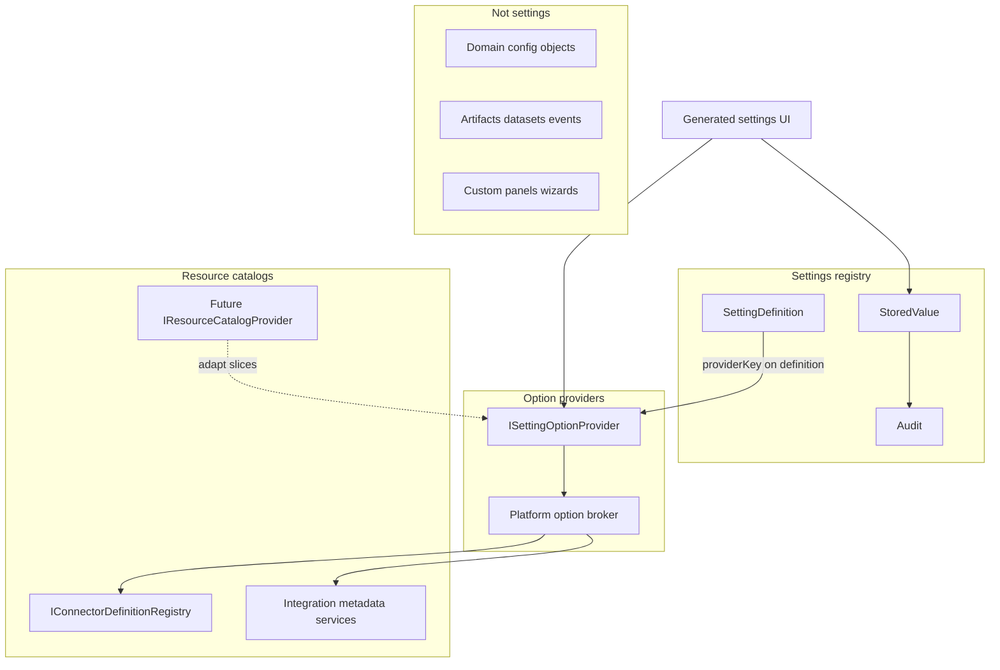

# Platform settings option providers and scoped settings

## Status

**Epic 113 — design specification only.** This document defines the architecture for dynamic setting option providers, resource-backed selections, future scoped settings, and related boundaries.

**Epic 114 — delivered:** Instance-scoped platform option provider prototype (`platform.connectorDefinitions`), options endpoint, write-time validation.

**Epic 115 — delivered (integration-context foundation):** `PlatformSettingOptionProviderContext` (Instance vs Integration), `OptionProviderContextKind` on definitions, `GET .../options?integrationId=`, optional `integrationId` on write validation, coordinator + integration authorization. **No** integration-scoped setting persistence, **no** production integration-context setting keys.

**Epic 116 — delivered (first real same-integration provider):** `campusnexus.campuses` — active Campus Nexus campuses via OData `Campuses` entity set; resolves `ICampusNexusApiClient` through `IRuntimeSlotResolver` (`CnsApi` slot). No production setting key; test-only definition validates the path.

**Epic 117 — delivered (design):** Integration-scoped value model and Integration Detail settings UI design documented in [integration-scoped-settings.md](integration-scoped-settings.md).

**Epic 118 — delivered (integration value scope + API):** Integration-scoped persistence and `/api/integrations/{integrationId}/settings` routes. Route `integrationId` supplies both value scope and provider context (no `?integrationId=` query). Integration settings auth uses `integration.read` / `integration.update` only. Platform route `/api/config/platform-settings` unchanged (Epic 115/116 provider context still stores instance values).

**Prerequisites (delivered):**

- [platform-settings-registry.md](platform-settings-registry.md) — Phase 1 registry (Epic 109), operator UI (Epic 111), `StringArray` / static MultiSelect (Epic 112)
- [ADR-0039: Environment, startup, bootstrap, and platform settings](../02-decisions/ADR-0039-environment-startup-bootstrap-and-platform-settings.md)

**Recommended next:** Epic 119 Integration Detail settings UI at `/integrations/{integrationId}/settings`, then Epic 120 first production integration setting key.

---

## Provider context vs value scope

| Concept | Role | Notes |
|---------|------|-------|
| **Provider context** | Where option values **come from** when loading/validating | `PlatformSettingOptionProviderContext` with `ContextKind` (`Instance` \| `Integration`) and `IntegrationId` when required |
| **Setting value scope** | Where the setting value is **stored** | Instance: `/api/config/platform-settings` → `Instance` / `instance`. Integration: `/api/integrations/{integrationId}/settings` → `Integration` / `integrationId` (Epic 118) |

On the **platform** route, integration-context providers (Epic 115/116) still persist **instance-scoped** values. On the **integration** route (Epic 118), integration-context providers persist **integration-scoped** values.

Definition metadata: `OptionProviderContextKind` (default `Instance`) alongside `OptionProviderKey`.

| API | Behavior |
|-----|----------|
| `GET /api/config/platform-settings/{key}/options?integrationId=` | Required when definition context is `Integration`; rejected when context is `Instance` and query param is present |
| `PUT /api/config/platform-settings/{key}` body `integrationId` | Passed to provider validation only; does not change persistence scope |

Authorization: `platform.settings.read` / `manage` on instance configuration plus `integration.read` on the target integration when integration context is used. Integration existence validated via `IIntegrationRepository`.

Test-only provider: `test.integration.options` (unit tests only; not registered in production DI).

Deferred: `sqlserver.tables`, `sftp.remoteDirectories`, cross-integration `ProviderBinding`, module-contributed providers, integration-scoped persistence/UI tab.

---

## Epic 116 — `campusnexus.campuses` (delivered)

| Piece | Behavior |
|-------|----------|
| Provider | [`CampusNexusCampusesOptionProvider`](../../src/Apperture.ControlPlane/Apperture.ControlPlane.Security/CampusNexusCampusesOptionProvider.cs) |
| OData | [`CampusNexusCampusQueries.ListActiveCampusesAsync`](../../src/Apperture.Connectors/Apperture.Connectors.CampusNexus/CampusNexusCampusQueries.cs) — active campuses, stable `Id` values |
| Resolution | Integration `ModuleId` + slot `CnsApi` via [`IRuntimeSlotResolver`](../../src/Apperture.Core/Apperture.Core.Application/Services/IRuntimeSlotResolver.cs) (Management.Host registers [`AddConnectorResolution`](../../src/Apperture.ConnectorResolution/ServiceCollectionExtensions.cs)) |
| Persistence | Provider context only — setting values remain instance-scoped when saved from platform settings API |

---

## Purpose

Operators will eventually configure settings whose valid choices come from **live platform or integration catalogs** (installed modules, connector definitions, campuses, SQL tables, operational teams, and similar). Epic 112 established static `AllowedValues` and `StringArray` storage. Epic 113 defines how **dynamic option sources** and **future scopes** fit the platform without turning the settings registry into a general metadata database or cross-module query bus.

---

## Architecture overview



---

## A. Conceptual separation

The platform must keep six concerns distinct. Mixing them leads to ungoverned cross-integration queries, secret leakage, and unmaintainable UI.

| Concern | What it is | What it is not | Examples | Anti-patterns |
|---------|------------|----------------|----------|---------------|
| **Settings** | Operator-controlled values stored, resolved, audited by the platform settings registry | A catalog of platform resources; runtime datasets | `Notifications.Delivery.Enabled`, future integration-scoped module flags | Storing full campus lists or SQL table metadata in `PlatformSettingValues` |
| **Option providers** | Authorized lookup of **selectable** `{ value, label }` choices for a setting definition | Owners of the setting value; generic browse APIs | `platform.modules.installed`, `campusnexus.campuses` (with `integrationId` context) | Returning secrets; exposing arbitrary SQL without authz |
| **Resource / catalog providers** | Browseable, queryable platform or integration metadata (often paged/searchable) | Settings; option lists stored in the settings tree | Future browse of tables/views/folders/campuses; connector definition catalog read path | Persisting catalog snapshots as setting values |
| **Domain configuration objects** | Rich structured configuration with dedicated models, validation, and UI | Flat generic settings when shape is non-trivial | Notification routing rules, rule builders, multi-stage policies | Forcing notification rule graphs into `StringArray` settings |
| **Integration outputs / datasets / artifacts** | Runtime data shared between integrations (exports, handoffs, lineage) | Operator settings knobs | Future artifact references, dataset bindings, event payloads | SFTP export integration “settings” that are really a copy of another integration’s campus table |
| **Custom UI panels / wizards** | Composed operator experiences (multi-step, domain-specific layout) | Part of the option-provider foundation | Future module settings panel, first-run wizard | Every module shipping a custom panel instead of contributed definitions |

**Settings** remain the only layer that writes to `PlatformSettingValues` and emits `platform.settings.set` / `platform.settings.reset` audit records. Option providers **never** persist operator choices themselves.

---

## B. Option source types

Future setting definitions will declare how selectable options are obtained. Epic 112 implements only the first row.

| Option source kind | Status | Description |
|--------------------|--------|-------------|
| **StaticAllowedValues** | Implemented (Epic 112) | `AllowedValues` on `PlatformSettingDefinition`; validated in [`PlatformSettingsAllowedValuesValidator`](../../src/Apperture.Core/Apperture.Core.Application/PlatformSettings/PlatformSettingsAllowedValuesValidator.cs) |
| **PlatformProvider** | Future | Platform-owned catalog; no integration context required (or optional filter) |
| **SameIntegrationProvider** | Future | Catalog scoped to the integration (or connection) being configured |
| **CrossIntegrationProvider** | Deferred | Consumer integration reads provider output from another integration; requires explicit binding (section J) |
| **DomainResourceReference** | Out of scope for settings | Artifacts, datasets, runtime bindings — separate subsystem |

### Platform provider examples (future)

| providerKey | Typical ValueType / InputKind | Data source (conceptual) |
|-------------|------------------------------|---------------------------|
| `platform.modules.installed` | `String` / `Select` or `StringArray` / `MultiSelect` | Module lifecycle registry |
| `platform.connectorDefinitions` | `String` / `Select` | [`IConnectorDefinitionRegistry`](../../src/Apperture.Core/Apperture.Core.Application/Services/IConnectorDefinitionRegistry.cs) |
| `platform.roles` | `StringArray` / `MultiSelect` | Governance role catalog |
| `platform.operationalTeams` | `String` / `Select` | Operational team persistence |
| `platform.notificationDefinitions` | `String` / `Select` | Notification definition store |

### Same-integration provider examples (future)

| providerKey | Context required | Examples |
|-------------|------------------|----------|
| `campusnexus.campuses` | `integrationId` | Campus list from CampusNexus connection |
| `campusnexus.programs` | `integrationId` | Program list |
| `sqlserver.tables` | `integrationId`, often `connectionId` | Tables visible to bound SQL connection |
| `sftp.remoteDirectories` | `integrationId`, `connectionId` | Remote paths (labels may be redacted) |

### Cross-integration provider examples (deferred)

| Scenario | Why deferred |
|----------|--------------|
| SFTP export integration selects campuses from a CampusNexus integration | Requires `ProviderBinding`, explicit authorization, lifecycle when provider integration is retired |
| Any “pick from Integration B while editing Integration A” | Same — must not use integration display names as stable keys |

### Future definition metadata (pseudo-code — not implemented)

```csharp
// Extends PlatformSettingDefinition — design only (Epic 113)
public enum OptionSourceKind
{
    StaticAllowedValues,
    PlatformProvider,
    SameIntegrationProvider,
    CrossIntegrationProvider  // requires ProviderBinding
}

public enum StaleValuePolicy
{
    Reject,
    PreserveWithWarning,
    // AutoRemoveOnSave — future only; not recommended for early implementations
}

// On PlatformSettingDefinition (future fields)
public OptionSourceKind OptionSource { get; init; }
public string? ProviderKey { get; init; }           // stable contract id; never integration display name
public StaleValuePolicy StalePolicy { get; init; } = StaleValuePolicy.PreserveWithWarning;
// AllowedValues used when OptionSource == StaticAllowedValues (Epic 112)
```

---

## C. Provider identity and naming

### providerKey rules

- **Stable contract identifier** — versioned with the platform or module; not operator-editable.
- **Not** an integration name, display label, or connection nickname.
- **Not** a SQL table name or remote path used as the key (those belong in **Value** after selection).
- Registered and validated at host/module install time (similar to [`IConnectorDefinitionContributor`](../../src/Apperture.Core/Apperture.Core.Application/Services/IConnectorDefinitionContributor.cs) contributing to [`IConnectorDefinitionRegistry`](../../src/Apperture.Core/Apperture.Core.Application/Services/IConnectorDefinitionRegistry.cs)).

### Context vs key

A single `providerKey` describes **what** catalog is offered. **Which instance** of that catalog is identified by request context, not by mutating the key:

| Field | Role | Example |
|-------|------|---------|
| `providerKey` | Contract | `campusnexus.campuses` |
| `integrationId` | Same-integration scope | `int_abc123` |
| `connectionId` | When multiple connections per integration | `conn_xyz` |
| `scopeKind` + `scopeId` | Future setting value scope | `Integration` + `int_abc123` |

**Wrong:** `providerKey = "Production CampusNexus"` or `providerKey = "int_abc123.campuses"`.

**Right:** `providerKey = "campusnexus.campuses"` with `integrationId = int_abc123` on the options/validation request.

### Namespace conventions

| Prefix | Owner | Module may register? |
|--------|-------|----------------------|
| `platform.*` | Platform only | **No** — modules must not define `platform.*` providers or settings |
| `{connectorPrefix}.*` | Connector package / module (e.g. `campusnexus.*`, `sqlserver.*`, `sftp.*`) | Yes, under platform validation |
| `modules.{moduleId}.*` | Contributing module (alternative pattern) | Yes, if reserved at install |

Platform validates prefix reservation at module **install/enable** to prevent collisions and impersonation of platform namespaces.

---

## D. Provider contract shape (design only)

Interfaces below are **documentation pseudo-code**. Epic 113 does not add these types to the repository.

### Option lookup

```csharp
public interface ISettingOptionProvider
{
    /// <summary>Stable contract id, e.g. platform.modules.installed.</summary>
    string ProviderKey { get; }

    Task<SettingOptionSet> GetOptionsAsync(
        SettingOptionRequest request,
        CancellationToken cancellationToken = default);
}

public sealed record SettingOptionRequest
{
    public required string SettingKey { get; init; }
    public required SettingScopeContext Scope { get; init; }  // ScopeKind + ScopeId
    public required IActor Actor { get; init; }
    public string? IntegrationId { get; init; }
    public string? ConnectionId { get; init; }
    public string? Search { get; init; }
    public int? Limit { get; init; }
    public string? ContinuationToken { get; init; }
}

public sealed record SettingOptionSet
{
    public required IReadOnlyList<SettingOption> Items { get; init; }
    public string? ContinuationToken { get; init; }
    public bool HasMore { get; init; }
}

public sealed record SettingOption
{
    public required string Value { get; init; }       // stored in setting payload
    public required string Label { get; init; }
    public string? Description { get; init; }
    public bool Disabled { get; init; }
    public string? DisabledReason { get; init; }
    public IReadOnlyDictionary<string, string>? Metadata { get; init; }  // non-secret hints only
}
```

### Write-time validation (provider-backed)

```csharp
public interface ISettingOptionValidator
{
    Task<SettingOptionValidationResult> ValidateSelectedValuesAsync(
        SettingOptionValidationRequest request,
        CancellationToken cancellationToken = default);
}

public sealed record SettingOptionValidationRequest
{
    public required PlatformSettingDefinition Definition { get; init; }
    public required SettingScopeContext Scope { get; init; }
    public required IActor Actor { get; init; }
    public required IReadOnlyList<string> SelectedValues { get; init; }
    public string? IntegrationId { get; init; }
    public string? ConnectionId { get; init; }
}

public sealed record SettingOptionValidationResult
{
    public bool IsValid { get; init; }
    public IReadOnlyList<SettingOptionValidationIssue> Issues { get; init; }
}

public sealed record SettingOptionValidationIssue(
    string Value,
    string Code,           // e.g. not_found, forbidden, stale, disabled
    string Message);
```

### Platform broker (future)

A single **platform option broker** dispatches by `providerKey`, enforces authorization, applies rate limits, and routes to registered providers. Modules register providers through an approved manifest path (section I); they do not expose providers directly to the UI.

### Future HTTP surface (design only)

| Endpoint | Purpose |
|----------|---------|
| `GET /api/config/platform-settings/{key}/options` | Instance-scoped setting options (`search`, `limit`, `continuationToken`) |
| `GET /api/integrations/{integrationId}/settings/{key}/options` | Same-integration / integration-scoped settings (future) |

Existing Epic 112 endpoints unchanged: `GET/PUT/DELETE /api/config/platform-settings/{key}` with `value` or `values` body.

---

## E. Backend validation requirements

**Normative rule: the backend must never trust UI-provided options.**

| Check | Static (Epic 112) | Provider-backed (future) |
|-------|-------------------|---------------------------|
| Definition exists | Yes | Yes |
| ValueType match | Yes | Yes |
| Payload shape (`value` vs `values`) | Yes ([`PlatformSettingsUpdateParser`](../../src/Apperture.Core/Apperture.Core.Application/PlatformSettings/PlatformSettingsUpdateParser.cs)) | Yes |
| Allowed value membership | [`PlatformSettingsAllowedValuesValidator`](../../src/Apperture.Core/Apperture.Core.Application/PlatformSettings/PlatformSettingsAllowedValuesValidator.cs) | Provider validator + catalog lookup |
| Duplicates | Reject | Reject (unless definition allows, unlikely) |
| MinItems / MaxItems | Yes | Yes |
| Authorization to **set** setting | `platform.settings.manage` | Same + scope-specific manage (future) |
| Authorization to **use** each selected value | N/A (static list) | Provider validation must verify principal can “see” each value |
| Stale / disabled values | N/A | Per `StaleValuePolicy` (section G) |
| Secrets in value or metadata | Forbidden | Forbidden; provider must not return secret material |

**UI options are convenience only.** A malicious or stale client may POST arbitrary strings; validation must re-resolve against the provider or authoritative catalog at write time.

Provider validation must be:

- **Permission-aware** — same principal context as settings API ([`IPrincipalContext`](../../src/Apperture.Core/Apperture.Core.Application/Services/IPrincipalContext.cs), [`IAuthorizationEvaluationService`](../../src/Apperture.ControlPlane/Apperture.ControlPlane.Security/IAuthorizationEvaluationService.cs))
- **Non-leaking** — error messages must not reveal resources the caller cannot otherwise read
- **Deterministic** — same inputs produce same accept/reject for auditability

---

## F. Authorization and governance

### Current platform settings permissions (Phase 1)

| Action | Resource | Use |
|--------|----------|-----|
| `platform.settings.read` | `InstanceConfiguration` @ instance | List/get resolved settings |
| `platform.settings.manage` | `InstanceConfiguration` @ instance | PUT override, DELETE reset |

See [`ActionConstants`](../../src/Apperture.Core/Apperture.Core.Domain/Governance/ActionConstants.cs) and [`ConfigPlatformSettingsController`](../../src/Apperture.ControlPlane/Apperture.Management.Api/Controllers/ConfigPlatformSettingsController.cs).

### Future option browse permissions (design)

Option lookup is **separate** from setting manage: browsing choices does not imply permission to change the setting, and managing a setting does not imply visibility into all catalog rows.

| Concern | Proposed pattern |
|---------|------------------|
| Browse options for instance setting | `platform.settings.options.read` @ instance **plus** provider-specific gate |
| Platform module list provider | `platform.settings.options.read` + module list permission (TBD) or implied by `platform.settings.read` |
| Connector definitions provider | `connector.definition.read` @ instance (existing catalog read) |
| Same-integration campuses | `integration.read` (or finer) @ `integration:{id}` |
| Roles / teams | Governance read actions on respective resources |
| Cross-integration provider | Explicit binding permission + read on **provider** integration (section J) |

### Principles

1. **Scope containment** — Operator who cannot view Integration A must not browse Integration A’s same-integration provider options ([authorization-and-governance-foundation.md](authorization-and-governance-foundation.md)).
2. **Module lifecycle** — Disabled or uninstalled module: provider unavailable; existing selections may be stale (section G).
3. **Sensitive metadata** — SFTP paths, SQL object names, or internal IDs may require stricter actions or redacted labels in `SettingOption.Label`.
4. **Filter results server-side** — Never return options the principal could not fetch through the governing resource API.

### Examples

| Scenario | Expected behavior |
|----------|-------------------|
| User can manage Integration B but not read Integration A | Cannot call `campusnexus.campuses` options with `integrationId = A` |
| Module disabled after selection saved | Read shows stale warning; save may reject or preserve per policy |
| User has `platform.settings.manage` but not `connector.definition.read` | Cannot use `platform.connectorDefinitions` provider until granted catalog read |

---

## G. Stale selections and lifecycle

Selected values can outlive the catalog row they referenced. Policies must be explicit and **must not silently remove** operator selections in early implementations.

### Stale-value policies

| Policy | Read behavior | Save behavior |
|--------|---------------|---------------|
| **Reject** | Show error or empty valid set | Reject if any selected value invalid |
| **PreserveWithWarning** | Show selected value with stale badge | Reject **or** allow per setting sensitivity |
| **AutoRemoveOnSave** | (future, discouraged early) | Strip invalid values on save — risks data loss |

**Recommended defaults:**

| Sensitivity | Default policy |
|-------------|----------------|
| General catalog (campus, table, folder) | **PreserveWithWarning** on read; **Reject** on save if value no longer exists |
| Security-sensitive (roles, teams, principals) | **Reject** on save if value invalid |
| Platform module selection | **PreserveWithWarning** on read; **Reject** on save if module no longer installed |

**Do not** implement `AutoRemoveOnSave` in the first provider-backed epic.

### Lifecycle events

| Event | Example impact |
|-------|----------------|
| Module uninstalled | `platform.modules.installed` value stale |
| Module disabled | Provider disabled; selections stale |
| Integration retired | Integration-scoped settings and providers unavailable |
| Connection retired | Same-integration provider empty or error |
| Remote entity removed | Campus/table/folder value stale |
| Connector definition removed from registry | Rare (code registry); treat as **Reject** |
| Operational team deleted | Governance reference stale |

### UI behavior (future)

- Render stale selected values with warning icon and explanation.
- Do not hide stale values from the “current selection” summary.
- Provider-backed picker may omit stale values from selectable list while still showing them in resolved state.

---

## H. Scope model

Phase 1 implements **Instance** scope only ([`PlatformSettingScopeConstants`](../../src/Apperture.Core/Apperture.Core.Application/PlatformSettings/PlatformSettingScopeConstants.cs)). Persistence already stores `ScopeKind` and `ScopeId` on each row ([`PlatformSettingValueEntity`](../../src/Apperture.Persistence/Apperture.Persistence.SqlServer/Entities/PlatformSettingValueEntity.cs)).

### Future scope kinds (design)

| ScopeKind | ScopeId pattern | Example use |
|-----------|-----------------|-------------|
| **Instance** | `instance` | Global notification and platform flags (today) |
| **Integration** | Integration primary key | Per-integration module/runtime configuration |
| **Module** | Module id | Module-wide defaults (uncommon) |
| **IntegrationModule** | `{integrationId}:{moduleId}` | Module settings within one integration deployment |
| **Connection** | Connection id | Connection-specific tuning (if ever needed) |
| **User** | User id | **Deferred** — operator preferences; separate product decision |

### Resolution precedence (future)

When multiple scopes could apply, resolve **most specific match first**, then fall back:

1. Matching scoped registry value (e.g. Integration + key)
2. Broader scoped default if defined (e.g. Module)
3. Instance-wide registry value
4. `appsettings` / environment configuration default
5. Definition default in code

Epic 109 precedence (`Database > ConfigurationDefault > DefinitionDefault`) remains per scope bucket. Cross-scope merging is **not** implemented in Phase 1.

### API implications (future)

- Instance UI: `/config/platform-settings` (existing)
- Integration UI: e.g. `/integrations/{id}/settings` tab — definitions filtered by `ScopeKind=Integration` and contributing module
- Query parameters on options endpoints must include scope context to prevent cross-scope leakage

---

## I. Module-contributed settings and providers

Modules will eventually contribute setting definitions and option providers under **approved namespaces**. Today [`module-manifest-spec.md`](../05-modules/module-manifest-spec.md) documents permissions, signals, and procedures; **Configuration schema** and settings contributions are listed as future.

### Contribution rules (design)

| Rule | Rationale |
|------|-----------|
| Modules may contribute keys under `modules.{moduleId}.*` or connector prefix (e.g. `campusnexus.*`) | Prevents namespace squatting |
| Modules **must not** define `platform.*` keys or providers | Platform-owned surface |
| Platform validates definitions at **install/enable** | Fail fast on collision or invalid providerKey |
| Disabled module hides definitions; existing values become stale | Lifecycle safety |
| Uninstalled module removes definitions; values may remain until operator resets | Audit trail preservation |
| Module **cannot** read arbitrary paths in the platform settings tree | No `GetSetting("OtherModule.*")` API |
| Module **cannot** query other integrations’ settings | Integration isolation |
| Module providers register through host broker only | Central authz and telemetry |

### Future manifest fields (illustrative)

```json
{
  "platformSettings": [
    {
      "key": "modules.sample.hello.featureMode",
      "valueType": "String",
      "inputKind": "Select",
      "optionSource": "PlatformProvider",
      "providerKey": "modules.sample.hello.modes",
      "scopes": ["IntegrationModule"]
    }
  ],
  "settingOptionProviders": [
    {
      "providerKey": "modules.sample.hello.modes",
      "implementation": "Sample.HelloWorld.SettingOptionProvider"
    }
  ]
}
```

Exact manifest shape is TBD in a later epic; Epic 113 only fixes boundaries.

---

## J. Cross-integration provider references (future only)

**Do not implement** until same-integration providers and integration-scoped settings are proven in production.

### Problem

Integration A (e.g. SFTP export) may need to select values discovered through Integration B (e.g. CampusNexus). Ad hoc “pick any integration” UI would bypass governance and encourage unstable identifiers.

### ProviderBinding (design concept)

```
ProviderBinding:
  Id
  ConsumerIntegrationId    # integration being configured
  ProviderIntegrationId    # integration that owns the catalog
  ProviderKey              # e.g. campusnexus.campuses
  Purpose                  # operator-visible description
  CreatedByPrincipalId
  CreatedUtc
  RetiredUtc?              # soft retire
```

### Rules

1. **Integration names are not stable identifiers** — always use integration ids in bindings and APIs.
2. **Explicit binding required** — no implicit cross-integration provider access.
3. **Dual authorization** — principal must be allowed to configure consumer integration **and** read provider catalog from provider integration.
4. **Lifecycle** — Retiring provider integration invalidates binding; stale policy applies to existing setting values.
5. **Audit** — Binding create/retire is audited separately from setting set/reset.
6. **Same-integration first** — Ship `campusnexus.campuses` with `integrationId = consumer` before cross-integration shortcuts.

---

## K. UI implications

Build on Epic 111/112 ([`PlatformSettings.razor`](../../src/Apperture.ControlPlane/Apperture.Management.Ui.Client/Pages/Config/PlatformSettings.razor), [`PlatformSettingRow.razor`](../../src/Apperture.ControlPlane/Apperture.Management.Ui.Client/Pages/Config/PlatformSettingRow.razor)).

| Capability | Epic 112 (today) | Future |
|------------|------------------|--------|
| Static MultiSelect | Checkbox list from `AllowedValues` | Unchanged |
| Provider-backed Select/MultiSelect | Unsupported state if no static list | Async search/paging against options API |
| Loading / error | Per-row error from API | Provider timeout and forbidden states |
| Stale selection display | N/A | Badge + message on resolved value |
| Missing provider | “Editor unavailable” message | Same pattern |
| Integration-scoped page | N/A | Tab under Integration detail |
| Custom Razor panel | N/A | Separate extension registry |
| Wizard | N/A | May read definitions/options; wizard framework separate |

### StringArray contract (unchanged)

- **Write:** `values` array in PUT body ([Epic 112](../01-architecture/platform-settings-registry.md#api-write-shape))
- **Read:** `CurrentValues` authoritative for editors; `CurrentValue` display summary (`[a, b]`) for scalars and arrays

Provider-backed UI must submit the same `values` array; validation happens server-side.

---

## L. Relationship to connector and resource catalogs

See [connector-resource-family.md](connector-resource-family.md) and [ADR-0027: Connector definitions not platform clients](../02-decisions/ADR-0027-connector-definitions-not-platform-clients.md).

| Layer | Authority | Settings relationship |
|-------|-----------|------------------------|
| **Connector definition catalog** | [`IConnectorDefinitionRegistry`](../../src/Apperture.Core/Apperture.Core.Application/Services/IConnectorDefinitionRegistry.cs) at host startup | `platform.connectorDefinitions` option provider **reads** registry; does not copy definitions into settings |
| **Connections** | Persisted SQL rows referencing definition id | Settings may reference `connectionId` in **context**, not store connection secrets |
| **Future resource catalog provider** | Live query against connection (tables, folders, entities) | Browse API ≠ settings; option provider **adapts** a page of results to `SettingOption` |
| **Settings registry** | `PlatformSettingValues` | Stores **chosen ids/keys only** |

**Do not:**

- Reintroduce SQL `ConnectorDefinitions` as a settings-backed catalog.
- Store serialized catalog JSON in `ValueJson`.
- Use the settings tree as a generic metadata or query index.

**Integration as deployment unit** ([ADR-0028](../02-decisions/ADR-0028-integration-canonical-deployment-unit.md)): same-integration providers align with the integration being configured; bindings and schedules already integration-scoped.

---

## M. Phased implementation roadmap

| Phase | Suggested epic | Deliverables | Out of scope |
|-------|----------------|--------------|--------------|
| **1** | Epic 114 — Platform option provider prototype | One `platform.*` provider; `GET .../options`; write validation; instance scope; tests | Cross-integration, module manifest |
| **2** | Same-integration provider prototype | e.g. `sqlserver.tables` or `campusnexus.campuses` with `integrationId`; connection context | Cross-integration |
| **3** | Integration-scoped settings | Resolver for `ScopeKind=Integration`; integration settings UI | User scope, module-contributed defs |
| **4** | Module-contributed definitions | Manifest registration; namespace enforcement; lifecycle | Custom panels |
| **5** | Cross-integration bindings | `ProviderBinding` persistence; governance; stale rules | Wizard framework |
| **6** | Custom panels / wizard framework | Module UI contribution design | — |

**Recommended immediate next step after Epic 113:** **Epic 114** — platform option provider prototype (`platform.modules.installed` or `platform.connectorDefinitions`), with full backend validation and no new production setting unless product approves a domain-safe key.

---

## N. Explicit non-goals

Epic 113 **does not**:

- Implement `ISettingOptionProvider` or any provider HTTP endpoint
- Implement installed-module, connector-definition, or governance selectors as production settings
- Implement integration-, module-, or user-scoped setting **behavior**
- Implement module-contributed setting definitions or manifest fields
- Implement `ProviderBinding` persistence or cross-integration provider access
- Implement custom Razor settings panels or a wizard framework
- Store platform or integration catalog metadata in the settings tree
- Expose arbitrary settings-tree path reads to modules
- Change Phase 1 nine production keys or Epic 112 scalar/array API behavior
- Add new setting keys
- Write settings back to `appsettings`
- Store secrets in setting values or option metadata

---

## Related documents

| Document | Relationship |
|----------|--------------|
| [platform-settings-registry.md](platform-settings-registry.md) | Phase 1 registry, Epic 112 static MultiSelect |
| [connector-resource-family.md](connector-resource-family.md) | Connector catalog and governance |
| [authorization-and-governance-foundation.md](authorization-and-governance-foundation.md) | RBAC and scope containment |
| [module-manifest-spec.md](../05-modules/module-manifest-spec.md) | Future module contributions |
| [ADR-0039](../02-decisions/ADR-0039-environment-startup-bootstrap-and-platform-settings.md) | Configuration layers |
| [ADR-0028](../02-decisions/ADR-0028-integration-canonical-deployment-unit.md) | Integration-scoped configuration context |
| [management-platform-configuration.md](../03-operations/management-platform-configuration.md) | Appsettings vs platform settings |
