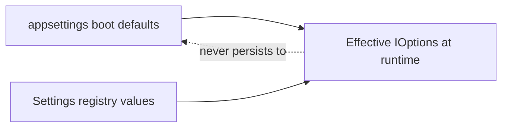

# Platform settings registry (conceptual)

## Status

**Phase 1 implemented (Epic 109).** Instance-scoped platform settings are now persisted in SQL (`PlatformSettingValues`), resolved with precedence `Database > Configuration > Definition default`, exposed through `api/config/platform-settings`, and editable in Management UI at `/config/platform-settings`.

**Epic 112 (foundation hardening):** Adds formal input metadata (`InputKind`, static `AllowedValues`), `StringArray` value type support, static multi-select validation, and MultiSelect UI rendering. No new production keys in Phase 1; nine platform-owned keys remain.

**Epic 113 (design spec):** Option providers and scoped settings architecture — see [platform-settings-option-providers-and-scopes.md](platform-settings-option-providers-and-scopes.md). Not implemented.

Phase 1 includes nine platform-owned keys for notification cutover, `PlatformEvents.Enabled`, and attention observation controls. Appsettings remains boot defaults only; runtime updates never write back to JSON files.

**Decision anchor:** [ADR-0039: Environment, startup, bootstrap, and platform settings](../02-decisions/ADR-0039-environment-startup-bootstrap-and-platform-settings.md).

## Purpose

After SQL connectivity and the control plane are available, Apperture operators should configure steady-state behavior **inside the product** — not by editing `appsettings` on disk.

The **platform settings registry** is the conceptual home for:

- Typed, scoped configuration values
- Validation and safe defaults
- Audit of changes
- API and UI management over time

The registry **must not** write values back to `appsettings` files or committed [deploy/config](../../deploy/config/) templates.

## Relationship to other layers

| Layer | Role relative to registry |
|-------|---------------------------|
| Environment / startup | Supplies **boot defaults** read at process start; registry overrides in memory after load |
| Secrets | Registry stores **references** only; resolution uses existing secret subsystems |
| Bootstrap | One-time / break-glass paths before registry is fully populated |
| Platform-managed settings | **Registry is the steady-state store** |

## Setting definitions

Metadata describing a configurable knob (not the live value).

**Conceptual fields:**

- **Key / path** — stable identifier (e.g. `Notifications.Delivery.Enabled`)
- **ValueType** — `Boolean`, `Integer`, `Duration`, `StringArray` (Phase 1 + Epic 112)
- **InputKind** — UI/editor hint distinct from value type: `Toggle`, `Number`, `Text`, `Duration`, `Select`, `MultiSelect`
- **AllowedValues** — static option list for Select/MultiSelect (`value`, `label`, optional `description`)
- **Description** — operator-facing help text
- **Default** — used when no scoped value exists (scalar or string array)
- **Scope applicability** — which scopes may hold a value
- **Validation rules** — ranges, `MinItems`/`MaxItems` for arrays, allowed-value checks, dangerous-pair guards
- **UI hints** — control kind, grouping, read-only when derived

Definitions may be **platform-owned** initially; modules and integrations may **contribute** definitions later (deferred).

## Setting scopes

Where a value applies. Illustrative hierarchy (not final schema):

| Scope | Example use |
|-------|-------------|
| **Instance** | Global notification delivery enabled |
| **Platform subsystem** | Platform events publisher enabled |
| **Module** | Module-specific operational toggle |
| **Integration** | Per-integration attention routing override |

Resolution picks the **most specific applicable** value for the current context, then falls back to broader scopes.

**Phase 1 scope (implemented):** Only **Instance** scope is active (`ScopeKind = Instance`, `ScopeId = instance`). Persistence rows already carry scope columns for future module/integration/user scopes; Epic 112 `StringArray` values use the same model. Broader scoped resolution behavior remains deferred.

## StringArray and static multi-select (Epic 112)

### Value type vs input kind

| ValueType | InputKind | Example |
|-----------|-----------|---------|
| `Boolean` | `Toggle` | Notification evaluation enabled |
| `Integer` | `Number` | Delivery poll interval seconds |
| `Duration` | `Duration` | Observation interval |
| `StringArray` | `MultiSelect` | Static allow-list (when a production key exists) |

`ValueType` describes storage and validation semantics. `InputKind` describes how the Management UI should render the editor.

### Array semantics

| Topic | Behavior |
|-------|----------|
| Missing DB row | No platform override; resolver falls back to configuration or definition default |
| Stored `[]` | Explicit empty selection (platform override) |
| Duplicates | Rejected at validation |
| Order | Preserved in storage, resolution, audit, and UI |
| AllowedValues | When present, every submitted value must match an allowed `value` (ordinal) |
| MinItems / MaxItems | Optional cardinality validation for `StringArray` |
| Secrets | Not supported in settings values |

### API write shape

- Scalar settings: `PUT` body `{ "value": "..." }`
- `StringArray` settings: `PUT` body `{ "values": ["a", "b"] }`
- Sending both `value` and `values`, or neither, returns `400`
- Reset (`DELETE`) removes the database override; precedence falls back unchanged
- Values never write back to `appsettings`

### Audit

Array values are audited as readable bracketed lists (e.g. `newValue=[alpha, beta]`). No secrets are stored or logged.

## Option providers and scoped settings (Epic 113)

Epic 112 implements **static** `AllowedValues` only. Dynamic option providers, scoped settings beyond Instance, module contributions, and cross-integration bindings are **not implemented** — they are specified in [platform-settings-option-providers-and-scopes.md](platform-settings-option-providers-and-scopes.md) (Epic 113 design). That document defines provider keys, backend validation rules, authorization, stale-value policies, and the phased implementation roadmap (recommended next: Epic 114 platform provider prototype).

## Setting values

Persisted records binding a definition to a scope and a value.

**Conceptual properties:**

- Definition reference
- Scope identity (type + id)
- Value payload (non-secret; or secret reference handle)
- Version / etag (optional optimistic concurrency)
- Last modified (timestamp, actor)

Storage technology (tables, JSON documents, hybrid) is **deferred**.

## Deterministic resolution and precedence

At runtime, effective configuration should resolve in a **documented, testable order**:

1. **Scoped registry value** (most specific match for current context)
2. **Instance-wide registry default** (if defined)
3. **`appsettings` / environment boot value** (startup input only)
4. **Code default** (fallback in options class)

**Important:**

- `appsettings` is **read-only input** at startup and for break-glass recovery — not a write target for operator or platform changes.
- Registry updates apply to **subsequent reads** (via `IOptions` monitor / post-configure pattern); they do not mutate JSON on disk.

**Precedent (partial today):** Active Entra registration overlaid onto `EntraAuthOptions` via database post-configure — same *direction*, not the full registry.

## Validation

Validation runs **at write time** when operators or APIs change registry values:

- Type and range checks
- Cross-setting rules (e.g. notification cutover dangerous combinations — see [epic77 cutover runbook](../03-operations/epic77-expected-run-missing-notification-cutover-runbook.md))
- Permission checks (governance actions)

Failed validation rejects the change; startup is not blocked for invalid *stored* values if break-glass env overrides exist (policy TBD at implementation).

## Audit

Every create/update/delete of registry values should emit audit records:

- Who (platform user / service identity)
- What (definition key, scope, old/new value or redacted summary)
- When

Secret references are audited by **handle**, not plaintext.

## Role of appsettings

| Use | Allowed |
|-----|---------|
| Safe boot defaults in committed JSON | Yes |
| Dev-only overlays (gitignored) | Yes |
| [deploy/config](../../deploy/config/) install templates | Yes |
| Steady-state operator edits | **No** — use registry API/UI at `/config/platform-settings` |
| Platform writing operator changes back to disk | **No** |

## Generated UI and custom panels (direction)

Over time, setting **definitions** should drive management UI:

- Schema-driven forms under `/config` (bools, enums, durations)
- Grouping by subsystem (notifications, auth, integrations)
- Custom panels for complex domains where generic controls are insufficient

Epic 105B does **not** specify component technology, routing, or permission model — only that UI should consume **definitions + resolved values**, not raw `appsettings` files.

## Operator UI (Epic 111)

The Management UI at `/config/platform-settings` (Phase 1 polish):

- **Source labels:** Platform override (database), configuration default, definition default — mapped from API `Source` values for operator clarity.
- **Precedence:** Platform override → configuration default → definition default. Reset removes the database override only; values never write back to appsettings.
- **Grouping:** Notifications, platform events, and attention observation categories.
- **Safety:** Short context on operationally sensitive flags (notification delivery, platform events, observation).
- **Audit:** Set/reset actions emit `platform.settings.set` / `platform.settings.reset` audit records (see audit timeline).

Generated schema-driven forms and module-contributed definitions remain deferred.

## Operator UI — MultiSelect (Epic 112)

When a setting definition uses `InputKind = MultiSelect` with static `AllowedValues`, the platform settings page renders a checkbox list. Source badges, dirty state, save/reset, validation errors, and read-only mode behave the same as scalar editors. If `MultiSelect` is declared without `AllowedValues`, the UI shows an explicit unsupported state rather than failing.

No production Phase 1 key uses MultiSelect yet; renderer coverage is validated through unit and component tests.

## Deferred implementation details

Not decided in Epic 105B:

- Database schema vs document store
- REST/gRPC API shape and versioning
- Migration from current `IOptions` + JSON notification flags
- Module contribution API for third-party setting definitions
- Cache invalidation and multi-host (Management.Host + WorkerHost) consistency
- How platform settings interact with Aspire-injected environment values (local dev only; see [management-platform-configuration.md](../03-operations/management-platform-configuration.md#local-orchestration-epic-106))

Track implementation against [ADR-0039 post-Aspire checklist](../02-decisions/ADR-0039-environment-startup-bootstrap-and-platform-settings.md#post-aspire-revisit-checklist). Phase 1 candidate settings and recommended slice: [epic107-post-aspire-assessment.md](../03-operations/epic107-post-aspire-assessment.md#4-future-platform-settings-registry).

## Related

- [ADR-0039](../02-decisions/ADR-0039-environment-startup-bootstrap-and-platform-settings.md)
- [management-platform-configuration.md](../03-operations/management-platform-configuration.md) — Environment/startup inventory (Epic 105A)
- [bootstrap-and-secrets-boundary.md](bootstrap-and-secrets-boundary.md)
