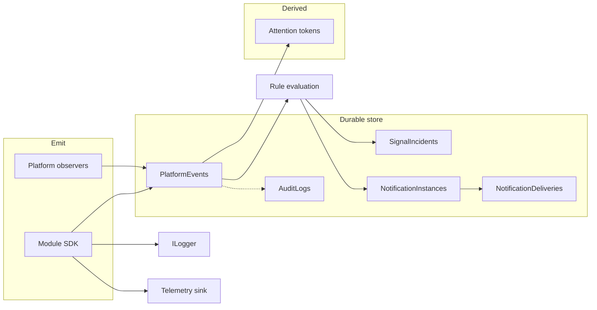

# ADR-0037: Platform signals, events, and notification system

## Status

Accepted (notification foundation delivered in Epic 77). **NTF-C (2026-09-10) completed legacy Attention email removal** — production delivery is the platform pipeline only (activation, reminder, escalation, resolved). Module SDK authoring conventions: [ADR-0038](./ADR-0038-platform-signals-sdk-conventions.md). The Context table below is the pre-cutover landscape.

## Context

Apperture today mixes several overlapping concepts under informal “attention” and “notification” language:

| Concept today | Primary artifacts | Limitation |
|---------------|-------------------|------------|
| Fleet attention tokens | `IntegrationFleetAttention`, readiness projection | Ephemeral; not a durable event log |
| Persisted incidents | `AttentionIncidents`, `IAttentionIncidentTracker` | Single condition (`expected_run_missing`); not generalized |
| Email delivery | `AttentionIncidentNotificationOrchestrator`, `AttentionIncidentNotifications` | Hard-coded templates; email-only; tied to incidents |
| Control attention | `ControlAttentionQueryService` | UI-only; no delivery pipeline |
| Audit | `IAuditService`, `AuditLogs` | Governance/compliance; not operator notification |
| Run timeline | `RunTimelineQueryService` | Read model over execution tables; not a signal bus |
| Module outcomes | `OperatorRunOutput`, `OperatorExecutionResult`, `ILogger` | No first-class platform emission contract |
| Telemetry table | `TelemetryEvents` | Schema exists; no application writers |

Epics 68–76 established durable **incidents**, **routing** (operational teams, managed contacts), and **delivery evidence** for one schedule condition. That stack is a useful prototype but cannot scale to module-authored signals, user-defined rules, multi-channel delivery, or user preferences without a deliberate platform layer.

ADR-0010 (federated child→parent notifications) remains valid for **cross-instance** delivery; this ADR defines the **within-instance** signal and notification platform that ADR-0010 can consume later.

Non-negotiables (see `AGENTS.md`): workflow-centric orchestration, single-tenant instance, portable workflow model. Platform signals must describe **facts about execution and integration health**, not replace workflow state or introduce a message-bus orchestration style.

## Decision

Introduce a **platform signal system** with three module-facing surfaces (events, logs, telemetry), a **durable platform event envelope**, and a **redesigned notification system** built on notification definitions, staged rule evaluation, subscriptions, and async delivery—with **first-class content templates** and rendered snapshots.

### 1. Taxonomy and separation of concerns

| Layer | Purpose | Durable? | Typical consumer |
|-------|---------|----------|------------------|
| **Log** | Developer diagnostics, high volume, unstructured or semi-structured | No (sink: logger) | Operators with run access; optional elevation to event |
| **Telemetry** | Metrics, timings, health probes, sampled diagnostics | Optional rollup store | Dashboards, SRE; not notification-default |
| **Platform event** | Instance-scoped fact: “something happened” with typed payload | Yes (`PlatformEvents`) | Rules, audit correlation, UI timelines, federation outbox |
| **Attention (computed)** | Derived triage flags for lists/filters (e.g. fleet tokens) | No | Fleet, dashboards, query filters |
| **Incident** | Durable lifecycle for a **condition** that may require human ownership | Yes (`SignalIncidents` or evolved `AttentionIncidents`) | Acknowledgement, SLA, escalation policy |
| **Notification** | Delivery intent + rendered content + channel attempts | Yes (`NotificationInstances`, `NotificationDeliveries`) | Email (v1), future channels |
| **Audit** | Security/governance evidence of privileged actions | Yes (`AuditLogs`) | Compliance, governance UI |

**Rules:**

- Platform **events** are the canonical input to notification rule evaluation.
- **Incidents** are optional state machines keyed by `(scope, conditionKey)`; an event may open, update, or resolve an incident; notifications may be incident-driven or event-driven per definition.
- **Audit** records privileged **actions** (who did what to which resource). Platform events record **facts** (what happened). Do not write operator notifications to `IAuditService` unless the action itself is governance-relevant.
- **Logs** stay on `ILogger` unless a module explicitly emits a **log-derived platform event** (with redaction and size limits).



### 2. Module-facing signal SDK

Add `Apperture.ModuleSdk.Signals` (name TBD) exposing:

| API | Responsibility |
|-----|----------------|
| `IPlatformEventEmitter` | Append a validated `PlatformEventEnvelope` (async, non-blocking preferred) |
| `IModuleOperationalLogger` | Structured operational log lines scoped to run/integration/module (wraps `ILogger`) |
| `IModuleTelemetry` | Counters/histograms/timed operations (no-op in tests; OpenTelemetry adapter later) |

**Execution context:** Step and operation handlers receive emitters via `IStepExecutionContext` extensions (or a scoped `ISignalScope` resolved from DI). Emission includes correlation from the active run: `runId`, `integrationId`, `moduleId`, `scheduleId`, `correlationId`.

**Constraints:**

- Modules MUST NOT call SMTP, notification orchestrators, or `IAuditService` for operational outcomes.
- Modules MAY emit **declared signal types** registered with the module manifest (built-in definitions).
- Unknown signal types are rejected at emit time in production; allowed in dev with warning.

### 3. Platform event envelope (CloudEvents-inspired, native)

Persist events using an Apperture-native envelope aligned with [CloudEvents v1.0](https://github.com/cloudevents/spec/blob/v1.0/spec.md) concepts but not requiring CloudEvents wire format.

**Required attributes:**

| Field | Description |
|-------|-------------|
| `id` | Unique event id (e.g. `pevt_{guid}`) |
| `type` | Reverse-DNS type: `apperture.{domain}.{name}` e.g. `apperture.schedule.expected_run.missing` |
| `source` | URI-like producer: `/modules/{moduleId}`, `/platform/scheduler`, `/platform/readiness` |
| `time` | `DateTimeOffset` UTC |
| `datacontenttype` | `application/json` |
| `data` | JSON payload (schema per `type`) |
| `specversion` | `1.0` |

**Apperture extensions** (first-class columns + JSON mirror for indexing):

| Extension | Use |
|-----------|-----|
| `apperture.instanceId` | Always single-tenant instance |
| `apperture.severity` | `critical`, `error`, `warning`, `info` |
| `apperture.integrationId` | Nullable |
| `apperture.moduleId` | Nullable |
| `apperture.runId` | Nullable |
| `apperture.scheduleId` | Nullable |
| `apperture.correlationId` | Workflow/operation correlation |
| `apperture.subject` | Human-stable subject key for idempotency grouping |
| `apperture.dedupekey` | Optional explicit dedupe for emitters |

**Storage:** New `PlatformEvents` table (preferred over repurposing unused `TelemetryEvents` without migration story). Indexes on `(type, time)`, `(integrationId, time)`, `(runId, time)`, `(severity, time)`.

**Idempotency:** Emitters may supply `dedupekey`; store unique index `(source, type, dedupekey)` where dedupekey is not null.

### 4. Notification definition model

A **notification definition** describes when to notify, who may receive, and **how to render** content.

**Kinds:**

| Kind | `owner` | Rule mutability | Subscription mutability |
|------|---------|-----------------|-------------------------|
| **Built-in (module)** | `module:{moduleId}` | Static rule JSON shipped with module; versioned | Instance admins enable/disable channels and add recipients |
| **Platform built-in** | `platform` | Static | Same |
| **User-created** | `integration:{integrationId}` | Editable by integration admins | Editable |

**Persistence (conceptual):**

- `NotificationDefinitions` — id, name, owner scope, enabled, rule JSON, template JSON, content fields schema, version, created/updated
- `NotificationDefinitionBindings` — links built-in definition to module registration version

**Rule JSON** (structured document, versioned schema `apperture.notification.rule/v1`):

```json
{
  "schemaVersion": "apperture.notification.rule/v1",
  "trigger": {
    "eventTypes": ["apperture.schedule.expected_run.missing"],
    "incidentTransitions": ["opened", "reminder", "resolved"]
  },
  "stages": [
    { "stage": "index", "filters": { "severity": ["error", "critical"], "integrationId": { "present": true } } },
    { "stage": "property", "match": { "data.status": "MissingExpectedRun" } },
    { "stage": "expression", "when": "event.data.evaluation.missingMinutes >= 30" }
  ],
  "throttle": { "perSubjectMinInterval": "1h" },
  "requiresIncident": false
}
```

**Stage evaluation order (mandatory):**

1. **Index** — cheap predicates mapped to SQL/EF columns (`event.type`, `severity`, `integrationId`, `moduleId`, `runId`, `scheduleId`, time window). No JSON parsing of `data`.
2. **Property** — JSON path match on `data` with allowlisted paths per event type (from signal catalog).
3. **Expression** — limited DSL (no arbitrary code); optional; disabled for user definitions in v1 if needed.

Definitions failing validation at save time are rejected.

### 5. Subscriptions and recipients

**Subscription** — binds a definition to recipients within a scope:

- `NotificationSubscriptions` — definitionId, scope (`instance` | `integration`), enabled, channel overrides
- **Recipient groups** reuse and extend **operational teams** (`OperationalTeams` / members: principal, external email, managed contact).

**Managed contact recipient syntax** (parse at rest and send time):

- `user@example.com`
- `Full Name <user@example.com>` (RFC 5322 display name form)

Store normalized: `displayName` + `emailAddress`; render using the same format. Reject ambiguous or unsafe display names (newlines, angle brackets in name).

**User opt-out overrides:**

- `NotificationUserPreferences` — `userId`, `definitionId` or `definitionPattern`, `channel`, `optOut: true`
- Evaluation: resolve recipients → subtract opt-outs → apply mandatory/system-critical flag on definition (cannot opt out when `priority: mandatory`)

Built-in module definitions: **static rule**, **mutable subscription** (who receives). User-created definitions: scoped to `integrationId`; cannot target other integrations.

### 6. Notification content templates (first-class)

Templates live on the definition as `template` JSON (`apperture.notification.template/v1`):

| Field | Purpose |
|-------|---------|
| `subjectTemplate` | Email subject / push title |
| `summaryTemplate` | Short line for UI and digest |
| `bodyTextTemplate` | Plain text body |
| `bodyHtmlTemplate` | Optional HTML body |
| `actionText` | CTA label (e.g. “View integration”) |
| `actionUrlTemplate` | Deep link into Management UI |
| `contentFields` | Structured key/value rows for email tables and UI |

**NotificationRenderContext** — normalized, safe view model built per evaluation:

- `event` — allowlisted scalars from envelope + `data` (no raw internal entities)
- `integration` — id, display name, state
- `module` — id, display name
- `run` — id, status, definition id, kind
- `schedule` — id, name
- `incident` — id, conditionKey, startedAt, acknowledgedAt
- `actor` — id, display name (if event references an actor)
- `notification` — instance id, kind (activation/reminder/digest)
- `instance` — instance id, base URL for links

**Variable allowlist:** Each `event.type` maps to a **template variable schema** in the signal catalog. Template parser extracts `{{event.integrationId}}`-style references; validation rejects unknown variables or unsafe paths.

**Content field definitions:** Named fields with label + value template + optional `sensitive` flag (forces redaction in UI).

**Redaction and limits (log-derived events):**

- Max payload size stored on event (e.g. 16 KB truncated with hash)
- Log-derived types: message excerpt max 500 chars; no stack traces in email by default
- `bodyHtmlTemplate` disabled for `source` containing `/logs/` unless admin enables

**Snapshots:** On notification instance creation, persist `RenderedNotificationSnapshot` (subject, summary, bodyText, bodyHtml, actionText, actionUrl, contentFields JSON, context JSON). `NotificationDeliveries` reference snapshot id; historical records stay truthful if integration name or team membership changes.

### 7. Module-authored built-in definitions

Modules declare in manifest (or code registration):

```json
{
  "notificationDefinitions": [
    {
      "id": "proof.studentReview.sync.failed",
      "displayName": "Student sync failed",
      "rule": { "... static ..." },
      "template": { "... default content ..." },
      "defaultSubscriptions": { "enabled": false }
    }
  ]
}
```

Platform registers definitions on module install/upgrade; subscriptions copy defaults. Upgrading module may bump `definitionVersion`; instances keep subscription choices.

### 8. Async durable delivery pipeline

**Flow:**

1. Rule match → create `NotificationInstance` (pending) with rendered snapshot
2. Enqueue `NotificationDeliveryWork` (outbox row or queue table)
3. Background `NotificationDeliveryHostedService` claims work, resolves recipients (teams → emails), applies opt-outs
4. Channel sender (`IEmailNotificationChannel` v1) attempts delivery
5. Append `NotificationDelivery` row (status, provider id, error, channel)

**Email v1:** Generalize `SmtpAttentionNotificationSender` into channel adapter; reuse SMTP options under `Notifications:Email`.

**Idempotency:** `(definitionId, dedupeKey, recipient, channel)` unique for successful sends; retries with backoff for transient failures.

**Relationship to incidents:** Incident-driven notifications (e.g. `expected_run_missing`) emit platform events on transitions; definitions may match events or incident transitions. Legacy `AttentionIncidentNotifications` migrates to `NotificationDeliveries` with mapping.

### 9. UI surfaces

**Config (admin):**

| Page | Purpose |
|------|---------|
| `/config/notifications/definitions` | List/edit user definitions; view built-in (read-only rule) |
| `/config/notifications/subscriptions` | Instance-level subscription defaults |
| `/config/notifications/deliveries` | Delivery history search |
| `/config/contacts/*` | Existing managed contacts (Epic 76) |

**Integration detail:**

| Tab | Purpose |
|-----|---------|
| Notifications | Subscriptions for this integration, user definitions, recent deliveries, test render |

**Operations:** Platform event explorer (future phase) linked from deliveries and run/integration detail.

### 10. Future: user preferences and digest/journal

Design for but do not require in v1:

- `NotificationUserPreferences` — per-channel quiet hours, severity minimum, digest enable
- **Digest** — aggregate `summaryTemplate` rows into daily/weekly email (`notification.kind: digest`)
- **Journal** — in-app unread feed backed by `NotificationInstances` with `channel: in_app`

Schema reserves `channel` enum and `notificationInstance.kind` values: `immediate`, `digest`, `journal`.

### 11. Migration from Epic 68–69 attention notifications

| Legacy | Target |
|--------|--------|
| `AttentionIncidents` | `SignalIncidents` or keep table with platform event linkage |
| `AttentionIncidentNotifications` | `NotificationDeliveries` + snapshots |
| `AttentionIncidentNotificationOrchestrator` | Platform event emit on transition + definition `apperture.schedule.expected_run.missing` |
| `AttentionNotificationOptions` | Email channel config + built-in platform definition |
| Fleet `expected_run_missing` token | Remains computed; may also emit info-level event on edge |

Phased cutover: dual-write deliveries → switch orchestrator off → deprecate ledger interface.

### 12. Relationship to ADR-0010 (federated notifications)

Within-instance platform events and delivery evidence become the **source of truth** for child-instance health signals. Federation adapters subscribe to `PlatformEvents` (filtered) and project to signed outbound envelopes per ADR-0010. Do not duplicate rule engines across instances.

## Consequences

### Positive

- Clear mental model for modules, operators, and compliance.
- Extensible rule and template system without hard-coded orchestrator strings.
- Historical delivery truth via snapshots.
- Reuses operational teams and managed contacts (Epic 72, 76).
- Staged rule evaluation keeps evaluation cost predictable at scale.

### Negative

- New tables, hosted services, and UI increase operational surface.
- Migration from Epic 69 requires careful dual-write and operator communication.
- Template DSL and expression stage require security review and testing.

### Neutral

- `TelemetryEvents` table remains unused until telemetry phase; may later hold rollups only.
- Serilog/OpenTelemetry adoption remains optional; SDK interfaces allow future wiring.

## References

- Epic 68–69, 71–72, 76 (attention, routing, contacts)
- ADR-0010 (federated notifications)
- ADR-0022, ADR-0023 (execution contracts and validation signals)
- Implementation plan: [Epic77-Platform-Signals-and-Notification-System-Implementation-Plan.md](./Epic77-Platform-Signals-and-Notification-System-Implementation-Plan.md)
- Module SDK conventions: [ADR-0038](./ADR-0038-platform-signals-sdk-conventions.md), [Epic103A plan](./Epic103A-Platform-Signals-SDK-Stabilization-Implementation-Plan.md)
