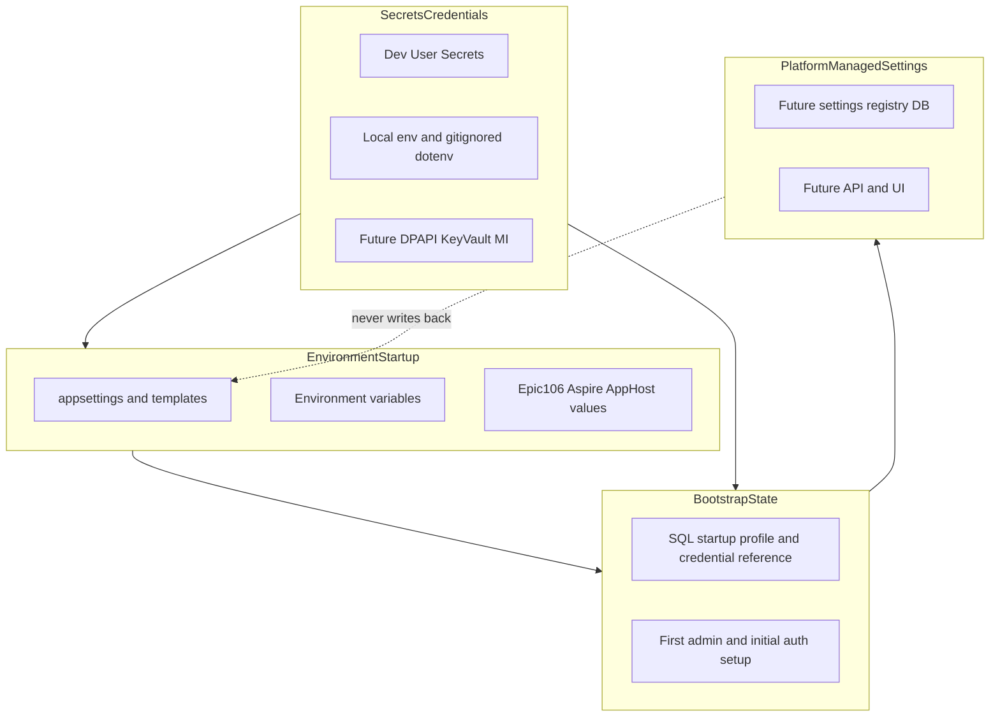

# ADR-0039: Environment, startup, bootstrap, and platform settings

## Status

Accepted (Epic 105B)

## Context

Epic 105A rationalized `appsettings` files, centralized [deploy/config](../../deploy/config/) templates, and documented the canonical startup inventory in [management-platform-configuration.md](../03-operations/management-platform-configuration.md).

Operators and contributors still need a **single decision record** that explains:

- Which configuration belongs at **host startup** vs in **secrets storage** vs in **bootstrap state** vs in **future platform-managed settings**.
- That `appsettings` is **not** the long-term operator control plane.
- What Epic 106 (Aspire integration) is expected to refine without replacing the layered model.

Epic 105B documents boundaries and decisions only. It does not implement setup automation, bootstrap persistence, platform settings storage, or UI.

## Decision

Apperture adopts a **four-layer configuration model**. Each layer has a distinct owner, lifecycle, and storage mechanism. Layers must not collapse into one another.

**Core rules:**

1. **`appsettings` and [deploy/config](../../deploy/config/) examples are startup/default/template configuration** — not the steady-state operator settings plane.
2. **Platform-managed settings must not write values back to `appsettings` files** (or any committed JSON startup template).
3. **Secret material must not live in committed JSON.**
4. **Bootstrap store, installer automation, credential binding implementations, first-run wizard, and platform settings registry implementation are deferred** until after Epic 106 Aspire integration, then revisited using the post-Aspire checklist below.

## Configuration layers

### 1. Environment / startup configuration

Gets hosts and processes running **before** steady-state platform configuration is available.

**Includes:**

- `appsettings.json` and `appsettings.{Environment}.json` (per host content root)
- [deploy/config](../../deploy/config/) templates and examples
- Environment variables and command-line arguments
- Development User Secrets (Management.Host) and gitignored `.env` where Docker Compose requires it
- Future: **Epic 106 Aspire** AppHost / deployment-provided values for local orchestration, service discovery, and dev-time wiring

**Typical contents:**

- Kestrel / binding URLs and listen configuration
- Logging bootstrap levels
- Non-secret SQL startup profile fields (server, database, user in dev)
- WASM `ApiBaseUrl` and UI topology (same-origin vs split-host)
- `ASPNETCORE_ENVIRONMENT` / environment name
- Safe boot defaults (e.g. notification flags off until operators enable via future platform settings)

**Operational guide:** [management-platform-configuration.md](../03-operations/management-platform-configuration.md) (Epic 105A inventory).

### 2. Secrets and credential material

Sensitive values required for startup and runtime. **Never committed** in repository JSON.

**Includes:**

- SQL passwords (dev: User Secrets; future prod: DPAPI, Key Vault, or managed identity)
- Entra client secrets and similar OIDC credentials
- SMTP and other transport credentials
- Gitignored `.env` entries (e.g. `MSSQL_SA_PASSWORD`) synced from User Secrets in dev

**Rules:**

- Platform-managed settings may **reference** secrets (handles, Key Vault URIs, `SecretRef`) but must **not** store secret plaintext in the settings registry or audit payloads.
- See [bootstrap-and-secrets-boundary.md](../01-architecture/bootstrap-and-secrets-boundary.md) for bootstrap vs operational secret separation.

**Dev mechanisms today:** User Secrets on Management.Host; [Sync-EnvFromUserSecrets.ps1](../../scripts/dev/Sync-EnvFromUserSecrets.ps1); worker env vars from dev scripts.

**Future production paths (post-Aspire):** DPAPI / certificate-backed local storage (Windows); Key Vault / Managed Identity (Azure).

### 3. Bootstrap configuration / state

Bridges **initial startup** and **first platform access** once SQL connectivity exists.

**Includes:**

- Bootstrap SQL profile and credential reference (non-secret profile + secret handle)
- First platform administrator creation (`POST /api/bootstrap/first-admin`)
- Initial auth mode setup (local vs Entra registration)
- Dev-only bootstrap helpers (`DevTestUser`, `BootstrapPlatformAdmin` in Development overlays)

**Storage today:** Mix of environment-layer JSON (dev), in-memory/API flows, and partial DB state (e.g. Entra instance registration). A dedicated **bootstrap configuration store** and **CLI/installer** are **not implemented**; see post-Aspire checklist.

**Related docs:** [bootstrap-and-secrets-boundary.md](../01-architecture/bootstrap-and-secrets-boundary.md), [bootstrap-cli-invocation.md](../01-architecture/bootstrap-cli-invocation.md), [next-stage-platform-auth.md](../01-architecture/next-stage-platform-auth.md).

### 4. Platform-managed settings (future steady state)

Configuration owned by Apperture **after** SQL and the control plane are available.

**Will include (over time):**

- Notification system feature flags and cutover stages
- Auth and instance policy beyond bootstrap
- Module- and integration-scoped operational settings
- Typed, scoped, validated, audited values exposed via API/UI

**Direction (conceptual only):** [platform-settings-registry.md](../01-architecture/platform-settings-registry.md).

**Precedent today:** Partial DB overlay of startup options (e.g. active Entra registration applied via `EntraAuthOptionsDatabasePostConfigure`) — not a full registry.

**Hard rule:** The platform **must not** persist operator changes by rewriting `appsettings` or [deploy/config](../../deploy/config/) template files on disk.

## What stays in appsettings

| Category | Examples | Notes |
|----------|----------|-------|
| Host wiring | URLs, logging defaults | Required by ASP.NET Core host startup |
| Boot defaults | Safe notification off defaults in committed `appsettings.json` | Overridden later by platform settings when implemented |
| Dev overlays | `appsettings.Development.json` (gitignored locally) | Install/dev/bootstrap only |
| Templates | [deploy/config/examples/](../../deploy/config/examples/) | Defaults for copy or future installer; not operator CRUD |
| UI topology | `ApiBaseUrl`, `ShellUi` in [deploy/config/ui/](../../deploy/config/ui/) | WASM and prerender need file-based config at browser boot |

## What belongs in secrets / credential storage

| Material | Never in committed JSON | Dev today | Future prod |
|----------|----------------------|-----------|-------------|
| SQL password | Yes | User Secrets, `.env` | DPAPI / Key Vault / MI |
| Entra client secret | Yes | User Secrets or env | Key Vault / app settings injection |
| SMTP password | Yes | Dev overlay or env | Secret store reference |

## What belongs in bootstrap state

| Item | Current surface | Future |
|------|-----------------|--------|
| SQL profile + credential ref | Env JSON + bootstrap abstractions | Bootstrap store (post-Aspire) |
| First admin | `POST /api/bootstrap/first-admin` | Wizard UI (post-Aspire) |
| Initial Entra registration | API + DB entities | Wizard + bootstrap store |
| Bootstrap audit | Planned via bootstrap subsystem | CLI/installer (post-Aspire) |

## What eventually belongs in platform-managed settings

| Domain | Today | Target |
|--------|-------|--------|
| Notification cutover flags | `appsettings` / env (`IOptions`) | Settings registry + `/config` UI |
| Entra tenant policy | DB + partial options overlay | Registry with validation |
| Integration/module knobs | Mixed | Scoped registry entries |
| Attention / SMTP policy | JSON options | Registry + secret references |

See [platform-settings-registry.md](../01-architecture/platform-settings-registry.md) for definitions, scopes, precedence, validation, audit, and UI direction.

## Explicit non-goals

**Epic 105B (this ADR):**

- No setup scripts, PowerShell modules, or installers
- No bootstrap store implementation
- No DPAPI / Key Vault credential binding implementation
- No first-run setup wizard
- No platform settings registry persistence or API
- No settings management UI
- No runtime behavior changes
- No Aspire AppHost (Epic 106)

**Until post-Aspire revisit:**

- No writing platform-managed settings back to `appsettings` files
- No treating [deploy/config](../../deploy/config/) examples as the long-term operator settings store

## Relationship to Epic 106 Aspire integration

Epic 106 is the **next expected refinement** of the **environment/startup layer** for local development and deployment orchestration:

- AppHost-driven service startup and dependencies
- Service discovery and dev-time endpoint wiring
- Potential reduction of manual copy steps for dev overlays

Aspire **does not replace**:

- The secrets layer (still external to committed JSON)
- Bootstrap state semantics (first admin, SQL bootstrap)
- Platform-managed settings (future DB/API/UI layer)

After Epic 106, re-evaluate how environment values flow into hosts (files vs Aspire-provided configuration) using the post-Aspire checklist. Update [management-platform-configuration.md](../03-operations/management-platform-configuration.md) when Aspire shapes are known.

## Post-Aspire revisit checklist

Revisit **after Epic 106** before implementing the following:

- [ ] Setup automation / `Initialize-AppertureEnvironment.ps1` (or equivalent installer)
- [ ] Bootstrap configuration store (`IBootstrapConfigurationStore` implementation)
- [ ] CLI / PowerShell bootstrap commands ([bootstrap-cli-invocation.md](../01-architecture/bootstrap-cli-invocation.md))
- [ ] DPAPI / Key Vault / Managed Identity credential binding
- [ ] First-run setup wizard (UI)
- [ ] Platform settings registry implementation ([platform-settings-registry.md](../01-architecture/platform-settings-registry.md))
- [ ] Settings management UI (generated panels / custom config surfaces)
- [ ] Migration plan from current `IOptions` + JSON flags to registry-backed settings

## Consequences

### Positive

- Clear mental model for contributors and operators: files vs secrets vs bootstrap vs platform settings
- Epic 105A inventory doc has a decision anchor (this ADR)
- Epic 106 scope is bounded (environment layer refinement, not full settings rewrite)
- Platform settings direction documented without premature implementation

### Negative

- Temporary dual paths: some operator knobs still live in JSON/env until registry is built
- Post-Aspire work list is intentionally deferred; onboarding may still require manual template copy in dev

### Neutral

- [deploy/config](../../deploy/config/) remains template/default material, not deprecated
- Existing dev scripts ([Start-Dev.ps1](../../scripts/Start-Dev.ps1)) remain dev orchestration, not the settings control plane

## Related

- [management-platform-configuration.md](../03-operations/management-platform-configuration.md) — Epic 105A startup file inventory
- [platform-settings-registry.md](../01-architecture/platform-settings-registry.md) — Future steady-state settings (conceptual)
- [bootstrap-and-secrets-boundary.md](../01-architecture/bootstrap-and-secrets-boundary.md)
- [bootstrap-cli-invocation.md](../01-architecture/bootstrap-cli-invocation.md)
- [epic77-expected-run-missing-notification-cutover-runbook.md](../03-operations/epic77-expected-run-missing-notification-cutover-runbook.md) — Example domain that will move toward platform settings
