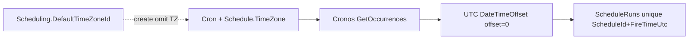

# Epic SWM-3 — Schedule Time Zone & Fire-Time Semantics Foundation

**Status:** Delivered  
**Track:** Scheduling & Worker Management  
**Depends on:** SWM-1 (plane identity), SWM-2 (dispatch EF/UTC fire correctness)  
**Delivered:** 2026-07-14

## Contract (v1)

1. Cron is interpreted in the schedule’s stored `TimeZone` string via `TimeZoneInfo.FindSystemTimeZoneById` (IANA preferred, e.g. `America/Los_Angeles`; Windows IDs accepted where the OS resolves them).
2. Due/fire instants are **UTC** `DateTimeOffset` with zero offset (`ScheduleTimeZoneResolver.ToNormalizedFireUtc`), matching SWM-2 claim/exists/complete normalization.
3. Idempotency = schedule id + UTC fire instant (unchanged).
4. **Due evaluation returns at most one unclaimed fire per schedule per cycle** (earliest after `LastAttemptedUtc`, or after a bounded first-run lookback). High-frequency crons such as `* * * * *` must not burst-dispatch every missed minute in one poll; catch-up drains across subsequent polls.
5. Operators see the cron timezone on create/list/detail; fire and schedule execution timestamps on SWM-3-touched pages are labeled **UTC** (not unlabeled server-local).
6. Create omit/blank timezone → `Scheduling.DefaultTimeZoneId` (platform setting, default `UTC`). Never server local time.
7. Create/update **rejects** invalid timezone IDs. Runtime evaluators/collectors fall back to UTC only for corrupt persisted rows, with a diagnosable warning log.
8. DST behavior is delegated to **Cronos** `GetOccurrences` (see notes below).

## Delivered changes

| Area | Change |
|------|--------|
| Platform setting | `Scheduling.DefaultTimeZoneId` (category Scheduling, default `UTC`, config path `Scheduling:DefaultTimeZoneId`) |
| Shared resolver | `ScheduleTimeZoneResolver` — TryFind / ResolvePersistedOrUtc (+ log) / ToNormalizedFireUtc |
| Create defaults | `IScheduleCreateTimeZoneDefaults` wired on `SchedulesController` and `IntegrationSchedulesController` |
| Evaluators | `CronScheduleEvaluator` + `ScheduleExpectedFireCollector` use resolver; corrupt IDs log then UTC |
| UI | Helper text on create/edit; blank TZ uses platform default; Schedule detail + run schedule-fire labels use UTC |
| Tests | `ScheduleTimezoneSwm3Tests` — named zone, defaults, validation, Cronos spring/fall |

## Schema

**No migration** — `ScheduleDefinitions.TimeZone` already exists.

## Cronos DST notes (documented behavior)

Under `America/Los_Angeles` with Cronos 0.13:

- **Spring-forward gap:** a cron minute that does not exist locally (e.g. `30 2 * * *` on 2025-03-09) is adjusted to the next valid local time (e.g. 03:00 → `10:00Z`), not omitted.
- **Fall-back overlap:** an ambiguous local time (e.g. `30 1 * * *` on 2025-11-02) yields **one** UTC occurrence (first pass), not two.

Apperture does not add a second DST policy layer beyond Cronos + stored schedule timezone.

## SWM-2 protection

Do **not** reintroduce `.UtcDateTime` inside EF predicates on `ScheduleRuns.FireTimeUtc`. Normalize outside the expression tree; compare `DateTimeOffset` equality.

## Explicitly out of scope (follow-ups)

- Calendar / date-periods
- Schedule designer
- Worker dashboard
- Historical fire-row migration

Operator display timezone foundation: **SWM-4** (delivered) — browser IANA → UTC labels. Persisted preferences: **SWM-5**.

## Manual validation

Validated 2026-07-14 against Aspire:

- WorkerHost running with plane `local` / host `worker-local` (AppHost env + `ClaimedByHostId=worker-local` on fires).
- Schedule `e3a76ff4dac24679b192305b` updated to `America/Los_Angeles` (`SWM3-Validate-HelloWorld-LA`, cron `* * * * *`).
- Automatic dispatch continued; `FireTimeUtc` persisted with zero offset; no duplicate `(ScheduleId, FireTimeUtc)` rows.
