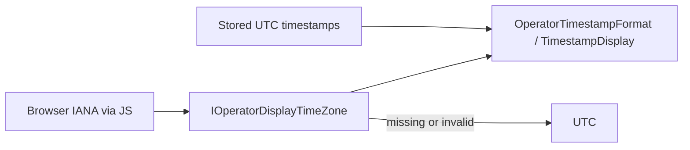

# Epic SWM-4 — Operator Display Time Zone Foundation

**Status:** Delivered  
**Track:** Scheduling & Worker Management  
**Depends on:** SWM-3 (schedule timezone & UTC fire semantics)  
**Delivered:** 2026-07-14

## Contract (v1)

1. **Stored truth** remains UTC `DateTimeOffset` (schedule fires, run timestamps).
2. **Schedule timezone** remains schedule-specific (cron interpretation only; SWM-3). Unchanged by this epic.
3. **Operator display timezone** resolves: **browser IANA → UTC** (superseded for preference path by [SWM-5](Epic-SWM5-Operator-Display-Timezone-Preferences.md): preference → browser → UTC when preference is set).
4. Labels are explicit zone ids (`America/Los_Angeles`, `UTC`), or `Your time (America/Los_Angeles)` when the source is the browser. Vague unlabeled “local” is forbidden on touched surfaces.
5. Browser resolution is async-safe: UI may render UTC first, then re-render when JS interop succeeds. JS failures never throw to the page.
6. Do **not** overload `Scheduling.DefaultTimeZoneId` (schedule create only).

## Delivered

| Area | Change |
|------|--------|
| Shared | `OperatorTimestampFormat` in Management.Ui.Shared |
| Client | `IOperatorDisplayTimeZone` / `OperatorDisplayTimeZoneService` (JS `appertureShell.getTimeZone`) |
| UI | `TimestampDisplay` molecule |
| Surfaces | Runs list/detail/summary, Schedule detail, Control Center, Integration recent activity |
| Tests | Formatter/resolver + touched-page no unlabeled `.ToLocalTime()` |

## Explicitly deferred — SWM-5 Operator Display Time Zone Preferences

**Delivered in [SWM-5](Epic-SWM5-Operator-Display-Timezone-Preferences.md):** persisted nullable `DisplayTimeZoneId`, additive Me read field, resolver preference → browser → UTC.

**Still deferred (profile overhaul):** Account/UI to set the preference, write API, capability flags, platform-level display fallback distinct from `Scheduling.DefaultTimeZoneId`.

## Out of scope

Calendar, date-periods, worker dashboard, schedule designer, schedule execution / Cronos / fire persistence changes.
