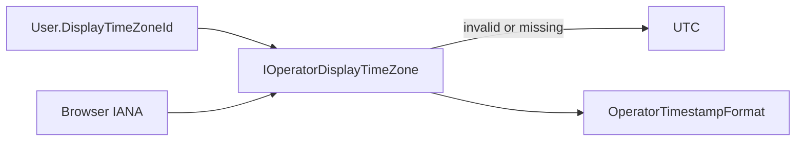

# Epic SWM-5 — Operator Display Time Zone Preference Shape

**Status:** Delivered  
**Track:** Scheduling & Worker Management  
**Depends on:** SWM-4 (operator display timezone foundation)  
**Delivered:** 2026-07-14

## Contract (v1) — shape only

1. **Persisted shape:** nullable `User.DisplayTimeZoneId` / `Users.DisplayTimeZoneId` (max 128). Null = no preference.
2. **Read path:** `GET /auth/me` includes additive `displayTimeZoneId` (API + Management.Client). Absent/null in JSON remains valid.
3. **Resolver order:** valid **user preference** → valid **browser IANA** → **UTC**. Invalid preference is ignored (treated as unset) with a one-shot warning log.
4. **Labels:** `Preferred (America/Los_Angeles)` when source is user preference; browser/UTC labels unchanged from SWM-4.
5. **No operator write path in this epic:** no Account UI control, no PUT/PATCH preference endpoint, no `canChangeDisplayTimeZone`, no platform `Operator.DisplayTimeZoneId`. Setting UX belongs to a later profile overhaul.
6. Do **not** overload `Scheduling.DefaultTimeZoneId` for display.

## Delivered

| Area | Change |
|------|--------|
| Domain | `User.DisplayTimeZoneId` optional |
| Persistence | `UserEntity` + migration `SWM5_UserDisplayTimeZoneId` + `SqlUserRepository` map |
| API / Client | Additive `MeResponse.displayTimeZoneId` (read-only) |
| UI resolve | Preference → browser → UTC; session refresh re-applies preference |
| Labels | `Preferred ({id})` for `UserPreference` |
| Tests | Me field, JSON round-trip, resolution preference precedence |

## Explicitly deferred — profile overhaul

**Resolved by AUP-1 (2026-08-18)** — see [AUP-1 closure](../audits/aup1-account-profile-personal-preferences.md) §9.
AUP-1 is the profile overhaul this epic deferred to, and it **reused `Users.DisplayTimeZoneId` rather
than introducing a second timezone model**.

| Deferred item | Outcome |
|---|---|
| Account / profile UI to set timezone | Delivered at `/account/preferences` via `TimeZoneSelector`: searchable, matches on identifier and description, treats underscores as spaces, and offers browser detection as a convenience |
| Authenticated write API for `DisplayTimeZoneId` | `PUT /api/account/preferences`, self-scoped from the authentication cookie. Identifiers are validated against `TimeZoneInfo.FindSystemTimeZoneById`; unrecognized values are rejected with `problem+json`, never coerced |
| Capability flags for who may change the preference | Not needed. This is self-service on the caller's own record, so `[Authorize]` plus resolver-derived scoping is sufficient; no new permission constant was added |
| Platform-level display fallback distinct from schedule default | Still deferred. The fallback chain remains user preference → browser IANA → UTC, and `Scheduling.DefaultTimeZoneId` is still not overloaded for display |

Two additions worth noting:

- **Identifiers are canonicalized to IANA.** `OperatorTimeZoneCatalog` converts Windows zone names via
  `TimeZoneInfo.TryConvertWindowsIdToIanaId`, because browsers report IANA and this platform's schedule
  model already prefers it. Offering the Windows form would store a value that disagrees with browser
  detection.
- **A clock-format preference was added alongside it** (`System`/`Hour24`/`Hour12`), threaded through
  `IOperatorDisplayTimeZone.ClockFormat` into `OperatorTimestampFormat`. The date portion stays ISO, and
  the UTC detail line stays 24-hour because it is execution truth.

UTC remains execution and storage truth; the preference affects display only.

## Out of scope

Schedule cron timezone, fire UTC persistence, SWM-2 EF compare shapes, unlabeled “local” display.
