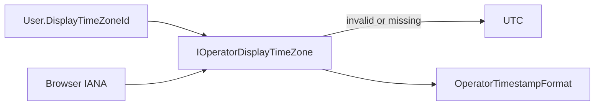

# Epic SWM-5 — Operator Display Time Zone Preference Shape

**Status:** Delivered  
**Track:** Scheduling & Worker Management  
**Depends on:** SWM-4 (operator display timezone foundation)  
**Delivered:** 2026-07-14

## Contract (v1) — shape only

1. **Persisted shape:** nullable `User.DisplayTimeZoneId` / `Users.DisplayTimeZoneId` (max 128). Null = no preference.
2. **Read path:** `GET /auth/me` includes additive `displayTimeZoneId` (API + Management.Client). Absent/null in JSON remains valid.
3. **Resolver order:** valid **user preference** → valid **browser IANA** → **UTC**. Invalid preference is ignored (treated as unset) with a one-shot warning log.
4. **Labels:** `Preferred (America/Los_Angeles)` when source is user preference; browser/UTC labels unchanged from SWM-4.
5. **No operator write path in this epic:** no Account UI control, no PUT/PATCH preference endpoint, no `canChangeDisplayTimeZone`, no platform `Operator.DisplayTimeZoneId`. Setting UX belongs to a later profile overhaul.
6. Do **not** overload `Scheduling.DefaultTimeZoneId` for display.

## Delivered

| Area | Change |
|------|--------|
| Domain | `User.DisplayTimeZoneId` optional |
| Persistence | `UserEntity` + migration `SWM5_UserDisplayTimeZoneId` + `SqlUserRepository` map |
| API / Client | Additive `MeResponse.displayTimeZoneId` (read-only) |
| UI resolve | Preference → browser → UTC; session refresh re-applies preference |
| Labels | `Preferred ({id})` for `UserPreference` |
| Tests | Me field, JSON round-trip, resolution preference precedence |

## Explicitly deferred — profile overhaul

- Account / profile UI to set timezone
- Authenticated write API for `DisplayTimeZoneId`
- Capability flags for who may change the preference
- Platform-level display fallback distinct from schedule default

## Out of scope

Schedule cron timezone, fire UTC persistence, SWM-2 EF compare shapes, unlabeled “local” display.
