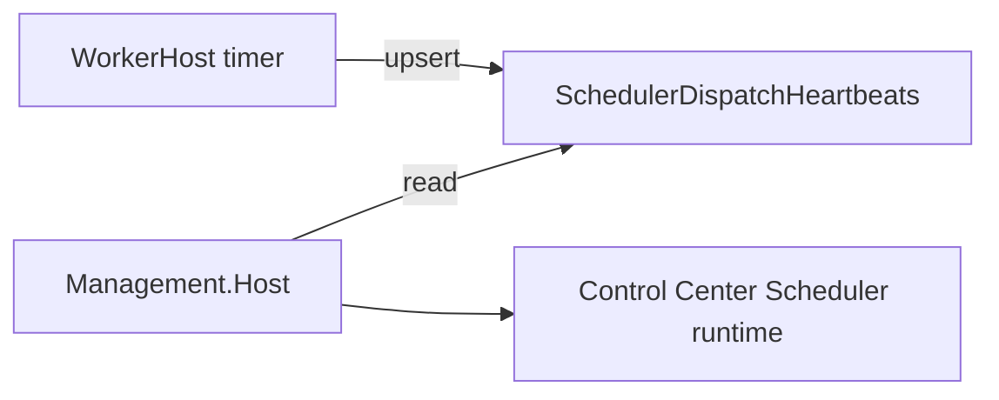

# Epic SWM-6 — Scheduler & Worker Runtime Visibility

**Status:** Delivered  
**Track:** Scheduling & Worker Management  
**Depends on:** SWM-1 (plane identity), SWM-2 (dispatch correctness)  
**Delivered:** 2026-07-14

## Contract (v1)

1. **Heartbeat** = last background `ScheduleDispatchBackgroundService` timer cycle for a runtime plane (one row per plane).
2. WorkerHost **upserts** the heartbeat after each cycle (success or failure). Writes are **best-effort**; dispatch continues if heartbeat write fails.
3. **Manual** Recovery `run-cycle` does **not** write this heartbeat (loop visibility ≠ on-demand dispatch).
4. Management reads via `GET /api/control/scheduler-status` (permission: `runtime.health.read`). No live WorkerHost RPC.
5. **Stale** when `now - UpdatedUtc > max(2 × pollIntervalSeconds, 60s)`.
6. **Classification:** Unknown (no row) / Healthy (fresh, no last error) / Warning (stale or last error).
7. **Alignment:** observed plane vs Management expected plane (`local`).
8. Control Center shows summary + technical details disclosure. No fleet UI.

## Delivered

| Area | Change |
|------|--------|
| Persistence | `SchedulerDispatchHeartbeats` + `ISchedulerDispatchHeartbeatStore` |
| WorkerHost | Heartbeat after each cycle; `RunCycleAsync` returns claim/dispatch/skip counts |
| API | `GET /api/control/scheduler-status` |
| UI | Control Center summary + advanced details; SWM-4 `TimestampDisplay` |
| Classifier | `SchedulerStatusClassifier` (healthy/warning/unknown, stale, alignment, guidance) |

## Where to look when schedules do not fire

1. Control Center → **Scheduler runtime** (status, plane, host, last cycle, guidance).
2. WorkerHost logs: Plane / HostId / Assignments / Due / Candidates.
3. Confirm `ScheduleDispatch:RuntimePlaneId` matches assignment plane (`local` under Aspire).
4. Per-schedule evidence still lives on Schedule diagnostics / runtime-health schedule rows.

## Known limitations

- Status is **DB-observed**; Unknown if WorkerHost never wrote (or cannot write).
- One heartbeat row per plane — last writer wins (multi-host fleet deferred).
- No process-alive / PID attach from Management.

## Deferred — SWM-7+ worker management

Fleet inventory, lifecycle controls, multi-host dashboards, scaling, live attach.
