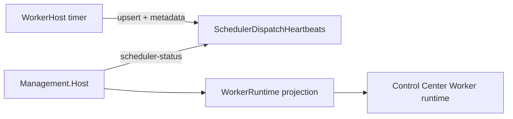

# Epic SWM-7 — Worker Runtime Inventory & Health Detail

**Status:** Delivered  
**Track:** Scheduling & Worker Management  
**Depends on:** SWM-6 (scheduler heartbeat visibility)  
**Delivered:** 2026-07-14

## Contract (v1)

1. **Reuse** `SchedulerDispatchHeartbeats` — no separate worker heartbeat table, no WorkerHost RPC.
2. **Single-host observed model:** Management observes the latest heartbeat row for the expected runtime plane (`local`). Not a fleet manager; multi-host inventory deferred.
3. **`WorkerRuntime` projection** on `GET /api/control/scheduler-status` (permission: `runtime.health.read`). Existing SWM-6 scheduler fields remain for compatibility.
4. **Optional heartbeat metadata** (nullable, best-effort): `ProcessStartedUtc`, `ApplicationVersion`, `EnvironmentName`. Missing metadata never fails dispatch or heartbeat write.
5. **Classification:** Healthy / Warning / Unknown. **Alignment:** Aligned / Mismatched / Unknown (same thresholds as SWM-6).
6. **UI:** Control Center primary summary + advanced details. Developer/Internal: link to Control Center only.
7. **Do not expose:** machine name, PID, user name, connection strings, ports, secrets, tokens, full process inventory.

## Host id vs runtime plane

| Concept | Meaning |
|---------|---------|
| Runtime plane | Which assignments the dispatcher evaluates (`ScheduleDispatch:RuntimePlaneId`, default `local`) |
| Host id | Which WorkerHost process claimed/wrote heartbeats (`APERTURE_RUNTIME_ID` / `SchedulerHostId`, e.g. `worker-local`) |

## Status meanings

| Status | Meaning |
|--------|---------|
| Unknown | No heartbeat row for expected plane — WorkerHost may be down, never started, or cannot write DB |
| Healthy | Fresh heartbeat, no last error |
| Warning | Stale heartbeat and/or last cycle error |

## Guidance (operator)

- No heartbeat → confirm WorkerHost running + shared DB; manual recovery run-cycle does **not** write this heartbeat
- Stale → timer may have stopped or lost DB connectivity
- Plane mismatch → assignments may not be evaluated
- Scheduler error → check WorkerHost logs (Plane/HostId)
- Heartbeat write failure → dispatch may still run; logs warn; UI stays Unknown/stale until write succeeds

## Deferred — SWM-8+

Multi-host fleet inventory, lifecycle controls (start/stop/restart), claiming controls, scaling, live attach.
