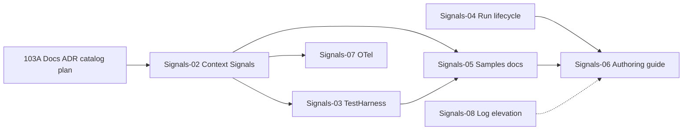

# Epic 103A — Platform Signals SDK stabilization (implementation plan)

**Status:** Planning (documentation only — no runtime code in this epic)  
**ADR:** [ADR-0038-platform-signals-sdk-conventions.md](./ADR-0038-platform-signals-sdk-conventions.md)  
**Builds on:** [ADR-0037](./ADR-0037-platform-signals-events-and-notification-system.md), [Epic 77](./Epic77-Platform-Signals-and-Notification-System-Implementation-Plan.md) (delivered)  
**Catalog:** [platform-signal-catalog.md](../01-architecture/platform-signal-catalog.md)

## Goal

Stabilize the **module developer signal SDK** so authoring docs, samples, and tests reflect a single contract: unified `IStepExecutionContext.Signals`, operational logging on context, harness assertions, platform lifecycle emitters, and gated module-authoring-guide updates.

## Epic 103A deliverables (this milestone)

| Deliverable | Status |
|-------------|--------|
| ADR-0038 accepted (SDK conventions) | Done in 103A |
| Catalog implementation-status column | Done in 103A |
| This implementation plan | Done in 103A |
| Runtime / SDK code changes | **Out of scope** |

## Non-goals (entire stabilization track)

- Log-source notification rules
- Telemetry aggregate notification rules
- OpenTelemetry production wiring (Signals-07)
- Log elevation to platform events (Signals-08) unless product requests
- `module-authoring-guide.md` rewrite before Signals-06 gates
- Handler factory / DI registration refactor in code (Signals-05 documents pattern only)

---

## Target SDK shape (implementation reference)

### Types (Signals-02)

| Type | Responsibility |
|------|----------------|
| `IStepExecutionSignals` | `Events`, `Logs`, `Telemetry`, `Correlation` |
| `IStepExecutionContext` | Adds `Signals`; keeps `PlatformEvents` → `Signals.Events` |
| `StepExecutionSignals` | Runtime implementation wiring scoped services |

### Authoring rules

- Handlers use **`context.Signals.*` only** — no `GetRequiredService<IModuleOperationalLogger>()` in step code.
- `EmitAsync` first parameter remains `IModulePlatformEmitContext`; pass `context.Signals.Correlation` (same instance as context).
- Manifest `Signals` required before emit; validator unchanged.

### Compatibility

- `[Obsolete("Use Signals.Events")]` on `IStepExecutionContext.PlatformEvents` after one release window.
- HelloWorld sample migrates to `Signals` in Signals-05.

---

## Operational logger v1 (Signals-02)

| Requirement | Detail |
|-------------|--------|
| Backing | `ILogger` with category `ModuleOperationalLogger` |
| Format | `module.op [{Code}] {Message} \| Data={@Data}` |
| Scopes | `BeginScope` with ModuleId, IntegrationId, RunId, ProcedureId, ScheduleId, CorrelationId, CausationId, StepName (when known) |
| API | Existing `IModuleOperationalLogger.LogOperational` |
| Failure mode | Swallow/log internal logger failures; never throw to step |
| Storage | None |
| Notifications | None |

---

## Telemetry v1 (Signals-02 + Signals-07)

| Phase | Behavior |
|-------|----------|
| Signals-02 | Wire `NoOpModuleTelemetry` on `Signals.Telemetry` |
| Signals-07 | Optional `OpenTelemetryModuleTelemetry` behind config flag |

No SQL `TelemetryEvents` writes. No notification rules.

---

## ModuleTestHarness v1 (Signals-03)

### API sketch

```csharp
public sealed class ModuleTestHarness
{
    public static ModuleTestHarness ForModule(IModule module, ModuleTestHarnessOptions? options = null);

    public FakePlatformEventStore PlatformEvents { get; }
    public InMemoryOperationalLogSink OperationalLogs { get; }
    public RecordingModuleTelemetry Telemetry { get; }

    public ValueTask<object?> ExecuteStepAsync(
        string stepName,
        IReadOnlyDictionary<string, object?>? parameters = null,
        TestExecutionScope? scope = null,
        CancellationToken cancellationToken = default);

    public void AssertManifestValid();
}
```

### Acceptance tests (package-level)

| Test | Assert |
|------|--------|
| Declared emit | Event in fake store with correct `type`, correlation, camelCase `data` |
| Undeclared emit | `PlatformEventValidationException` or equivalent |
| Operational log | Sink contains code, level, scoped ids |
| Telemetry | Recording sink received counter/duration |
| Disabled platform events | Skipped result; step still succeeds |

### Dependencies

- `Apperture.ModuleSdk.Testing` references abstractions only; no SQL.
- Reuse patterns from `ModulePlatformEventEmitterTests`.

---

## Implementation phases

### Signals-02 — Unified signal surface on `IStepExecutionContext` (Epic 103B — **shipped**)

**Scope:** Runtime + abstractions only.

| Task | Detail |
|------|--------|
| Add `IStepExecutionSignals` + `StepExecutionSignals` | Wire Events, Logs, Telemetry, Correlation |
| Extend `StepExecutionContext` | Construct signals bag; delegate `PlatformEvents` |
| Extend `DefaultWorkflowExecutor` | Pass operational logger + telemetry + `ILoggerFactory` into context |
| `CorrelatedModuleOperationalLogger` | Scope + structured data enrichment; best-effort |
| Unit tests | `StepExecutionSignalsSurfaceTests` |

**Authoring (preferred):** `context.Signals.Events`, `context.Signals.Logs`, `context.Signals.Telemetry`, `context.Signals.Correlation`.

**Compatibility:** `context.PlatformEvents` aliases `context.Signals.Events` (not obsolete yet).

**Operational logs:** Diagnostic only; not notification triggers in v1.

**Telemetry:** `NoOpModuleTelemetry` default; best-effort; no SQL table.

**Exit criteria:** Step handler can use `context.Signals.*` in worker host without resolving signal services from DI.

---

### Signals-03 — `ModuleTestHarness` v1 (Epic 103C — **shipped**)

**Scope:** `Apperture.ModuleSdk.Testing` + `ModuleTestHarnessTests`.

| Component | Detail |
|-----------|--------|
| `ModuleTestHarness.ForModule(...).With*().Build()` | Fluent builder |
| `HarnessStepExecutionContext` | `Signals`, `PlatformEvents` alias, slot resolver |
| `RecordingModulePlatformEventEmitter` | Manifest validation, `EmittedEvents`, `ShouldContain` / `GetEvent` |
| `InMemoryOperationalLogSink` | Correlation fields + `OperationalLogs` |
| `RecordingModuleTelemetry` | Counters + durations |
| `ExecuteStepAsync` / `CreateStepContext` | Handler invocation without SQL |
| `PlatformEventCatalog.ValidateEmitRequest` | Public validation API |

**Exit criteria:** HelloWorld `demo.completed` harness test passes; undeclared/disabled/required-property tests pass.

**Depends on:** Signals-02 (shipped).

---

### Signals-04 — Platform-owned run lifecycle events (Epic 103D — **shipped**)

**Scope:** `ExecutionLifecyclePlatformEventEmitter` wired from `WorkflowStartRequestProcessor` and `OperationStartRequestProcessor` after terminal state commit.

| Deliverable | Detail |
|-------------|--------|
| Types | `apperture.execution.run.completed`, `apperture.execution.run.failed` |
| Catalog | `PlatformEventCatalog` descriptors + authoring display names |
| Flag | `PlatformEvents:ExecutionLifecycle:Enabled` (default **false**); requires `PlatformEvents:Enabled` |
| Dedupe | `{runId}:terminal:{status}`; subject `run:{runId}` |
| Semantics | Best-effort post-terminal observer — emit failure does not mutate run |

**Cancelled runs:** not emitted in 103D (`apperture.execution.run.cancelled` remains future).

**Exit criteria:** Flag-on worker persists lifecycle events once per terminal transition; modules unchanged.

---

### Signals-05 — Sample / proof adoption and handler guidance

**Scope:** Docs + sample modules (minimal code).

| Task | Detail |
|------|--------|
| Migrate HelloWorld to `context.Signals` | Events + sample operational log line |
| Update `execution-contract-handler-patterns.md` | Signals section, anti-patterns |
| Document handler registration | Prefer DI factory **as future work**; keep `new Handler()` acceptable with context-only signals |
| Optional Proof module | One operational log in sync step |

**Exit criteria:** Sample demonstrates all three surfaces; patterns doc linked from ADR-0038.

**Depends on:** Signals-02, Signals-03.

---

### Signals-06 — Module authoring guide update

**Scope:** `docs/05-modules/module-authoring-guide.md`.

**Gates (all required):**

| Gate | Epic |
|------|------|
| `Signals` on context | Signals-02 |
| Harness documented | Signals-03 |
| Lifecycle types shipped or clearly flagged | Signals-04 |
| Sample uses preferred API | Signals-05 |

**Sections to add:**

- When to emit events vs logs vs telemetry
- Manifest `Signals` declaration
- `ModuleTestHarness` quickstart
- Notification = events only (v1)
- Anti-patterns (audit for ops, ILogger.Error for alerting)

**Exit criteria:** Guide marked production-ready for signals.

---

### Signals-07 — OpenTelemetry adapter (later)

**Scope:** Optional `IModuleTelemetry` implementation.

| Task | Detail |
|------|--------|
| `OpenTelemetryModuleTelemetry` | Meters from `MeterFactory` |
| Config | `Telemetry:Enabled` |
| Docs | Dev-only dashboard note |

**Non-goals:** SQL telemetry table; notification rules.

---

### Signals-08 — Log elevation (later, if needed)

**Scope:** Only if product requires log-driven notifications.

| Task | Detail |
|------|--------|
| `LogOperational(..., elevate: true)` | When level ≥ Warning |
| Emit `apperture.module.{id}.log.{code}` | Catalog future → shipped |
| Redaction tests | Excerpt, no HTML templates |

**Alternative:** Defer indefinitely; keep notifications event-only.

---

## Dependency graph



---

## Verification checklist (per epic)

| Epic | Verify |
|------|--------|
| 103A | ADR-0038 Accepted; catalog has Status column; no runtime diff required |
| Signals-02 | Unit tests; worker host smoke with one log line |
| Signals-03 | Harness tests in CI |
| Signals-04 | Integration test behind flag |
| Signals-05 | HelloWorld + patterns doc review |
| Signals-06 | Doc review against gates |

---

## Open decisions (user input)

| # | Question | Default if silent |
|---|----------|-------------------|
| 1 | Obsolete `PlatformEvents` immediately or N-release window? | Obsolete in Signals-02, remove in Signals-06 |
| 2 | Run lifecycle emit: fail-fast or fire-and-forget like schedule dual-emitter? | Fire-and-forget for platform observers |
| 3 | Signals-05: migrate Proof module or HelloWorld only? | HelloWorld required; Proof optional |
| 4 | `Signals.Correlation` as separate property vs using context as emit context? | Separate property referencing same instance (clarity) |
| 5 | TryEmit / best-effort emit API timing | Defer to Signals-08 or backlog |

---

## References

- [ADR-0038](./ADR-0038-platform-signals-sdk-conventions.md)
- [platform-signal-catalog.md](../01-architecture/platform-signal-catalog.md)
- [epic77-notification-system-backlog.md](../03-operations/epic77-notification-system-backlog.md)
