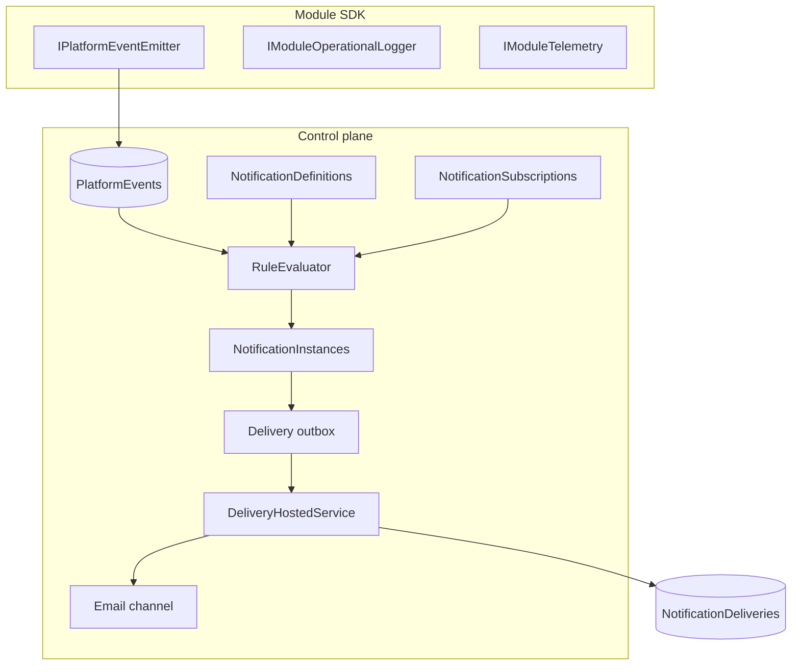

# Epic 77 — Platform signals and notification system (implementation plan)

**Status:** Proposed (documentation only; no implementation in this epic)  
**ADR:** [ADR-0037-platform-signals-events-and-notification-system.md](./ADR-0037-platform-signals-events-and-notification-system.md)  
**Replaces (eventually):** Epic 69 incident email orchestration; extends Epic 68 incidents, Epic 71–72 routing, Epic 76 managed contacts

## Goal

Deliver a unified **platform signal** layer (module SDK + durable events) and a **notification system** (definitions, staged rules, subscriptions, templates, async email delivery, admin UI) without breaking existing schedule attention behavior during migration.

## Non-goals (v1)

- Non-email channels (webhook, Teams, SMS)
- Full OpenTelemetry/Serilog pipeline wiring
- Federated child→parent delivery (ADR-0010 transport)
- In-app journal UI and digest scheduler (schema only)
- Arbitrary user-authored expression stage (property stage only for user definitions)
- Repurposing `TelemetryEvents` without explicit migration ADR

---

## Architecture summary



---

## Phase 0 — Design contracts and catalog (no runtime)

**Deliverables**

| Artifact | Location (proposed) |
|----------|---------------------|
| Signal type catalog | `docs/01-architecture/platform-signal-catalog.md` |
| Rule JSON schema | `docs/01-architecture/notification-rule-schema.md` |
| Template JSON schema | `docs/01-architecture/notification-template-schema.md` |
| Template variable allowlist spec | same doc, per `event.type` |
| Migration notes from Epic 69 | section in this plan (below) |

**Signal catalog entries (initial)**

| `type` | Source | Severity | Indexed fields |
|--------|--------|----------|----------------|
| `apperture.schedule.expected_run.missing` | `/platform/readiness` | warning/error | integrationId, scheduleId |
| `apperture.schedule.expected_run.cleared` | `/platform/readiness` | info | integrationId |
| `apperture.execution.run.failed` | `/platform/runtime` | error | runId, integrationId, moduleId |
| `apperture.execution.run.completed` | `/platform/runtime` | info | runId |
| `apperture.module.{normalizedModuleId}.{signalName}` | `/modules/{normalizedModuleId}` | per manifest | moduleId, runId, integrationId |

**Exit criteria:** Schemas reviewed; variable allowlists documented; no code.

---

## Phase 1 — Platform event envelope and persistence

**Scope:** Durable event store only; no notifications yet.

### 1.1 Domain and application

- `PlatformEventEnvelope` record (required + extension fields)
- `IPlatformEventStore.AppendAsync` / `QueryAsync` (filters: type, time, integrationId, runId, severity)
- `IPlatformEventEmitter` with validation (type catalog, payload size, required extensions)

### 1.2 Persistence

- Migration: `PlatformEvents` table
  - Columns: `Id`, `Type`, `Source`, `Time`, `DataContentType`, `Data` (nvarchar max capped), `SpecVersion`, extension columns, `DedupeKey`
  - Indexes: `(Type, Time DESC)`, `(IntegrationId, Time DESC)`, `(RunId, Time DESC)`, unique `(Source, Type, DedupeKey)` where not null
- `SqlPlatformEventStore`

### 1.3 Platform producers (read-only migration of observers)

- `AttentionIncidentObservationHostedService` → emit `apperture.schedule.expected_run.missing` / `.cleared` on incident open/resolve (alongside existing tracker until Phase 6)
- `WorkflowStartRequestProcessor` / `OperationStartRequestProcessor` → emit `execution.run.failed` / `.completed` (optional, feature-flagged)

### 1.4 Tests

- Unit: envelope validation, dedupe, payload truncation
- Integration: SQL append + query filters

**Exit criteria:** Events persisted and queryable via internal API; Epic 68 behavior unchanged.

---

## Phase 2 — Module signal SDK

**Scope:** `Apperture.ModuleSdk.Signals` package.

### 2.1 APIs

```csharp
// Illustrative — final names in implementation
public interface IPlatformEventEmitter
{
    ValueTask EmitAsync(PlatformEventEmitRequest request, CancellationToken ct = default);
}

public interface IModuleOperationalLogger
{
    void LogOperational(LogLevel level, string code, string message, IReadOnlyDictionary<string, object?>? data = null);
}

public interface IModuleTelemetry
{
    void RecordCounter(string name, double value = 1, IReadOnlyDictionary<string, string>? tags = null);
    IDisposable MeasureDuration(string name, IReadOnlyDictionary<string, string>? tags = null);
}
```

- Wire emitters into `IStepExecutionContext` from runtime DI
- `ModuleManifest.Signals`: validated at worker / Management startup via `ModuleSignalManifestValidator` (naming, severities, required payload property names); emit-time validation enforces declared required JSON properties (not an arbitrary JSON Schema document in v1)

### 2.2 Runtime registration

- `StartRequestWorker` / processors resolve scoped `IPlatformEventEmitter` per run
- Unknown module signal name at emit → validation failure (fail fast)
- Undeclared platform `type` → validation failure

### 2.3 Sample module

- `Sample.HelloWorld`: declares signal `demo.completed`; `HelloWorldCompleteStepHandler` emits when workflow step parameter `emitDemoPlatformEvent` is truthy (otherwise no emission). Persisted event type: `apperture.module.sample.helloworld.demo.completed` (`ModulePlatformEventTypes.Format`).

### 2.4 Tests

- Handler test with fake emitter
- Manifest validation tests

**Exit criteria:** Module can emit catalog-typed events from a step; logs unchanged.

---

## Phase 2B — Management catalog + query parity (substrate hardening)

**Goal:** Align Management Host with Worker validation surfaces so Phase 3 can validate notification rules/templates against real platform + module event types without persisting signal declarations separately.

### Implemented behaviors

- **Merged catalog on Management:** `AddApperturePlatformEvents` registers `IModuleSignalRegistry` + `CompositePlatformEventCatalog` from the same `IEnumerable<IModule>` used by `AddKnownModules`. Startup warmup resolves `IPlatformEventCatalog` so invalid manifests fail fast.
- **Read API filters:** `PlatformEventQuery` / `GET api/platform/events` support optional `runId` and `moduleId`. Indexes: `(RunId, OccurredAtUtc DESC)`, `(ModuleId, OccurredAtUtc DESC)` on `PlatformEvents` where columns non-null.
- **Workflow causation:** When present on `WorkflowStartRequestEntity`, `IdempotencyKey` is copied to platform-event `CausationId` via `WorkflowStepExecutionScope` (aligned with operation starts).

### Design note — emit failures vs workflow completion

ADR-0037 / this epic defer explicit “best-effort platform telemetry” wording for module emits. **Current behavior:** module emission uses the same durable `IPlatformEventEmitter` path as platform-owned events; **SQL append or validation failures propagate and fail the workflow step** (same as any other step exception). Changing to non-fatal emit requires an explicit ADR amendment.

**Exit criteria:** Management DI exposes a merged `IPlatformEventCatalog`; SQL/API support run/module filtering for authoring and debugging.

---

## Phase 3 — Notification definitions and template model

**Scope:** CRUD + validation; no delivery.

### 3.1 Persistence

| Table | Purpose |
|-------|---------|
| `NotificationDefinitions` | Rule + template JSON, owner, version, enabled |
| `NotificationDefinitionContentFields` | Optional normalized rows per field (or JSON blob v1) |

**Owner scopes:** `platform`, `module:{moduleId}`, `integration:{integrationId}`

### 3.2 Template system

- `NotificationRenderContext` builder from envelope + related entities (read-only queries)
- `INotificationTemplateRenderer` — Scriban or Mustache-like **limited** engine (no arbitrary .NET calls)
- `ITemplateValidator` — parse variables, cross-check allowlist for `event.type`
- `RenderedNotificationSnapshot` record

**Template fields (required support):**

| Field | Notes |
|-------|-------|
| `subjectTemplate` | Required |
| `summaryTemplate` | Required |
| `bodyTextTemplate` | Required |
| `bodyHtmlTemplate` | Optional; escaped |
| `actionText` | Optional |
| `actionUrlTemplate` | Must be relative or same-origin Management URL pattern |
| `contentFields[]` | `{ "key", "labelTemplate", "valueTemplate", "sensitive" }` |

**Redaction:** `IRedactionService` for log-derived types; clip strings to configured max lengths.

### 3.3 Built-in platform definition (parity target)

Migrate Epic 69 behavior into definition id `platform.schedule.expected_run_missing`:

- Triggers: incident transitions + event types
- Template: current activation/reminder/resolved subjects/bodies as templates
- Static rule; subscriptions mutable

### 3.4 API

- `NotificationDefinitionsController` — list/get/create/update (integration-scoped create); built-in read-only rule
- DTOs in `Apperture.Management.Client`

### 3.5 Tests

- Template validation rejects `{{event._internal.foo}}`
- Render golden tests for `expected_run_missing` context
- Snapshot immutability test

**Exit criteria:** Definitions saved and rendered in API test harness; no email sent.

---

## Phase 4 — Staged rule evaluation

**Scope:** Match events (and optional incident transitions) to definitions.

### 4.1 `INotificationRuleEvaluator`

| Stage | Implementation |
|-------|----------------|
| **Index** | SQL pre-filter on subscribed definitions using indexed columns + event extensions |
| **Property** | JSON path matcher on allowlisted paths only |
| **Expression** | Deferred; platform definitions only if needed for `missingMinutes` |

### 4.2 Throttling

- `INotificationThrottleStore` — per `(definitionId, subject, recipient?)` last sent time
- Respect `throttle.perSubjectMinInterval` from rule JSON

### 4.3 Incident integration

- `ISignalIncidentService` — evolve `IAttentionIncidentTracker` or adapter
- Map transitions to synthetic internal events for evaluator

### 4.4 Tests

- Index stage reduces candidate set (perf test with N definitions)
- Property stage false positives/negatives
- Throttle honors interval

**Exit criteria:** Given fixture events, evaluator returns matching definition ids.

---

## Phase 5 — Subscriptions, recipients, opt-outs

**Scope:** Who receives notifications.

### 5.1 Persistence

| Table | Purpose |
|-------|---------|
| `NotificationSubscriptions` | definitionId, scopeType, scopeId, enabled, recipientTeamIds, extraRecipients |
| `NotificationUserPreferences` | userId, definitionId/pattern, channel, optOut, quietHours (future) |

### 5.2 Recipient resolution

- Extend `SqlAttentionRecipientResolver` → `INotificationRecipientResolver`
  - Expand operational teams (principal, external email, managed contact)
  - Parse managed contact display forms: `email` or `Full Name <email>`
  - Normalize to `ResolvedRecipient { Email, DisplayName }`
- Apply user opt-outs after expansion
- `mandatory` flag on definition bypasses opt-out

### 5.3 Built-in module definitions

- On module install: register definitions from manifest
- Create disabled-by-default subscription with module-suggested team placeholder (empty)

### 5.4 User-created definitions

- Create only when `integration.manage` (or dedicated permission `notification.manage`)
- `owner = integration:{id}`; rule must include `integrationId` match in index stage

### 5.5 API

- `NotificationSubscriptionsController`
- Extend `ManagedContactsController` validation for recipient format

### 5.6 Tests

- Opt-out removes user; mandatory keeps
- Managed contact without email → `no_deliverable_email` on delivery row (not send)

**Exit criteria:** Resolver unit tests; subscription CRUD integration tests.

---

## Phase 6 — Async delivery pipeline (email)

**Scope:** Durable send path.

### 6.1 Persistence

| Table | Purpose |
|-------|---------|
| `NotificationInstances` | definitionId, eventId, incidentId?, snapshotId, status, createdAt |
| `NotificationDeliveryOutbox` | instanceId, recipient, channel, attempts, nextAttemptAt |
| `NotificationDeliveries` | final status, providerMessageId, error, sentAt |
| `RenderedNotificationSnapshots` | subject, summary, bodies, action, contentFields, contextJson |

### 6.2 Services

- `NotificationDispatchHostedService` — poll outbox, claim rows, send
- `IEmailNotificationChannel` — refactor from `SmtpAttentionNotificationSender`
- Idempotency key: `hash(definitionId + eventId + transition + recipient)`

### 6.3 Dual-write migration from Epic 69

1. Orchestrator writes legacy ledger **and** new pipeline
2. Compare delivery counts in tests
3. Feature flag `Notifications:UsePlatformPipeline`
4. Disable orchestrator; read legacy for history only

### 6.4 Tests

- Orchestrator parity tests (existing `AttentionIncidentNotificationOrchestratorTests` → platform)
- Outbox retry/backoff
- Snapshot frozen when integration renamed

**Exit criteria:** Email sends for `expected_run_missing` via new pipeline in dev; ledger parity.

---

## Phase 7 — Admin Config UI

**Routes (proposed)**

| Route | Component | Permissions |
|-------|-----------|-------------|
| `/config/notifications` | Landing | `notification.read` |
| `/config/notifications/definitions` | Definition list/editor | `notification.manage` |
| `/config/notifications/subscriptions` | Instance subscriptions | `notification.manage` |
| `/config/notifications/deliveries` | Delivery history | `notification.read` |
| `/config/contacts` | Existing managed contacts | existing |

**Definition editor UX**

- Built-in: show rule JSON read-only; edit subscriptions + enable
- User: rule builder (index + property stages); template editor with variable hint panel from catalog
- Test render button → API `POST .../definitions/{id}/preview` returns snapshot

**Menu:** Add under Config in `ControlPanelMenuDefinitions.cs`

**Exit criteria:** Operator can enable subscription and receive test email.

---

## Phase 8 — Integration Notifications tab

**Route:** `/integrations/{id}/notifications`

**Sections**

1. Subscriptions for this integration (built-in + user definitions)
2. User definition CRUD (scoped)
3. Recent deliveries (last 50)
4. Link to schedule diagnostics / active incidents

**Fleet list:** Keep attention tokens; add icon if active notification instance in last 24h (optional).

**Exit criteria:** Integration admin configures team without visiting global config.

---

## Phase 9 — User preferences and digest (foundation only)

**Scope:** Schema + read path; minimal UI stub.

- `NotificationUserPreferences` CRUD API
- `Preferences.razor` — add “Notifications” section placeholder
- Digest/journal: reserve `NotificationInstance.Kind`; no scheduler

**Exit criteria:** User can opt out of non-mandatory definition; documented in ADR.

---

## Phase 10 — Telemetry and log elevation (optional follow-up)

- `IModuleTelemetry` → OTel meter (adapter)
- Log elevation: `IModuleOperationalLogger` → optional `PlatformEvent` when `elevate: true` and level >= Warning
- Do **not** migrate `TelemetryEvents` without usage plan

---

## Permissions (new)

| Action | Resource | Notes |
|--------|----------|-------|
| `notification.read` | Instance | View definitions, deliveries |
| `notification.manage` | Instance / Integration | Edit subscriptions, user definitions |
| `notification.deliver` | Instance | Internal/service only |

Seed platform admin role via `PlatformAdminRolePermissionRepair`.

---

## File / project layout (proposed)

```
src/Apperture.Core/Apperture.Core.Application/Signals/
src/Apperture.Core/Apperture.Core.Application/Notifications/
src/Apperture.ModuleSdk/Apperture.ModuleSdk.Signals/
src/Apperture.Persistence/.../Entities/PlatformEventEntity.cs
src/Apperture.Persistence/.../SqlPlatformEventStore.cs
src/Apperture.ControlPlane/.../Notifications/
tests/Apperture.UnitTests/Signals/
tests/Apperture.UnitTests/Notifications/
```

---

## Migration checklist (Epic 68–76 → Epic 77)

| Step | Action |
|------|--------|
| 1 | Ship Phase 1 events; observer dual-emits |
| 2 | Register platform definition matching Epic 69 templates |
| 3 | Map `AttentionIncidentNotifications` → read model over `NotificationDeliveries` |
| 4 | Enable platform pipeline flag per instance |
| 5 | Remove `AttentionIncidentNotificationOrchestrator` |
| 6 | Deprecate `IAttentionIncidentNotificationLedger` (adapter to new store) |
| 7 | Rename UI strings from “attention notification” to “notification delivery” where global |

**Attention incidents** remain for acknowledgement and SLA; only delivery moves.

---

## Risk register

| Risk | Mitigation |
|------|------------|
| Rule eval too slow | Mandatory index stage; definition cap per integration |
| Template injection | Allowlist + no HTML in user templates v1 optional |
| Email spam on burst events | Throttle + incident-driven defaults |
| Dual-write drift | Automated parity tests in Phase 6 |
| Module manifest bloat | Limit definitions per module (e.g. 20) |

---

## Verification plan (when implemented)

| Area | Tests |
|------|-------|
| Events | SQL integration, dedupe |
| SDK | Module handler + manifest |
| Templates | Validator + render golden |
| Rules | Stage unit + perf |
| Delivery | Outbox, SMTP fake, snapshot |
| UI | bUnit smoke for definition editor |
| Migration | Epic 69 parity suite on platform pipeline |

---

## Suggested sequencing timeline

| Phase | Depends on | Relative effort |
|-------|------------|-----------------|
| 0 | — | S |
| 1 | 0 | M |
| 2 | 1 | M |
| 3 | 1 | L |
| 4 | 3 | M |
| 5 | 3 | M |
| 6 | 4, 5 | L |
| 7 | 6 | M |
| 8 | 5, 6 | S |
| 9 | 5 | S |
| 10 | 2 | M |

**Recommended MVP:** Phases 0–6 + 7 + 8 with email only and one platform built-in definition (`expected_run_missing`) plus module manifest registration (no user expressions).

---

## Open questions (resolve before Phase 3 implementation)

1. **Scriban vs Mustache** for templates — Scriban with strict member accessor vs Mustache no logic?
2. **Incident table rename** — keep `AttentionIncidents` or rename to `SignalIncidents`?
3. **Single hosted service** vs separate event indexer and delivery worker?
4. **User definition limit** per integration (default 10)?

---

## Related documentation to update when implementation starts

- `.ai/memory/decisions-index.md` — link ADR-0037
- `docs/01-architecture/` — new catalog + schema docs (Phase 0)
- Epic 69 doc — add superseded-by note after Phase 6
