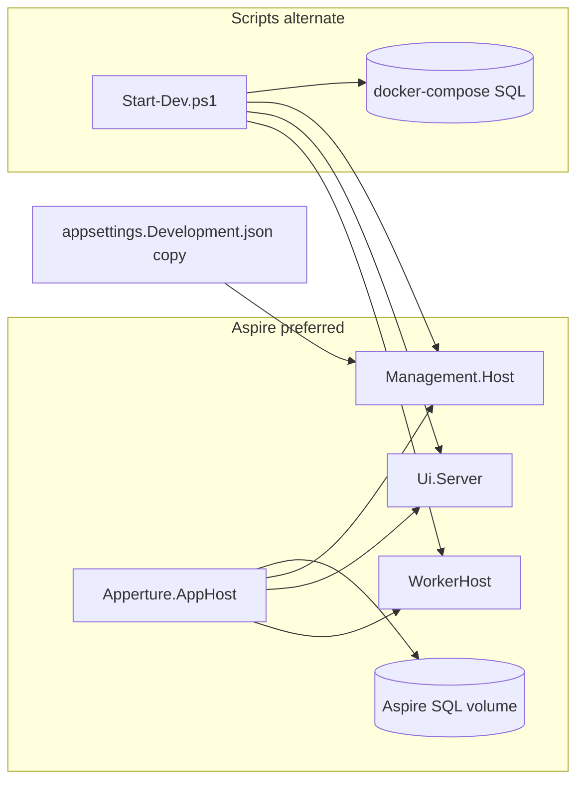

# Epic 107: Post-Aspire setup, bootstrap, and settings reassessment

> **Superseded for next-step recommendations** by [epic110-foundation-stabilization.md](epic110-foundation-stabilization.md) (Epics 108–109 are implemented). This document remains useful as historical context for what Aspire solved vs deferred.

**Status:** Assessment complete (documentation only — no runtime changes).

**Context:** Epic 105A cleaned up appsettings/templates; Epic 105B documented the four-layer configuration model ([ADR-0039](../02-decisions/ADR-0039-environment-startup-bootstrap-and-platform-settings.md)); Epic 106 delivered [`Apperture.AppHost`](../../src/Apperture.AppHost/) and [`Apperture.ServiceDefaults`](../../src/Apperture.ServiceDefaults/). This document records what Aspire solved, what remains, and recommended next steps.

**Related:** [management-platform-configuration.md](management-platform-configuration.md), [platform-settings-registry.md](../01-architecture/platform-settings-registry.md), [bootstrap-cli-invocation.md](../01-architecture/bootstrap-cli-invocation.md), [deploy/README.md](../../deploy/README.md).

---

## Executive summary

| Area | Aspire solved | Still open |
|------|---------------|------------|
| **Local dev orchestration** | SQL container, multi-process startup, connection injection, dashboard/OTEL | One-time appsettings template copy; dev auth/bootstrap flags |
| **Configuration layers** | Dev-time env injection for SQL | Templates, secrets, bootstrap store, platform registry |
| **Production bootstrap** | Nothing (by design) | File-backed bootstrap store, credential binding, CLI persistence |
| **Platform settings** | Nothing (by design) | Registry Phase 1 (notification cutover flags) |
| **Worker topology** | Clarified local dev = one WorkerHost | Production remains control-plane + SQL dispatch, not Aspire |

**Recommended next epic:** **Epic 108** — file-backed `IBootstrapConfigurationStore` (Windows) + thin dev setup automation. **Epic 109** (platform settings registry Phase 1) is the secondary, parallelizable follow-on.

---

## 1. Local development setup

### What Aspire handles

[`Apperture.AppHost`](../../src/Apperture.AppHost/AppHost.cs) orchestrates:

- SQL Server container (`2022-latest`, persistent volume `apperture-aspire-sql`)
- `ConnectionStrings:DefaultConnection` to Management.Host and WorkerHost
- Management API (:9000), Management UI (:9001), WorkerHost
- Startup ordering (`WaitFor` SQL → API → UI)
- Worker dev identity (`APERTURE_RUNTIME_ID=worker-local`)
- Aspire dashboard; health/OTEL/service discovery via [`Apperture.ServiceDefaults`](../../src/Apperture.ServiceDefaults/)

**Preferred entry:**

```powershell
dotnet run --project src/Apperture.AppHost/Apperture.AppHost.csproj
```

### What still requires manual setup (both paths)

| Step | Aspire path | Script path |
|------|-------------|-------------|
| Copy docker-dev template → `Management.Host/appsettings.Development.json` | Required (DevTestUser, bootstrap admin, notification flags) | Required |
| SQL password | Default in AppHost `Parameters:sql-password`; optional User Secrets override | User Secrets on Management.Host + `.env` sync for docker-compose |
| Worker SQL overlay | Optional if using Aspire connection injection | Optional [`worker/appsettings.Development.json.example`](../../deploy/config/worker/appsettings.Development.json.example) |

Aspire **reduced** dev orchestration friction but **did not eliminate** the appsettings Development overlay for auth and bootstrap helpers.

### What the script/docker-compose path still provides

- [`Start-Dev.ps1`](../../scripts/Start-Dev.ps1) / [`up.ps1`](../../scripts/dev/up.ps1): full stack startup via docker-compose SQL (`apperture-sqlserver` volume)
- **Selective restart:** `-Host`, `-Ui`, `-Workers`, `-Db` switches
- **Tooling not in AppHost:** [`down.ps1`](../../scripts/dev/down.ps1), [`reset-db.ps1`](../../scripts/dev/reset-db.ps1), [`logs.ps1`](../../scripts/dev/logs.ps1)
- Headless logging to `artifacts/devlogs/`

### Script path recommendation

| Action | Rationale |
|--------|-----------|
| **Preserve** | Alternate path, selective restart, DB reset, debugging workflows |
| **Reframe** | Document as "alternate / selective-restart path"; Aspire remains preferred for full-stack startup |
| **Do not deprecate** | Mutual exclusion on ports 1433/9000/9001 is documented; dual SQL volumes are acceptable |
| **Defer simplification** | Optional future: banner in scripts pointing to AppHost; no script deletion in near term |



---

## 2. Configuration boundaries

### Templates that remain necessary

- Committed baselines: [`Management.Host/appsettings.json`](../../src/Apperture.ControlPlane/Apperture.Management.Host/appsettings.json), [`WorkerHost/appsettings.json`](../../src/Apperture.RuntimeHost/Apperture.RuntimeHost.Windows/Apperture.RuntimeHost.Windows.WorkerHost/appsettings.json)
- [`deploy/config/examples/`](../../deploy/config/examples/) — docker-dev, Windows, Azure topology skeletons
- [`deploy/config/ui/appsettings.json`](../../deploy/config/ui/appsettings.json) — WASM boot / same-origin topology

### Still environment/startup (not platform registry)

- Host URLs, logging levels, `ASPNETCORE_ENVIRONMENT`
- Non-secret SQL profile fields (when not fully replaced by injected connection string)
- Safe production boot defaults (notifications off in committed JSON)
- Dev-only bootstrap helpers in gitignored `appsettings.Development.json`
- Aspire-injected `ConnectionStrings:DefaultConnection` (dev orchestration layer)

### Strong platform-settings registry candidates

| Setting domain | Rationale |
|----------------|-----------|
| `Notifications.*` cutover flags | Epic 77 runbook; dangerous combinations documented; high ops value |
| `PlatformEvents.Enabled` | Instance-wide toggle; clear scope |
| `AttentionIncidents.Observation.*` | Operational interval/enabled knobs |
| Entra policy (partial) | Precedent: `EntraAuthOptionsDatabasePostConfigure` already DB-overlays options |

### Explicitly remain out of registry

- Connection strings and SQL passwords
- `DevTestUser`, `BootstrapPlatformAdmin`, local auth bootstrap blocks
- Entra client secrets, SMTP passwords
- WASM `ApiBaseUrl` and prerender boot config
- Module/integration authoring config (defer module-contributed definitions)

### Documentation alignment

Existing Aspire docs ([management-platform-configuration.md](management-platform-configuration.md), [deploy/README.md](../../deploy/README.md), [CONTRIBUTING.md](../../CONTRIBUTING.md)) match the landed state. Minor gap closed in [bootstrap-cli-invocation.md](../01-architecture/bootstrap-cli-invocation.md): CLI/bootstrap commands target **production install**, not local dev orchestration (Aspire handles the latter).

**Precedence rule (unchanged):** registry value > environment/Aspire injection > appsettings boot default > code default. Registry must never write back to JSON files.

---

## 3. Bootstrap path

### Current state

- **Dev runtime:** [`BootstrapConnectionProfile`](../../src/Apperture.Bootstrap/Apperture.Bootstrap/BootstrapConnectionProfile.cs) resolves SQL via appsettings, env vars, User Secrets, or Aspire-injected `DefaultConnection`
- **Persistence:** [`IBootstrapConfigurationStore`](../../src/Apperture.Bootstrap/Apperture.Bootstrap/IBootstrapConfigurationStore.cs) → [`StubBootstrapConfigurationStore`](../../src/Apperture.Bootstrap/Apperture.Bootstrap/Stubs/StubBootstrapConfigurationStore.cs) (`SaveAsync` throws)
- **CLI surface:** [`BootstrapCliService`](../../src/Apperture.Cli/Apperture.Cli.Bootstrap/BootstrapCliService.cs) + documented PowerShell functions — orchestration exists, persistence does not

### Is a file-backed bootstrap configuration store still necessary?

**Yes, for Windows/on-prem production.**

- First-install and CLI flows need a **non-DB** store for `BootstrapConfigurationDocument` (SQL profile + credential reference — no secret plaintext)
- Aspire dev injection **bypasses** the bootstrap store entirely; it does not replace production bootstrap
- **DB-backed bootstrap store:** defer — chicken-and-egg before SQL exists and schema is created

Azure production may prefer deployment-injected config + Key Vault references, but Windows/on-prem still needs file or installer-managed bootstrap config for CLI parity.

### Unresolved by hosting mode

| Concern | Windows/on-prem | Azure |
|---------|-----------------|-------|
| Bootstrap config persistence | File store + installer path | Deployment injection; file store optional |
| Credential binding | DPAPI / integrated security | Key Vault / Managed Identity |
| First admin | API + dev overlays today | Wizard + API (deferred) |
| CLI/PowerShell bootstrap | Install, validate, rotate, repair | KV bind, validate subset |

### CLI/PowerShell bootstrap commands

**Still appropriate** for production lifecycle. **Not** a replacement for AppHost local orchestration.

### Remain deferred

- First-run setup wizard UI
- Full `IBootstrapCredentialResolver` (DPAPI, Key Vault, MI)
- Recovery MFA / `IBootstrapRecoveryAuthorizer` real implementation
- pwsh direct Cli.Bootstrap assembly loading (helper exe fallback today)

---

## 4. Future platform settings registry

### Best first candidates (Phase 1)

1. **Notification cutover flags** — `Notifications.Evaluation/Instances/Delivery/UsePlatformPipeline.Enabled` plus delivery poll/batch numerics (instance scope)
2. **`PlatformEvents.Enabled`** (instance scope)
3. **`AttentionIncidents.Observation.Enabled`** and interval

### Recommended first implementation slice (Epic 109)

| Layer | Scope |
|-------|-------|
| **Persistence** | SQL tables in existing Management DB (align with Entra registration precedent) |
| **Definitions** | Platform-owned, hardcoded metadata initially (no module contributions) |
| **API** | Instance-scoped CRUD + validation at write time |
| **Runtime** | `IPostConfigureOptions<T>` / `IOptionsMonitor` overlay (mirror `EntraAuthOptionsDatabasePostConfigure`) |
| **UI** | Single `/config` panel for notification cutover flags |

**Exclude from Phase 1:** secret plaintext, module-contributed definitions, WorkerHost live sync (Host reads first; document WorkerHost lag until post-configure pattern extends to worker).

### Registry vs Aspire

No conflict: Aspire injects dev startup wiring; registry is steady-state operator control plane after SQL and control plane are available.

---

## 5. Worker orchestration implications

### What Aspire clarified

- Local dev = **one** [`WorkerHost`](../../src/Apperture.RuntimeHost/Apperture.RuntimeHost.Windows/Apperture.RuntimeHost.Windows.WorkerHost/) + shared SQL + modules co-loaded with Management.Host
- [`SchedulerHost`](../../src/Apperture.RuntimeHost/Apperture.RuntimeHost.Windows/Apperture.RuntimeHost.Windows.SchedulerHost/), [`ModuleHost`](../../src/Apperture.RuntimeHost/Apperture.RuntimeHost.Windows/Apperture.RuntimeHost.Windows.ModuleHost/), [`InstanceAgent`](../../src/Apperture.RuntimeHost/Apperture.RuntimeHost.Windows/Apperture.RuntimeHost.Windows.InstanceAgent/) are **not** in local dev topology (SchedulerHost is a stub; schedule dispatch runs in WorkerHost)
- [`Management.Ui.Client`](../../src/Apperture.ControlPlane/Apperture.Management.Ui.Client/) is served by Ui.Server — not a separate AppHost process

### What must NOT follow from Aspire for production

- Aspire AppHost as production orchestrator
- Aspire service discovery as runtime enrollment or worker routing
- Modeling a one-module-per-process ModuleHost fleet in AppHost (local dev intentionally collapses to WorkerHost)

### Conflation risk

**Apperture production orchestration** = control plane + SQL dispatch + runtime trust/enrollment + one module per compute process.

**Aspire local orchestration** = developer convenience for co-located processes on a workstation.

Do not design production worker scaling, enrollment, or module lifecycle around AppHost `WithReference` / service-discovery patterns.

---

## ADR-0039 post-Aspire checklist disposition

Epic 107 assessment of [ADR-0039 checklist items](../02-decisions/ADR-0039-environment-startup-bootstrap-and-platform-settings.md#post-aspire-revisit-checklist):

| Checklist item | Disposition | Notes |
|----------------|-------------|-------|
| Setup automation / `Initialize-AppertureEnvironment.ps1` | **Recommend Epic 108** | Scope reduced post-Aspire: template copy + secrets init + print Aspire vs script steps; does not replace AppHost |
| Bootstrap configuration store (`IBootstrapConfigurationStore`) | **Recommend Epic 108** | File-backed store for Windows/on-prem; unblocks CLI |
| CLI / PowerShell bootstrap commands | **Recommend Epic 108** (wire to store) | Surface exists; persistence is the blocker |
| DPAPI / Key Vault / MI credential binding | **Defer Epic 108b or later** | After file store; Windows DPAPI before Azure KV for on-prem golden path |
| First-run setup wizard (UI) | **Defer** | After bootstrap store + credential binding |
| Platform settings registry implementation | **Recommend Epic 109** | Phase 1: notification cutover flags |
| Settings management UI | **Defer Epic 109** (minimal panel) / expand later | Single panel in Phase 1; generated panels later |
| Migration plan from `IOptions` + JSON to registry | **Defer Epic 109** (document in epic plan) | Start with notification flags; expand incrementally |

---

## Recommended next epics

### Epic 108 (primary): File-backed bootstrap store + thin dev setup automation

| Deliverable | Why first |
|-------------|-----------|
| `FileBootstrapConfigurationStore` implementing `IBootstrapConfigurationStore` | Unblocks on-prem install golden path; CLI persistence |
| Wire store in CLI; document Windows default path | Makes bootstrap-cli-invocation actionable |
| Thin `Initialize-AppertureEnvironment.ps1` (or equivalent) | Automates template copy + optional secrets; points to Aspire vs scripts |

Optional stretch (or Epic 108b): minimal DPAPI `IBootstrapCredentialResolver` for Windows.

### Epic 109 (secondary): Platform settings registry Phase 1

- Notification cutover flags + `PlatformEvents.Enabled`
- SQL persistence, API, Host-side `IPostConfigureOptions`, minimal `/config` UI
- Parallelizable with Epic 108 if different owners

### Explicitly defer

- First-run setup wizard UI
- Full Azure Key Vault / Managed Identity bootstrap binding
- Production deployment orchestration (K8s, Azure AppHost)
- Module-contributed setting definitions
- Deprecating PowerShell dev scripts
- Platform settings write-back to appsettings

---

## Epic 106–107 non-goals (unchanged)

Epic 107 did **not** implement:

- Platform-managed settings registry runtime
- Bootstrap store or credential binding
- Setup wizard or production installer
- AppHost/ServiceDefaults refactors
- Changes to business/runtime behavior
