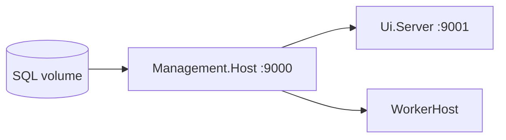

# Epic 110: Foundation stabilization and roadmap realignment

**Status:** Complete (documentation and alignment only — no new subsystems).

**Context:** Epics 105A through 109 delivered appsettings rationalization, configuration-layer documentation, Aspire local orchestration, post-Aspire assessment, file-backed bootstrap store, and platform settings registry Phase 1. Epic 110 consolidates smoke-test expectations, fixes stale cross-references, and recommends the next implementation epic.

**Related:** [management-platform-configuration.md](management-platform-configuration.md), [ADR-0039](../02-decisions/ADR-0039-environment-startup-bootstrap-and-platform-settings.md), [platform-settings-registry.md](../01-architecture/platform-settings-registry.md), [bootstrap-cli-invocation.md](../01-architecture/bootstrap-cli-invocation.md), [epic107-post-aspire-assessment.md](epic107-post-aspire-assessment.md) (historical).

---

## Completed foundation sequence (105A–109)

| Epic | Summary |
|------|---------|
| **105A** | Appsettings and [deploy/config](../../deploy/config/) template rationalization; canonical startup inventory in [management-platform-configuration.md](management-platform-configuration.md). |
| **105B** | Four-layer configuration model documented in [ADR-0039](../02-decisions/ADR-0039-environment-startup-bootstrap-and-platform-settings.md) (environment/startup, secrets, bootstrap, platform-managed settings). |
| **106** | [`Apperture.AppHost`](../../src/Apperture.AppHost/) and [`Apperture.ServiceDefaults`](../../src/Apperture.ServiceDefaults/) for local dev: SQL container, connection injection, health/OTEL, `WaitFor` ordering (SQL → Management API → UI and WorkerHost). |
| **107** | Post-Aspire assessment — what Aspire solved vs deferred ([epic107-post-aspire-assessment.md](epic107-post-aspire-assessment.md)). **Next-step recommendations superseded by this document.** |
| **108** | File-backed `IBootstrapConfigurationStore` at `%ProgramData%\Apperture\bootstrap\configuration.json`; CLI `set-profile` / `show`; thin [`Initialize-AppertureEnvironment.ps1`](../../scripts/Initialize-AppertureEnvironment.ps1). DPAPI password binding deferred (108b). |
| **109** | Platform settings Phase 1: nine instance-scoped keys, SQL `PlatformSettingValues`, resolver precedence `Database > Configuration > Definition default`, `api/config/platform-settings`, `/config/platform-settings`, audit, governance capabilities. No appsettings writeback. |

---

## Current stable baseline

- **Aspire (preferred)** — AppHost orchestrates SQL (`apperture-aspire-sql` volume), Management API (:9000), Management UI (:9001), WorkerHost; API health gated on SQL/migrations; UI and Worker wait for API readiness.
- **Scripts (alternate)** — [`Start-Dev.ps1`](../../scripts/Start-Dev.ps1) / docker-compose SQL (`apperture-sqlserver` volume); selective restart via `scripts/dev/`; **not deprecated**.
- **Separate SQL volumes** — Aspire and script paths do not share users, passwords, or data. Do not run both paths simultaneously (ports 1433, 9000, 9001).
- **appsettings** — Startup/default/template layer only; platform settings do not write back to JSON.
- **Bootstrap store** — Non-secret SQL profile + credential references in JSON; no plaintext passwords; not the platform settings registry.
- **Platform settings Phase 1** — Operator edits via API/UI; secrets are not stored in registry or bootstrap JSON.
- **Connector definitions** — In-memory [`IConnectorDefinitionRegistry`](../../src/Apperture.Core/Apperture.Core.Application/Services/IConnectorDefinitionRegistry.cs) at host startup; API `GET /api/connector-definitions`. Legacy SQL `ConnectorDefinitions` table removed (Epic 53).

---

## Foundation smoke baseline

**Last API verification:** 2026-05-24 (Epic 109 smoke on Aspire Release AppHost). Re-run after major foundation changes.

### Aspire path (preferred)

| Step | Expected result |
|------|-----------------|
| Start | `dotnet run --project src/Apperture.AppHost/Apperture.AppHost.csproj` |
| Aspire dashboard | Open **token URL** printed in console (e.g. `https://localhost:17173/login?t=...`). HTTP fallback often `http://localhost:15235`. Do not use bare dashboard origin if dev cert is untrusted. |
| Management API health | `http://localhost:9000/health` → **200** (after migrations) |
| Management UI | `http://localhost:9001` → **200** (**HTTP only** — no TLS on 9001) |
| WorkerHost | **Running** in Aspire dashboard |
| Login | `DevTestUser` from `Management.Host/appsettings.Development.json` (template: `tenny` / `dev`) |
| `GET /api/auth/me` | Bootstrap admin; `role-platform-administrator` |
| `GET /api/control/capabilities` | `canViewPlatformSettings` / `canManagePlatformSettings` for platform admin |
| Fresh Aspire DB | Migrations applied; bootstrap user/roles; **0** connections and **0** integrations is normal |
| Connector catalog | `GET /api/connector-definitions` → non-empty array from registry; **do not** query SQL `ConnectorDefinitions` |
| Platform settings API | `GET /api/config/platform-settings` → 9 Phase 1 keys; PUT override → `source: Database`; DELETE reset → falls back to `ConfigurationDefault` or `DefinitionDefault` |
| Platform settings UI | `/config/platform-settings` — see manual verification below |
| appsettings | No file changes after API/UI setting updates |

**One-time setup:** Copy [`appsettings.docker-dev.json.example`](../../deploy/config/examples/appsettings.docker-dev.json.example) to `Management.Host/appsettings.Development.json`, or run [`Initialize-AppertureEnvironment.ps1`](../../scripts/Initialize-AppertureEnvironment.ps1).

**Clean restart:** Stop prior AppHost (Ctrl+C); optional `scripts/dev/down.ps1` if script-path processes linger. Avoid port conflicts and file-lock build errors.

### Script / docker-compose path (alternate)

| Step | Expected result |
|------|-----------------|
| Start | `.\scripts\Start-Dev.ps1` (after User Secrets SQL password + appsettings template) |
| SQL volume | `apperture-sqlserver` (not `apperture-aspire-sql`) |
| Endpoints | Same ports 9000/9001; credentials from **this** path's DB seed only |
| Mutual exclusion | Do not run with Aspire simultaneously |

See [deploy/README.md](../../deploy/README.md) and [management-platform-configuration.md](management-platform-configuration.md).

### Manual verification (operator-owned)

| Item | Action | Status |
|------|--------|--------|
| Platform settings UI | Sign in at `:9001`, open **Config → Platform settings**, save a safe boolean (e.g. `AttentionIncidents.Observation.Enabled`), confirm **Source** updates; reset and confirm fallback | Recommended ~2 min; not automated in Epic 110 |

### Epic 109 API smoke summary (recorded)

- **Setting tested:** `AttentionIncidents.Observation.Enabled`
- **Original:** `true` / `DefinitionDefault`
- **After PUT `false`:** `false` / `Database`
- **After DELETE:** `true` / `DefinitionDefault`
- **Validation:** HTTP 400 with clear messages for invalid bool, interval below minimum, integer below minimum; no invalid persistence
- **Audit:** `platform.settings.set` and `platform.settings.reset` in `AuditLogs` with actor `tenny`, key in details
- **appsettings:** SHA256 unchanged; no git diff on appsettings files

---

## Platform settings Phase 1 scope and limitations

**In scope (Epic 109):**

- Nine platform-owned keys (notification cutover, `PlatformEvents.Enabled`, attention observation)
- Instance scope only
- Precedence: database override → appsettings/configuration default → definition default
- Governance: `platform.settings.read`, `platform.settings.manage`
- Management.Host overlays via `IPostConfigureOptions`; partial WorkerHost overlay (e.g. platform events)

**Explicitly deferred:**

- Write-back to appsettings or deploy templates
- Secret values in registry or bootstrap JSON
- Module-contributed definitions, integration/module/user scopes
- Generated settings form framework
- Full migration of all `IOptions` flags to registry
- Expanded WorkerHost overlays for every Phase 1 key

See [platform-settings-registry.md](../01-architecture/platform-settings-registry.md).

---

## Deferred follow-up

| Item | Notes |
|------|-------|
| Epic 108b — DPAPI credential binding | Windows on-prem; after file bootstrap store |
| Azure Key Vault / Managed Identity binding | Cloud/production path |
| First-run setup wizard | After bootstrap store + credential binding |
| Platform settings UI polish | **Recommended as Epic 111** |
| Expanded runtime overlays | WorkerHost coverage for remaining Phase 1 keys |
| Integration-scoped settings | Out of Phase 1 |
| Module-contributed setting definitions | Out of Phase 1 |
| Generated settings form framework | Later |
| Module / integration / user settings scopes | Later |
| Production worker orchestration / control-plane modeling | Design epic; not local Aspire |
| Deprecating `Start-Dev.ps1` | Not planned |
| Merging Aspire and docker-compose SQL volumes | Not planned |

---

## Recommended next epic: Epic 111

**Title:** Epic 111 — Platform settings operator polish and UI hardening

**Rationale:**

- Foundation sequence 105A–109 is functionally complete; **API smoke passed** for Phase 1.
- [`PlatformSettings.razor`](../../src/Apperture.ControlPlane/Apperture.Management.Ui.Client/Pages/Config/PlatformSettings.razor) is minimal (text inputs, limited validation UX, no category grouping or restart hints).
- Bounded scope completes the operator experience for Phase 1 before DPAPI (108b), expanded overlays, or broader UI sweeps.
- Orthogonal to deferred bootstrap credential binding.

**Suggested scope (implementation epic, not Epic 110):**

- Typed editors by `ValueType` (boolean toggles, duration/integer with bounds)
- Source badges (`Database`, `ConfigurationDefault`, `DefinitionDefault`)
- Inline validation and concurrency error display
- Category-grouped layout (Notifications, PlatformEvents, AttentionIncidents)
- `RequiresRestart` affordance where applicable

**Not recommended as immediate next:**

| Option | Why defer |
|--------|-----------|
| Expanded runtime overlays | Valuable; partial coverage exists; second after operator UI trust |
| DPAPI 108b | Security-sensitive; explicitly deferred |
| First-run wizard | Depends on 108b |
| Integration/module settings | Out of Phase 1 |
| Full UI/design-system stabilization | Broader than closing Epic 109 |
| Production worker orchestration | Large design epic |

---

## Epic 110 non-goals

- No DPAPI, Key Vault, or Managed Identity binding
- No setup wizard, scope expansion, or module-contributed settings
- No AppHost/ServiceDefaults refactors (unless fixing a small doc/code mismatch found during review)
- No merging SQL volumes or deprecating script path
- No platform settings writeback or secret persistence

---

## Files updated in Epic 110

- This document (created)
- [management-platform-configuration.md](management-platform-configuration.md) — stale scope/future sections
- [docs/01-architecture/README.md](../01-architecture/README.md) — platform settings status
- [ADR-0039](../02-decisions/ADR-0039-environment-startup-bootstrap-and-platform-settings.md) — implemented Phase 1 wording
- [epic107-post-aspire-assessment.md](epic107-post-aspire-assessment.md) — superseded banner
- [scripts/README.md](../../scripts/README.md) — `seed.ps1` description
- [.ai/memory/decisions-index.md](../../.ai/memory/decisions-index.md) — Epic 110 entry
- [CONTRIBUTING.md](../../CONTRIBUTING.md), [deploy/README.md](../../deploy/README.md) — smoke baseline link
